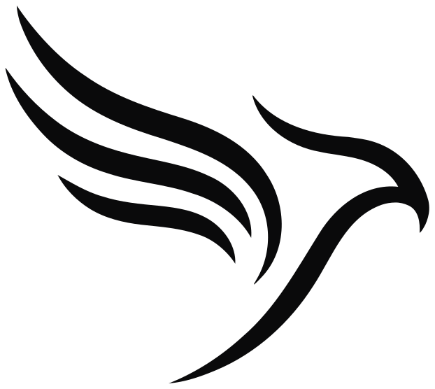
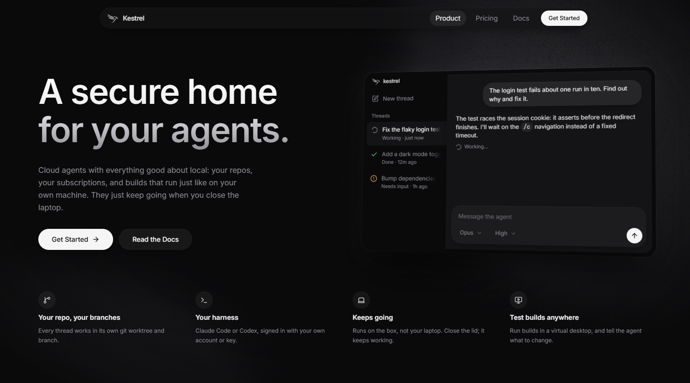
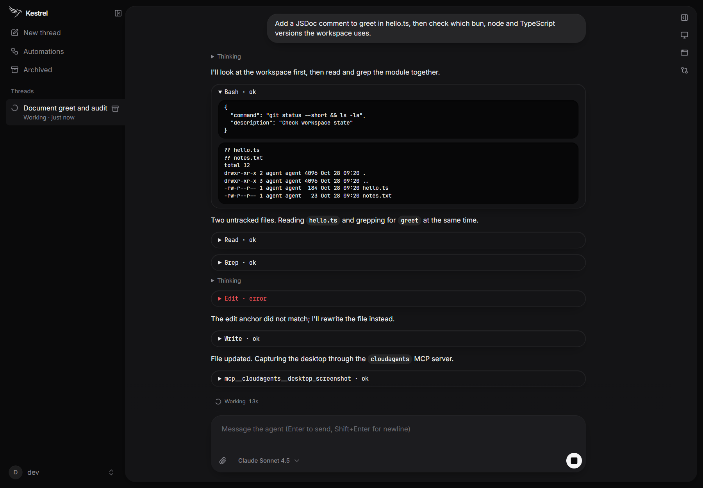
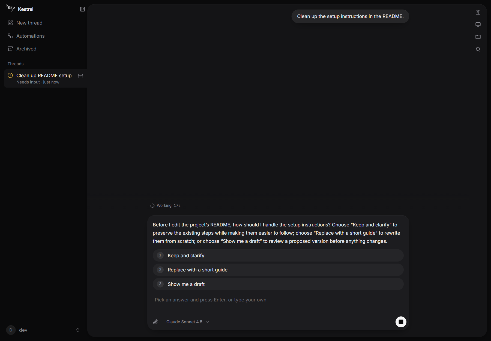
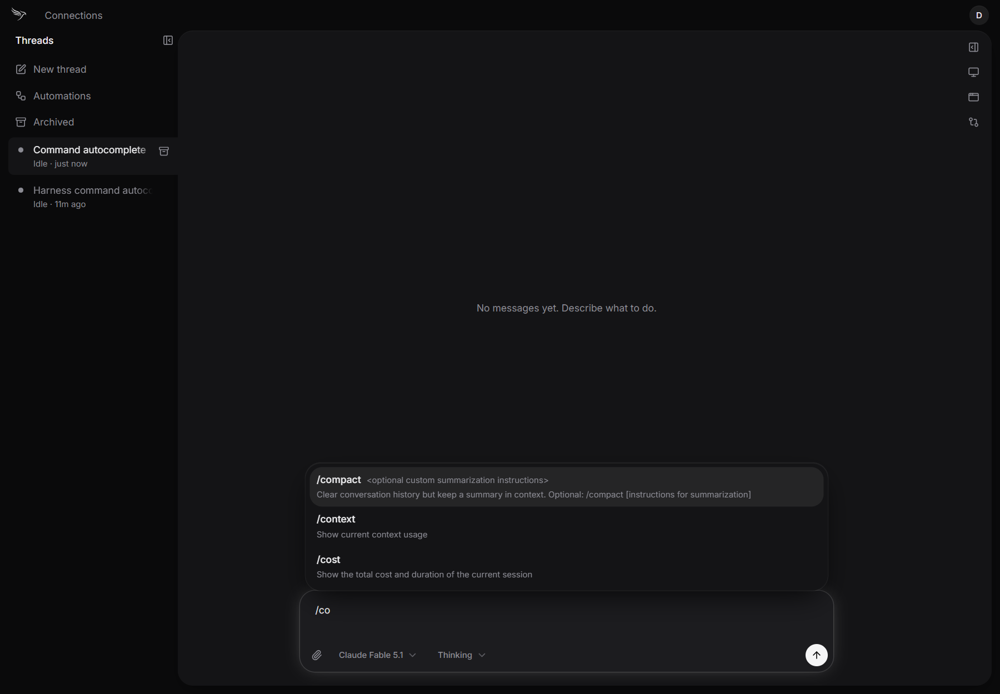

<p align="center">
  
</p>

<h1 align="center">Kestrel</h1>

<p align="center">
  <b>A secure home for your agents.</b><br>
  Cloud agents with everything good about local: your repos, your subscriptions, and builds that run just like on your own machine.<br>
  <a href="https://app.kestrel-agent.com">App</a> · <a href="https://kestrel-agent.com">Website</a> · <a href="docs/architecture.md">Architecture</a>
</p>

<p align="center">
  
</p>

Kestrel runs Claude Code or Codex on a box you own, driven from a chat in the browser or on your phone. Each thread gets its own workspace, sandbox and, when it needs one, a live desktop you can watch and take over. Close the laptop; the agent keeps going.

- **Your harness, your account.** Claude Code or Codex, signed in with your own subscription or API key. Switch models mid-thread.
- **Your repos, your branches.** The agent checks out what it needs and works on its own branch. Review the diff in the thread, or let it open the PR.
- **Live desktop.** Browsers, Blender, Roblox Studio: watch the GUI apps the agent drives and take control.
- **Sandboxed by default.** Every run is locked into bubblewrap with per-thread CPU, memory and disk limits and its own network namespace. Model keys stay on the host; agents only get short-lived tokens.
- **Built-in tools.** An MCP server for screenshots, the shell, questions, previews, automations and messaging other threads.
- **No ports to open.** The box dials out to a Cloudflare control plane, so it runs anywhere.

<p align="center">
  <br>
  <sub>Tool calls and command output stream into the thread as the agent works.</sub>
</p>

<table>
  <tr>
    <td width="50%"></td>
    <td width="50%"></td>
  </tr>
  <tr>
    <td align="center">The agent asks when it needs you</td>
    <td align="center">Your harness's slash commands and skills</td>
  </tr>
</table>

## Run it locally

Nothing in the cloud is required. Needs [Bun](https://bun.sh) and Node 22 (for `wrangler`); works on Linux, macOS and Windows.

```sh
bun install --frozen-lockfile
CLOUDAGENTS_FAKE_AGENT=1 bun run dev
```

Open the printed URL (`http://localhost:5173/auth/dev-login`) to sign in as `dev`. This starts the Worker (`:8788`), a box connected to it (`:8797`, data in `.data-dev/`) and Vite (`:5173`); Ctrl+C stops all three. The public landing page is at `http://site.localhost:5173/`.

- **Fake agent:** `CLOUDAGENTS_FAKE_AGENT=1` runs a scripted agent that needs no model key. Drop it for a real agent and add a key or subscription in Settings › Connections.
- **Sandbox and desktop (Linux + Nix):** `nix run` runs the same stack with the flake's toolchain and turns on the bubblewrap sandbox and the task desktop. Without Nix, agents run **unsandboxed** and there is no desktop on macOS and Windows. On NixOS use the flake (npm's `workerd` does not start there).
- **Linux without Nix:** the desktop needs weston, Xwayland, openbox, hsetroot, xterm, xdotool, ffmpeg and the `xdamage-capture` helper from `packages/server/native`. Add `CLOUDAGENTS_SYSTEMD=0` if you have no user systemd manager.
- **Windows:** agent commands run through POSIX `sh` (from `PATH` or Git for Windows).
- **Several stacks on one machine:** ports shift by `(uid - 1000) * 100 + KESTREL_DEV_SLOT * 10`, so give each running stack its own `KESTREL_DEV_SLOT` (0-9). The ports are printed at startup; forward the app port with `ssh -L` to use a remote dev machine.

Before a PR: `bun run typecheck` (and `bun run build:app` if `packages/app` changed). Contributing workflow: [AGENTS.md](AGENTS.md).

## Repository

| Path | What |
|---|---|
| [`packages/app`](packages/app) | React SPA (Vite, Tailwind, shadcn/ui, TanStack Query). One build serves the public pages on `kestrel-agent.com` and the app on `app.kestrel-agent.com`. |
| [`packages/control`](packages/control) | Cloudflare Worker: GitHub sign-in, control API and the relay to the box. Serves the built app. |
| [`packages/server`](packages/server) | The agent box: harnesses in bubblewrap, MCP, credential broker, desktop. Dials out to the control plane. |
| [`packages/protocol`](packages/protocol) | Shared Effect schemas: relay frames, control API, REST. |
| [`packages/mobile`](packages/mobile) | Expo app ([README](packages/mobile/README.md)). |

Deeper docs: [architecture and ownership](docs/architecture.md), [the box: harnesses, sandbox and limits](docs/box.md).

## Deploys

- **App and control plane:** Workers Builds deploys `main` (`bun run build:app`, then `wrangler deploy` in `packages/control`). By hand: `bunx cf builds create d87f7f0a-5dee-45c5-bb88-e5829c3a7792 --branch main`.
- **GitHub sign-in:** a GitHub OAuth app with callback `https://app.kestrel-agent.com/auth/github/callback`; `GITHUB_CLIENT_ID` and `GITHUB_CLIENT_SECRET` are secrets on Worker `kestrel`.
- **Production box:** `nix run .#box-auto` on the host; it follows `main` and restarts on every merge ([details](docs/box.md#production-box)).
- **Previews:** every branch gets `https://<branch with / replaced by ->-kestrel.jarenmchugh.workers.dev` (own empty Hub, no secrets, no box; UI review only).
