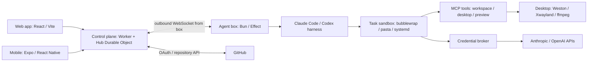

# Kestrel

Run your own agent harness in a sandboxed box with a live desktop.

Repository: [github.com/jarenm1/kestrel](https://github.com/jarenm1/kestrel). Hosted app: [app.kestrel-agent.com](https://app.kestrel-agent.com).

## Quick start

Install Git, Bun and Node.js 22. The local demo runs without a Cloudflare account, GitHub OAuth app or model API key.

```sh
git clone https://github.com/jarenm1/kestrel.git
cd kestrel
bun install --frozen-lockfile
```

Start the stack with the scripted agent (POSIX shell):

```sh
CLOUDAGENTS_FAKE_AGENT=1 bun run dev
```

In Windows PowerShell, use `$env:CLOUDAGENTS_FAKE_AGENT = "1"; bun run dev` instead. On Linux without a user systemd manager, also set `CLOUDAGENTS_SYSTEMD=0`. On NixOS, use `CLOUDAGENTS_FAKE_AGENT=1 nix run` so the pinned toolchain supplies a compatible Worker runtime; this is also the recommended Linux route for the sandbox and desktop.

Open the `/auth/dev-login` URL printed in the terminal (normally `http://localhost:5173/auth/dev-login`) to sign in as `dev`. Follow [Reproduce the demo](#reproduce-the-demo) below. Ctrl+C stops the stack.

## Tech stack and architecture

Kestrel is a TypeScript monorepo using Bun workspaces. The box uses Effect and the MCP SDK; the web client uses React 19, Vite, Tailwind CSS, shadcn/ui and TanStack Query; the control plane uses Cloudflare Workers and a Durable Object. The optional mobile client uses Expo and React Native. Linux desktops use Weston, Xwayland and ffmpeg, with bubblewrap, pasta and systemd providing task isolation and resource limits.



The clients talk only to the control plane; the box opens the relay connection. The broker keeps model API keys outside the agent sandbox. Local development replaces the deployed Worker with Wrangler and can replace the real harness with a scripted agent. See [docs/architecture.md](docs/architecture.md) for the detailed diagram and component responsibilities.

- `packages/app`: the React SPA (Vite, Tailwind, shadcn/ui, TanStack Query). One build serves two hosts, picked by hostname: the public landing and pricing pages on https://kestrel-agent.com (and `www.`), and the app on https://app.kestrel-agent.com (new chat at `/`, threads at `/c/:id`). Talks only to the control plane, same origin.
- `packages/control`: the Cloudflare Worker control plane: GitHub sign-in, connections, and a relay to the agent box. Serves the built `packages/app` as static assets. Deployed as Worker `kestrel` on https://app.kestrel-agent.com, https://kestrel-agent.com and `www.` (and its workers.dev URL, which boxes dial). Sign-in and the API only answer on the app host; the public hosts redirect them there.
- `packages/server`: the agent box. Runs harnesses inside bubblewrap, serves the desktop and MCP, and dials out to the control plane.
- `packages/protocol`: shared schemas, including the relay frames (`relay.ts`) and control-plane API (`control.ts`).
- `packages/mobile`: the Expo app. Start Metro with `bun run dev:mobile` and open it in Expo Go (SDK 58). A single React Native `KeyboardAvoidingView` wraps the full-screen app (iOS padding, Android height), above the safe-area padding and page headers, so both composers stay above the keyboard. GitHub sign-in captures the `kestrel://auth-callback` redirect inside its WebView; Expo Go does not need to register that custom URL scheme.
  Native API requests authenticate with the session saved in SecureStore and use `credentials: "omit"`: React Native must not merge the WebView cookie jar into the explicit `Cookie` header (which produces a comma-joined, invalid session value).
  In a thread, swipe left over chat or from its right edge to open Desktop/Diff; swipe right over the panel header or left edge to close it. Swipe right over chat for Threads, or use the header buttons. Mostly horizontal swipes tolerate small vertical drift; vertical swipes keep scrolling the content.
  The composer groups modern models by connected Anthropic/OpenAI provider. **Manage models** opens Connections, where each provider's visible models can be toggled or reset. Choices are saved on the device. Thinking offers only levels supported by the selected model, and disappears for models without thinking controls.

## Reproduce the demo

### No-key demo

1. Start the stack with `CLOUDAGENTS_FAKE_AGENT=1` using the quick start and sign in through `/auth/dev-login`.
2. Create a new thread and send `Write a short project note`. The scripted agent writes `AGENT_NOTES.md` in the thread workspace and reports `Wrote AGENT_NOTES.md from the prompt.` It does not call a model or need a repository checkout. Its initial desktop screenshot tool error is expected: desktops start only when opened.
3. After the run finishes, send `/replay claude/markdown` to show formatted chat output, or `/replay codex/kitchen-sink` to show reasoning, tool results and file changes. These commands replay bundled transcripts through the real event pipeline; they do not execute the actions described in those transcripts. Replay is available only in dev-login sessions.
4. For a live desktop demonstration on Linux with the desktop dependencies installed (included by `nix run`), send `desktop-probe`. It opens the desktop, launches terminal processes, exercises input and capture tools, then reports `desktop probes finished`. This step is optional; the note and replay demos also work without a desktop.

### Environment and API keys

For the commands below, set box variables in your shell before starting `bun run dev`; no manual `.env` file is required. The Worker reads `packages/control/.dev.vars`; the dev script creates this file on first run with a random `BOX_TOKEN`, `DEV_SESSION_LOGIN=dev` and `ALLOWED_GITHUB_LOGINS=dev`, then passes the matching token and local Worker URL to the box automatically.

Example shell environment for the no-key demo (omit `CLOUDAGENTS_SYSTEMD=0` when a user systemd manager is available):

```sh
export CLOUDAGENTS_FAKE_AGENT=1
export KESTREL_DEV_SLOT=1
export CLOUDAGENTS_SYSTEMD=0
bun run dev
```

For reference, this is the shape of the generated Worker configuration; let the dev script generate the actual token:

```dotenv
# packages/control/.dev.vars — local development only; never commit this file
BOX_TOKEN=<random-local-token-generated-by-the-dev-script>
DEV_SESSION_LOGIN=dev
ALLOWED_GITHUB_LOGINS=dev
# Optional, only for exercising real GitHub OAuth:
# GITHUB_CLIENT_ID=<your-development-oauth-app-client-id>
# GITHUB_CLIENT_SECRET=<your-development-oauth-app-client-secret>
```

The tracked [Worker example](packages/control/.dev.vars.example) also lists OAuth fields. If configuring OAuth, register a development GitHub OAuth app with callback `http://localhost:<app-port>/auth/github/callback`, add its credentials to `.dev.vars`, and include your GitHub login in `ALLOWED_GITHUB_LOGINS`. The dev-login account has no GitHub token; use real GitHub sign-in to exercise private repository access and GitHub writes.

To run a real agent, stop the stack, unset `CLOUDAGENTS_FAKE_AGENT` (PowerShell: `Remove-Item Env:CLOUDAGENTS_FAKE_AGENT`), and restart with `bun run dev` or `nix run`. Install the corresponding Claude Code or Codex CLI on the box when running without the Nix toolchain. Add an Anthropic/OpenAI API key or sign in to a supported subscription under **Settings › Connections**, then select its model in the composer. Alternatively, export `ANTHROPIC_API_KEY` before startup for the box's Anthropic fallback. Real runs use your provider's billing or subscription limits; the no-key demo needs neither. Never put keys in prompts or committed files.

| Variable | Purpose |
|---|---|
| `CLOUDAGENTS_FAKE_AGENT=1` | Use the scripted agent instead of a model-backed CLI. |
| `KESTREL_DEV_SLOT=0`–`9` | Give simultaneously running worktrees separate ports; default `0`. Use the printed URLs. |
| `CLOUDAGENTS_SYSTEMD=0` | Disable task resource limits when no user systemd manager is available. |
| `CLOUDAGENTS_DEV_DATA_DIR` | Override the local box data directory, normally `.data-dev/`. |
| `ANTHROPIC_API_KEY` | Optional box-side fallback for real Anthropic runs. |
| `KESTREL_REPLAY_DELAY_MS` | Delay between replay transcript lines; default `300`. |

## Local development

The [quick start](#quick-start) runs the whole stack with a scripted agent. For normal development with a real agent connection, use:

```sh
bun install --frozen-lockfile
bun run dev
```

This starts (ports for uid 1000; see below):
- the Worker on http://127.0.0.1:8788 (`wrangler dev`, local Durable Object state in `packages/control/.wrangler`),
- a box on 127.0.0.1:8797 connected to that Worker (data in `.data-dev/`); 8787 is left to the production box,
- Vite on http://localhost:5173.

Open the printed URL (`/auth/dev-login`) to sign in as `dev`. The first run creates `packages/control/.dev.vars` with a random local box token and builds `packages/app/dist`, which the Worker serves. Output is prefixed `[worker]`, `[box]` and `[app]`; Ctrl+C stops all three, and so does any one of them exiting. `CLOUDAGENTS_FAKE_AGENT=1 bun run dev` runs a scripted agent that needs no model key.

### Nix

`nix run` runs the same `bun run dev` with the flake's toolchain (Bun, Node, wrangler, bubblewrap, pasta, the desktop stack). Nix is what turns the agent sandbox on: the sandbox exposes only `/nix/store` and a toolchain directory from it (`CLOUDAGENTS_SANDBOX_PATH`, `CLOUDAGENTS_SANDBOX_SSL`, set by the flake). On NixOS use the flake: the npm `workerd` binary that `bunx wrangler` runs does not start there, so the flake passes its own wrangler in `KESTREL_WRANGLER`.

### Without Nix

Without `CLOUDAGENTS_SANDBOX_PATH`, `bun run dev` starts the box with `CLOUDAGENTS_SANDBOX=0`, which runs agents unsandboxed: fine for local work with the fake agent or your own key, never for a shared or production box. Set `CLOUDAGENTS_SANDBOX` yourself to override that.

- **Linux:** the task desktop needs weston, Xwayland, openbox, xterm, xdotool, an ffmpeg with rawvideo input (screenshots use x11grab) and the `xdamage-capture` helper built from `packages/server/native` (the flake provides all of these). Add `CLOUDAGENTS_SYSTEMD=0` if you have no user systemd manager.
- **macOS and Windows:** no task desktop (Xwayland and x11grab are Linux-only; runs go ahead without a display, and `desktop_open` says why there is none) and no resource limits (`bun run dev` sets `CLOUDAGENTS_SYSTEMD=0`).
- **Windows:** agent commands and `workspace_exec` run through POSIX `sh`: the one on `PATH`, else the one from Git for Windows. Each process the box starts gets its own job object, so cancelling a run or stopping the stack also ends whatever it started. There is no uid, so ports move only with `KESTREL_DEV_SLOT`.

### Shared dev machine

Several people can run `bun run dev` (or `nix run`) on one machine, each from their own clone under their own Linux user, and each person can run several worktrees at once. Ports are offset by `(uid - 1000) * 100 + KESTREL_DEV_SLOT * 10` (slot 0-9, default 0; `KESTREL_DEV_OFFSET` overrides the whole offset): uid 1001 slot 0 gets app 5273, Worker 8888, box 8897; slot 1 adds 10 to each. The ports are printed at startup. From your laptop, forward the app port and open it locally:

```sh
ssh -L 5273:localhost:5273 <you>@<dev-machine>
# then open http://localhost:5273/auth/dev-login
```

Working with agents or in parallel: see [AGENTS.md](AGENTS.md) (one git worktree and one PR per change).

Agents need a model key: add one in Settings › Connections (account menu at the bottom left), or export `ANTHROPIC_API_KEY` before starting the box (the box's broker uses it as a fallback; the sandbox only ever sees a per-run token).

Each message runs on the model picked in the composer. The picker lists, per connected provider (an Anthropic or OpenAI key, or a Claude or ChatGPT subscription), the models chosen for it under Models in Settings › Connections; the list is kept per browser. Anthropic models run through Claude Code (`claude -p --model … --effort …`), OpenAI models through codex (`codex exec --json -m … -c model_reasoning_effort=…`); `CLOUDAGENTS_ANTHROPIC_COMMAND` / `CLOUDAGENTS_OPENAI_COMMAND` override either command. The thinking picker offers only the levels the chosen model supports. A thread resumes its agent session while the provider stays the same; after a switch to the other provider the new run starts a fresh session whose prompt carries the conversation so far (the newest ~60k characters). A message sent with no model (nothing connected) runs on Claude Code's default.

In an existing thread, type `/` at the start of the composer to discover that thread's harness commands. Claude Code supplies slash commands through its stream-JSON initialization API; Codex supplies enabled skills through `app-server`'s `skills/list`. Codex also accepts `$` as the autocomplete trigger and inserts its native `$skill-name` syntax (terminal-only Codex slash actions are not commands in `codex exec`). Suggestions include the harness's descriptions and argument hints. Use ↑/↓ to navigate, Enter or Tab to insert without sending, Escape to dismiss, or click a suggestion; any existing arguments are preserved.

Discovery uses `GET /api/tasks/:id/commands?model=<model-id>`, checks thread ownership, and runs the CLI in that thread's workspace with the signed-in user's own CLI home. The discovery sandbox has no network, so repo-controlled config cannot reach the box's loopback services; Claude Code runs with `disableAllHooks` so the workspace's `.claude/settings.json` hooks do not execute. At most four discovery runs execute box-wide; further requests queue, and a full queue answers "command discovery is busy". While a turn is running, its provider takes precedence over the next-turn model picker. Results are briefly cached per user, provider and workspace; discovery starts no model turn and exposes no credential or skill-file paths. The new-thread composer does not query a harness.

### Agent sandbox

Everything an agent controls runs in bubblewrap inside a transient systemd scope: the agent run, every `workspace_exec`, the desktop terminal and apps started with `desktop_launch`. Each task gets a slice `kestrel-box<port>-t<task>.slice` (under `kestrel.slice`) whose limits cap all of the task's processes together; swap is off for it, so the memory limit is hard and the kernel OOM-kills inside the task only.

The task desktop is not started with the run. The agent starts it with `desktop_open` when it needs one (or you start it from the Desktop tab), and the desktop tools fail until it is running. A run started without a desktop has no `DISPLAY`, so the agent starts apps with `desktop_launch`, whose sandbox has the display; its `PATH` (the flake's `sandboxEnv`) has `xterm` and `firefox` as GUI apps. An app that exits within half a second is reported with its exit status and output, and a non-zero exit is a tool error.

Heavy desktop apps are opt-in per task, never in `sandboxEnv`. The agent installs one with the `toolkit_install` MCP tool: `blender` (Blender) or `roblox-studio` (Roblox Studio through Vinegar, plus Rojo and Wally). The box builds the flake's `toolkit-<name>` package with `nix build` on the host (the first install on a box downloads it, which can take minutes; later ones reuse `/nix/store`), keeps the out-link under the task home at `.kestrel/toolkits/<name>` as its GC root, and links its executables into `.kestrel/bin`, which is last on every sandbox `PATH`, the agent's already-running shell included. Toolkits need a box started through Nix (`CLOUDAGENTS_TOOLKITS_FLAKE`, set by the flake) on x86_64 Linux.

Each desktop's X server is a rootful Xwayland in a headless weston. On a host with a GPU, weston and Xwayland render on it, and every sandbox that can draw on the desktop gets the GPU too: the DRM render nodes (not the card nodes, which can modeset), NVIDIA's `/dev/nvidia*`, `/sys/dev` and `/sys/devices` read-only (Mesa finds a node's driver there), and the host's drivers at `/run/opengl-driver`. Apps get hardware GL and Vulkan only where those drivers are, i.e. on NixOS; elsewhere, and on hosts without a GPU, the flake's toolkit wrappers fall back to Mesa's software drivers (llvmpipe for GL, lavapipe for Vulkan). Desktops share the GPU: one task's app can use all of its memory.

GPU access is not a tenant isolation boundary: desktop apps reach the host GPU driver and share its memory and scheduling. Keep the existing task CPU/RAM limits, but do not treat them as a VRAM quota.

Roblox Studio through Vinegar is community-supported and can break when Studio changes. The toolkit's `vinegar` writes the sandbox's defaults on first run (only where the task has no Vinegar config yet): the `Vulkan` renderer, since DXVK crashes Studio on lavapipe, and Web Pages off, since Studio's embedded WebView2 sign-in never loads under Wine here. Studio then signs in through the browser: its "Login via Browser" goes through the toolkit's `xdg-open` to Firefox on the task desktop, where the user signs in to roblox.com (Quick Sign-in with a code approved on a device already signed in, or an emailed one-time code, avoids typing a password into the remote desktop), and Firefox hands the returned `roblox-studio-auth:` link to Vinegar, which passes it to Studio. Studio can outgrow the default 4 GB task memory limit.

Each task also has its own network namespace, made by `pasta` (passt) when the task first launches something and shared by all of that task's sandboxes, so a browser on the task desktop reaches the agent's dev server on `localhost`. Outbound internet works through pasta's user-space NAT. The host's `127.0.0.1` is out of reach except the box port, which is forwarded in for the broker and MCP. Other tasks' servers and X servers that listen on abstract sockets (such as a desktop session's `:0`) are out of reach too, and the task's own servers are not published on the host. The LAN and the host's non-loopback addresses are still reachable. pasta and its holder process live in the task slice and go away with the task.

The holder of that namespace also owns the task's own SysV IPC namespace (`unshare --ipc`). The task's sandboxes, its X server and the box's capture and screenshot processes for it all join it, so GTK and Qt apps on the desktop can use X shared memory (MIT-SHM), and no task can attach another task's shared memory. Starting a desktop therefore starts the task's pasta and holder if nothing else has, and the desktop fails to start if pasta does. Processes keep the namespaces they started in: if the holder dies and is replaced while a desktop runs, apps launched afterwards no longer share memory with that desktop's X server until the desktop is restarted.

| Variable | Default | Meaning |
|---|---|---|
| `CLOUDAGENTS_TASK_MEMORY_MAX` | `4G` | systemd `MemoryMax` per task |
| `CLOUDAGENTS_TASK_CPU_QUOTA` | `200%` | systemd `CPUQuota` per task (100% = one core) |
| `CLOUDAGENTS_TASK_TASKS_MAX` | `1024` | systemd `TasksMax` (processes + threads) per task |
| `CLOUDAGENTS_SYSTEMD` | on | `0` runs without limits (machines without a user systemd manager) |

The box needs the user's systemd manager (`systemd-run --user`) with the memory, cpu and pids controllers delegated (the default on systemd distros). It checks this at startup and refuses to start otherwise; a box that outlives your login session (the production box) needs `loginctl enable-linger <user>`. At startup the box also stops its own slice, killing sandboxes a previous instance left behind; deleting or archiving a task stops its slice and drops its limits. Inspect live sandboxes with `systemd-cgls --user-unit kestrel.slice`.

Signed-in users can instead run agents on their own Claude or ChatGPT subscription: sign in under Settings › Connections (the box runs the unmodified `claude auth login` / `codex login --device-auth` in that user's directory). Each user's CLI state lives only on the box under `<CLOUDAGENTS_DATA_DIR>/users/<login>/{claude,codex}`, and the box's CLI runs use their own login; the sandbox sees just the directories of the providers that user has signed in to. Those runs use the login in place of the broker's API key for that provider.

Threads are private to the user who started them: the box answers every thread, run, diff and desktop route (REST and WebSocket) only for the thread's owner and returns `404` to anyone else. A thread starts with no repository; the agent checks repositories out into the thread's workspace with `repo_checkout`, and the box clones with the owner's own GitHub token, so GitHub decides which repositories someone's agent can read. The broker pays for a run with the keys of the user who started it. At first start after the upgrade, the box turns each old project thread into a thread with one checkout of its branch (uncommitted files included); the old `repos/` and `worktrees/` directories stay on disk (logged).

Checks: `bun run typecheck`.

## Datasets and synthetic data

Kestrel does not require an external dataset or train a model for this demo. The demo inputs are your prompt and the bundled agent transcripts:

| Data | Provenance and use |
|---|---|
| [`packages/server/scripts/fake-agent.ts`](packages/server/scripts/fake-agent.ts) | Repository-authored scripted behavior. Writes the supplied prompt to `AGENT_NOTES.md` and exercises live MCP tools; its output is not model-generated. |
| [`fixtures/agent/claude/*.jsonl`](packages/server/fixtures/agent/claude) | Four hand-authored synthetic transcripts based on Claude stream-JSON shapes, for Markdown, tools, long responses and errors. |
| [`fixtures/agent/codex/recorded-*.jsonl`](packages/server/fixtures/agent/codex) | Two real `codex exec --json` recordings from codex-cli 0.163.0, sanitized for paths, the PowerShell wrapper/output and thread IDs. |
| [`fixtures/agent/codex/kitchen-sink.jsonl`](packages/server/fixtures/agent/codex/kitchen-sink.jsonl) and [`failed-turn.jsonl`](packages/server/fixtures/agent/codex/failed-turn.jsonl) | Hand-authored synthetic transcripts covering rendering and error cases. |

See the [fixture provenance and recording guide](packages/server/fixtures/agent/README.md) for the per-file inventory and sanitization instructions. Your own repository checkouts, uploads and messages are runtime inputs, not bundled demo datasets. Local box state lives in `.data-dev/`; local Worker state lives in `packages/control/.wrangler/`.

## Known limitations and next steps

- **Scripted demo scope:** the fake agent follows fixed branches; replay shows recorded output without running its tool actions. Use a real provider connection to evaluate agent quality or repository work.
- **Platform support:** the live desktop is Linux-only. Without the Nix sandbox toolchain, local agents run unsandboxed; macOS and Windows also run without systemd resource limits. See [Without Nix](#without-nix).
- **Isolation boundaries:** task CPU/RAM limits do not impose a VRAM quota, and desktops share the host GPU. The task network can still reach the LAN and the host's non-loopback addresses.
- **Preview scope:** pull-request Previews have no box or production secrets, so they support UI review only. In-thread browser previews intentionally omit app-origin storage, cookies, popups and service workers.
- **Runtime availability:** production box updates restart the box and interrupt active runs. Optional Roblox Studio support depends on Vinegar and can break with upstream changes.

Next steps include direct WebRTC desktop streaming, NVENC encoding, and adding real Claude recordings to complement the synthetic fixtures. These are planned improvements, not prerequisites for reproducing the demo; see [architecture](docs/architecture.md) and the [fixture guide](packages/server/fixtures/agent/README.md).

## Deploys

- **App and control plane:** Workers Builds deploys `main` (build `bun run build:app`, then `wrangler deploy` in `packages/control`). To deploy by hand: `bunx cf builds create d87f7f0a-5dee-45c5-bb88-e5829c3a7792 --branch main`.
- **GitHub sign-in** needs a GitHub OAuth app whose callback URL is `https://app.kestrel-agent.com/auth/github/callback`, with `GITHUB_CLIENT_ID` and `GITHUB_CLIENT_SECRET` set as secrets on Worker `kestrel`.
- **Production box:** runs on the host machine with `nix run .#box-auto`. It keeps its own clone of `main` in `~/.local/share/kestrel-box` (override with `KESTREL_BOX_DIR`), polls GitHub every 60 s (`KESTREL_BOX_POLL`), and on a new commit fast-forwards and restarts the box, which interrupts in-flight agent runs. It reads `CLOUDAGENTS_CONTROL_URL` and `CLOUDAGENTS_BOX_TOKEN` from `.box.env` in that clone (copied from the current directory on first run). `nix run .#box` runs a box once from the current checkout.

Don't run a box against production with the production token from your machine: the control plane keeps one box and a new connection replaces the live one.

Pull requests get isolated Previews at `https://<branch>-kestrel.jarenmchugh.workers.dev`, branch name with `/` replaced by `-`. The Preview has its own empty Hub, no production secrets and no box, so it is for UI review.
