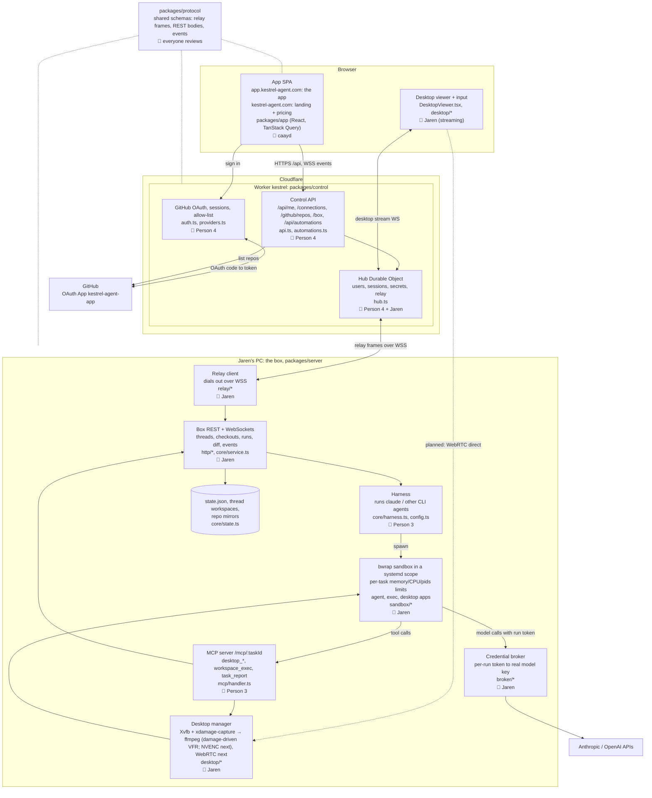

# Kestrel architecture and ownership

## How it fits together

- The browser only talks to Cloudflare. One Worker serves the API and one SPA build on two hosts: `app.kestrel-agent.com` is the app, and `kestrel-agent.com` (and `www.`) shows only its public landing and pricing pages, sending every other path, sign-in and the API to the app host.
- The Hub Durable Object relays app requests to the box over the WebSocket the box dials out to, so nothing on the box is exposed to the internet.
- The control plane signs users in; the box decides what they can see. Each thread is owned by the user who started it, and the box serves a thread and its runs, diffs and desktop only to that user (identity comes from the relay; the box's own port has no user and gets no thread data).
- A thread starts in an empty workspace directory with no repository. The agent checks repositories out on demand with the `repo_checkout` MCP tool (a GitHub `owner/name` the owner's token can read, or a public `https://` URL; never local paths), at most one checkout per repository, each on its own thread branch. The box keeps one bare mirror per user and repository, fetched on the host with the owner's token before every checkout; a checkout is a clone that borrows the mirror's objects, so the sandbox sees that user's mirrors read-only and its own workspace read-write. Host-side git (diff, push) never runs inside a checkout's agent-writable git directory: it works from a host-owned shadow repository per checkout, so repository config the agent writes cannot make the host run commands.
- Automations are user-defined triggers that start a thread on the owner's box: a cron schedule in an IANA time zone, or a GitHub `pull_request` event (opened, reopened, ready for review, synchronize, review requested). The Hub stores them, arms one alarm for the next schedule fire, and receives GitHub deliveries at `/webhooks/github` (verified with a per-repo HMAC secret; deduped by delivery id). An automation names an optional GitHub repository (required for `pull_request` triggers). Each repo has one webhook shared by its automations, created on GitHub with the owner's token when the first enabled GitHub automation is saved; the Hub change is saved first, and the webhook is removed when the last enabled GitHub automation on the repo is deleted, disabled, or switched to a schedule. Removal is best-effort and needs the owner's token; without one the webhook stays and is reused later. Firing starts a thread on the box (`POST /api/tasks`) with the automation's repository checked out; a PR run also passes `pullRequest` and the PR's base branch, so the checkout forks from the PR head and its diff shows only the agent's edits. Then the automation's prompt is sent.
- The agent runs inside a bubblewrap sandbox, in a transient systemd scope whose task slice caps memory, CPU and process count, and in the thread's own network namespace (pasta): internet yes, host loopback no, except the box port for MCP and the broker. Everything the agent can start (runs, `workspace_exec`, the desktop terminal, `desktop_launch` apps) goes through the same path and shares that namespace. It gets tools through MCP and makes model calls through the broker, so it never holds the real model keys. Each run has one token (`CLOUDAGENTS_MCP_TOKEN`): MCP requires it as a bearer header, the broker takes it in its URL, and both refuse it once the run ends; MCP sessions close with the run.
- The thread desktop is on demand: a run starts without one, and the agent starts it with `desktop_open` (or the user starts it from the Desktop tab). The desktop tools refuse until it is running. When it comes up, the Desktop tab opens for the user. Its Xvfb and the box's capture run in the thread's IPC namespace, the one the thread's sandboxes share, so desktop apps can use MIT-SHM.
- Users attach files by uploading them first (`POST /api/tasks/:id/uploads`, raw bytes, `Content-Type` as the file type, optional `?name=`; at most 10 MiB). An upload waits on the box, unsent, until a message names it in `attachments`; then its bytes are copied into the task home at `uploads/<id>/<name>` and the message's text is followed by a note giving the agent that path. Uploads not sent are deleted with their task.
- `repo_checkout` and the GitHub tools (`git_push`, `github_pr_create`, `github_pr_status`, `github_pr_review`) run on the box host, not in the sandbox; the GitHub tools name the checkout they act on (optional when the thread has one). The host pushes the checkout's thread branch to the repository with the owner's GitHub token passed only through git's per-process config, and the PR calls use the same token from the host side. Mirror fetches for a checkout (base branch or pull request head) work the same way. The token never enters the sandbox environment, tool arguments, tool output, or logs; pushes never force and only ever push the checkout's own thread branch.
- Agents manage automations with the `automation_list`, `automation_create`, `automation_update` and `automation_delete` MCP tools. The box calls the control plane at `/box/automations` over HTTPS with the box token and the thread's owner in `x-kestrel-box-user` (`BOX_USER_HEADER`, from `packages/protocol`). The control plane checks the token and that the user exists, then runs the same handlers as the browser. A tool sees and changes the automations of its thread's owner.
- Archiving a thread (`POST /api/tasks/:id/archive`; `DELETE` lifts it) tears down its runtime: running runs are cancelled, the desktop stops, and the sandbox network and systemd slice are removed. The workspace, checkouts, branches, messages and runs stay, and the thread leaves the active list. While archived, sending a message or starting the desktop fails with 409 Conflict. Unarchiving restores both and starts nothing on its own.
- Dotted WebRTC line: planned direct video path from the box to the browser, replacing today's stream relayed through the Hub.

## Owners

| Owner | Area | Starter items |
|---|---|---|
| Jaren | Box runtime, relay, sandbox, broker, desktop/GPU streaming (NVENC, WebRTC) | Encoder switch, WebRTC sender, configurable dev ports |
| caayd | `packages/app` (UI/UX) | Install-on-GitHub link, page titles, reconnect states |
| Person 3 | Harness and MCP | `desktop_scroll`, `desktop_double_click`, fake-agent coverage, `docs/harness.md` |
| Person 4 | OAuth / control plane | Friendlier "not allowed" page, repo pagination past 100, reconnect on 401, OG image, `/docs` page |

Changes to `packages/protocol` need a review from everyone, since every package depends on it.
