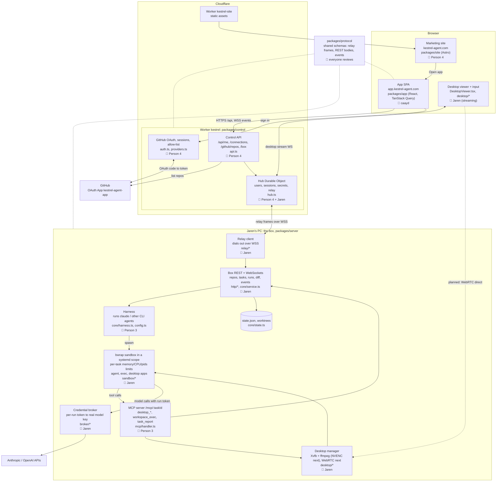

# Kestrel architecture and ownership

## How it fits together

- The browser only talks to Cloudflare. `kestrel-agent.com` is the static marketing site; `app.kestrel-agent.com` is the app, served by the same Worker as the API.
- The Hub Durable Object relays app requests to the box over the WebSocket the box dials out to, so nothing on the box is exposed to the internet.
- The control plane signs users in; the box decides what they can see. Each project is owned by the user who added it, and the box serves a project and its tasks, runs and desktops only to that user (identity comes from the relay; the box's own port has no user and gets no project data).
- The agent runs inside a bubblewrap sandbox, in a transient systemd scope whose task slice caps memory, CPU and process count, and in the task's own network namespace (pasta): internet yes, host loopback no, except the box port for MCP and the broker. Everything the agent can start (runs, `workspace_exec`, the desktop terminal, `desktop_launch` apps) goes through the same path and shares that namespace. It gets tools through MCP and makes model calls through the broker, so it never holds the real model keys.
- Dotted WebRTC line: planned direct video path from the box to the browser, replacing today's stream relayed through the Hub.

## Owners

| Owner | Area | Starter items |
|---|---|---|
| Jaren | Box runtime, relay, sandbox, broker, desktop/GPU streaming (NVENC, WebRTC) | Encoder switch, WebRTC sender, configurable dev ports |
| caayd | `packages/app` (UI/UX) | Install-on-GitHub link, page titles, reconnect states |
| Person 3 | Harness and MCP | `desktop_scroll`, `desktop_double_click`, fake-agent coverage, `docs/harness.md` |
| Person 4 | OAuth / control plane and `packages/site` | Friendlier "not allowed" page, repo pagination past 100, reconnect on 401, OG image, `/docs` page |

Changes to `packages/protocol` need a review from everyone, since every package depends on it.
