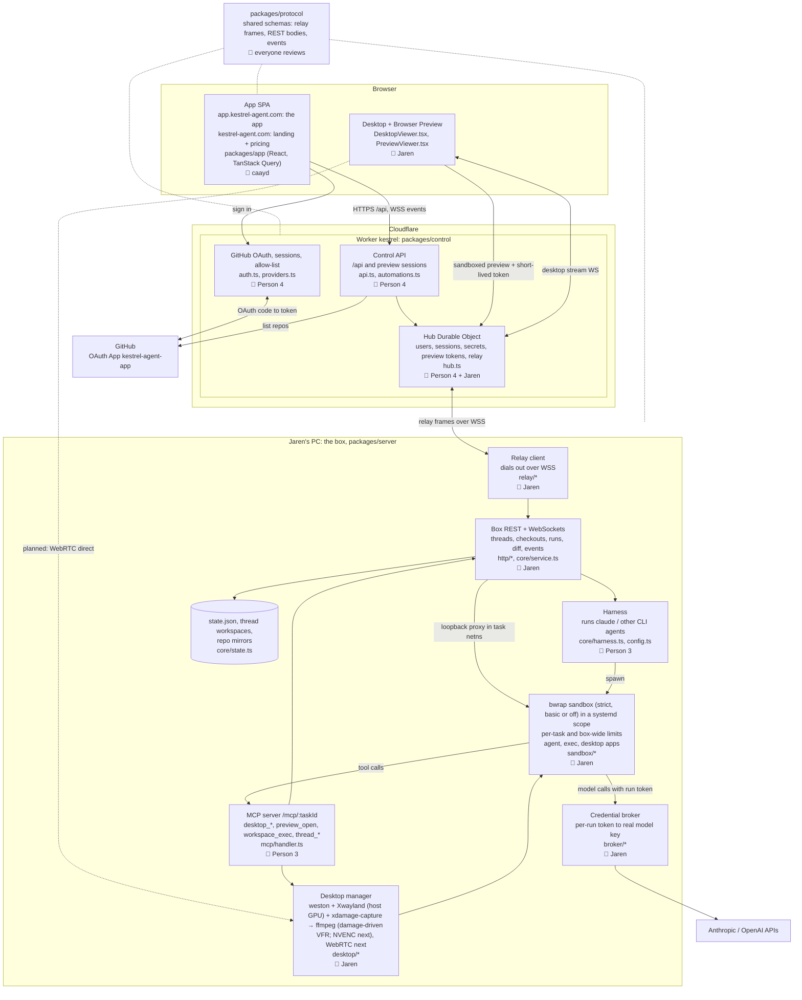

# Kestrel architecture and ownership

## How it fits together

- The browser only talks to Cloudflare. One Worker serves the API and one SPA build on two hosts: `app.kestrel-agent.com` is the app, and `kestrel-agent.com` (and `www.`) shows only its public landing and pricing pages, sending every other path, sign-in and the API to the app host.
- The Hub Durable Object relays app requests to the box over the WebSocket the box dials out to, so nothing on the box is exposed to the internet. Durable Object requests are the scarce resource (100k/day on the free plan; every RPC, every relayed request and every 20 incoming WebSocket messages count as one), so the relay is kept lean: a browser API call costs one Hub request (the Worker forwards the session id and the Hub resolves it, attaches credentials and relays in that request), and what changes often is pushed over WebSockets instead of polled, since the Hub's outgoing messages are free. The thread list comes over `/api/events` (`task.updated` for every thread of the user, `task.deleted`), the Desktop graphs over `/api/tasks/:id/stats/stream`, and the diff is refetched on agent activity rather than every few seconds. The desktop stream is opened only while the desktop is starting or running (the box refuses it otherwise, and retrying would cost a request every 2 s).
- The control plane signs users in; the box decides what they can see. Each thread is owned by the user who started it, and the box serves a thread and its runs, diffs and desktop only to that user (identity comes from the relay, or on a user's own box from a box token; otherwise the box's own port has no user and gets no thread data).
- A user can run their own box and make it their active box (Settings › Boxes; [byo-box.md](byo-box.md)). The web and mobile apps then call that box's URL directly with a box token (HS256, signed with the box's secret, `aud` the box id) that the control plane mints for the box's owner, so no box traffic goes through the Hub. The box verifies tokens offline and fetches its owner's connection secrets from `/box/self` with its secret, again only when a newer token carries a changed credentials version. It also mints preview sessions and serves `/_preview/…` itself. Automations still run only on Kestrel's box.
- A thread starts in an empty workspace directory with no repository. The agent checks repositories out on demand with the `repo_checkout` MCP tool (a GitHub `owner/name` the owner's token can read, or a public `https://` URL; never local paths), at most one checkout per repository, each on its own thread branch. The box keeps one bare mirror per user and repository, fetched on the host with the owner's token before every checkout; a checkout is a clone that borrows the mirror's objects, so the sandbox sees that user's mirrors read-only and its own workspace read-write. Host-side git (diff, push) never runs inside a checkout's agent-writable git directory: it works from a host-owned shadow repository per checkout, so repository config the agent writes cannot make the host run commands.
- Automations are user-defined triggers that start a thread on the owner's box: a cron schedule in an IANA time zone, or a GitHub `pull_request` event (opened, reopened, ready for review, synchronize, review requested). The Hub stores them, arms one alarm for the next schedule fire, and receives GitHub deliveries at `/webhooks/github` (verified with a per-repo HMAC secret; deduped by delivery id). An automation names an optional GitHub repository (required for `pull_request` triggers). Each repo has one webhook shared by its automations, created on GitHub with the owner's token when the first enabled GitHub automation is saved; the Hub change is saved first, and the webhook is removed when the last enabled GitHub automation on the repo is deleted, disabled, or switched to a schedule. Removal is best-effort and needs the owner's token; without one the webhook stays and is reused later. Firing starts a thread on the box (`POST /api/tasks`) with the automation's repository checked out; a PR run also passes `pullRequest` and the PR's base branch, so the checkout forks from the PR head and its diff shows only the agent's edits. Then the automation's prompt is sent.
- Each automation stores a catalog `model` or `null` for the box default. Web and mobile editors offer connected providers' shown models and retain a saved selection even when hidden or disconnected. Agent tools accept the same model IDs. Creating without a model uses the default; updates preserve an omitted model and reset it with `null`. Existing automations migrate to the default. Scheduled, GitHub and manual runs send the stored model with the thread's first message, selecting the provider's harness.
- Response decoding accepts older automations that omit `model`, normalizing the missing field to `null` so the web app, mobile app and box control client can read them. Explicit selections are preserved and unknown model IDs are rejected; this response default does not change partial-update semantics.
- The agent runs inside a bubblewrap sandbox (`strict` with the flake's Nix toolchain, `basic` otherwise; see [box.md](box.md#agent-sandbox)), in a transient systemd scope whose task slice carries the task's limits. Under `strict` it runs in the thread's own network namespace (pasta): internet yes, host loopback no, except the box port for MCP and the broker, and everything the agent can start (runs, `workspace_exec`, the desktop terminal, `desktop_launch` apps) shares that namespace. Under `basic` it shares the host's network. It gets tools through MCP and makes model calls through the broker, so it never holds the real model keys. Each run has one token (`CLOUDAGENTS_MCP_TOKEN`): MCP requires it as a bearer header, the broker takes it in its URL, and both refuse it once the run ends; MCP sessions close with the run.
- Each message names a model from the catalog in `packages/protocol/src/models.ts` (display name, provider, supported thinking levels). The harness runs the model's provider CLI: Claude Code for Anthropic, Codex app-server for OpenAI (`agentCommands` in `config.ts`). The box talks to both while a run works: app-server's JSON-RPC (`core/codex-app-server.ts`) and Claude Code's stream-json input (`core/claude-stream.ts`), so a running turn can be steered and interrupted. Agent sessions are recorded with the provider that printed them; a run resumes the thread's latest session only on the same provider, and a run on the other provider starts fresh with the earlier conversation in its prompt (`core/handoff.ts`).
- Web and mobile tool-call summaries use the shared `toolDisplayName` helper in `packages/protocol/src/tool-names.ts`: action labels for Kestrel MCP tools and known harness tools, readable words for unknown identifiers, and the server name for third-party MCP tools. Both Claude's `mcp__cloudagents__<tool>` and Codex's `cloudagents.<tool>` names resolve to the same label. The original identifier remains in expanded details with the input and output; stored transcripts and wire schemas are unchanged.
- The thread desktop is on demand: a run starts without one, and the agent starts it with `desktop_open` (or the user starts it from the Desktop tab). The desktop tools refuse until it is running. When it comes up, the Desktop tab opens for the user. Its X server (a rootful Xwayland in a headless weston, on the host GPU when there is one) and the box's capture run in the thread's IPC namespace, the one the thread's sandboxes share, so desktop apps can use MIT-SHM. Sandboxes that can reach the desktop get the GPU's render nodes and the host's GL/Vulkan drivers.
- Optional desktop apps (Blender, Roblox Studio via Vinegar) are per-task toolkits, not part of the sandbox toolchain. The agent's `toolkit_install` MCP tool (offered only on a box with the flake) runs `nix build` of the flake's `toolkit-<name>` on the host, outside the sandbox, with the out-links in the task home as GC roots; the executables are linked into the task home's `.kestrel/bin`, which every sandbox launch has on `PATH`. The sandbox only ever sees the result read-only through `/nix/store`, and a deleted task drops its GC roots. Other software comes in through `package_install`, backed by the package manager the box operator picks (`CLOUDAGENTS_PACKAGES`): `nix` builds nixpkgs the same way, per task; `apt` runs `sudo -n apt-get install` system-wide, for a box one user owns (see [box.md](box.md#packages)).
- Under the desktop stream, the Desktop tab graphs the thread's own resources over the last minute against its limits (pushed over `/api/tasks/:id/stats/stream`, one sample a second; owner only): RAM and CPU from the thread's systemd slice (`memory.current` and `cpu.stat`, against the thread's ceiling: its own `MemoryMax` and `CPUQuota` under `per-thread` provisioning, the box's totals otherwise; empty without systemd), storage against the per-thread storage limit, and VRAM for the whole GPU, labelled shared, since there is no per-thread VRAM limit. Hovering a graph shows the polled sample nearest the pointer. The box samples a thread (`stats.ts`) only while a stats stream is open, and keeps its history 15 s after the last one closes. Storage (workspace, home, shadow repos and the thread's attachment files, pending uploads included) is measured for every thread every 30 s, uploads count as they arrive, and the box enforces the limit (`core/storage.ts`; see the limits table in [box.md](box.md#resource-limits)).
- The agent's `preview_open` MCP tool makes a dev server available in the separate Preview tab by recording its port on the Task; there is no user-facing port picker. A signed-in browser obtains a 24-hour preview-only bearer token; the iframe uses an opaque sandbox origin, and app cookies and connection credentials are never forwarded to the dev server. HTTP assets and text HMR WebSockets use the existing box relay, and the box connects only to `127.0.0.1:<registered port>` from the task's private network namespace. No dev-server port is published on the host or internet. “Select element” highlights a DOM element and returns its label and CSS selector for copying into a message. This sandbox intentionally does not expose app-origin storage, cookies, popups, or service workers.
- Users attach files by uploading them first (`POST /api/tasks/:id/uploads`, raw bytes, `Content-Type` as the file type, optional `?name=`; at most 10 MiB). An upload waits on the box, unsent, until a message names it in `attachments`; then its bytes are copied into the task home at `uploads/<id>/<name>` and the message's text is followed by a note giving the agent that path. Uploads not sent are deleted with their task.
- `repo_checkout` and the GitHub tools (`git_push`, `github_pr_create`, `github_pr_status`, `github_pr_review`) run on the box host, not in the sandbox; the GitHub tools name the checkout they act on (optional when the thread has one). The host pushes the checkout's thread branch to the repository with the owner's GitHub token passed only through git's per-process config, and the PR calls use the same token from the host side. Mirror fetches for a checkout (base branch or pull request head) work the same way. The token never enters the sandbox environment, tool arguments, tool output, or logs; pushes never force and only ever push the checkout's own thread branch.
- Agents manage automations with the `automation_list`, `automation_create`, `automation_update` and `automation_delete` MCP tools. The box calls the control plane at `/box/automations` over HTTPS with the box token and the thread's owner in `x-kestrel-box-user` (`BOX_USER_HEADER`, from `packages/protocol`). The control plane checks the token and that the user exists, then runs the same handlers as the browser. A tool sees and changes the automations of its thread's owner.
- Each thread's agent can reach the owner's other threads: `thread_list` (active threads, archived ones left out), `thread_read` (a thread's latest messages) and `thread_send`. A sent message is stored on the target thread as a user message with `fromThread` (the sending thread's id and title) and shown there as coming from that agent. It joins the target's running run (the running turn takes it at once; once the run's last turn is over it waits in the run's `task_inbox`), or starts a run that resumes the target's latest session (on that provider's default model); it never answers the target's open `task_ask` question, and an archived target refuses it with 409. The receiving agent reads who sent it and to answer with `thread_send` only when asked for something, so two agents do not keep waking each other. Everything stays on the box: another user's thread is NotFound, like on every owned route.
- Archiving a thread (`POST /api/tasks/:id/archive`; `DELETE` lifts it) tears down its runtime: running runs are cancelled, the desktop stops, and the sandbox network and systemd slice are removed. The workspace, checkouts, branches, messages and runs stay, and the thread leaves the active list. While archived, sending a message or starting the desktop fails with 409 Conflict. Unarchiving restores both and starts nothing on its own.
- Dotted WebRTC line: planned direct video path from the box to the browser, replacing today's stream relayed through the Hub. Until then the box can bundle desktop fragments into fewer relay messages (`CLOUDAGENTS_DESKTOP_BUNDLE_MS`, off by default; see [box.md](box.md#desktop-stream-bundling-cloudagents_desktop_bundle_ms)).

## Owners

| Owner | Area | Starter items |
|---|---|---|
| Jaren | Box runtime, relay, sandbox, broker, desktop/GPU streaming (NVENC, WebRTC) | Encoder switch, WebRTC sender, configurable dev ports |
| caayd | `packages/app` (UI/UX) | Install-on-GitHub link, page titles, reconnect states |
| Person 3 | Harness and MCP | `desktop_scroll`, `desktop_double_click`, fake-agent coverage, `docs/harness.md` |
| Person 4 | OAuth / control plane | Friendlier "not allowed" page, repo pagination past 100, reconnect on 401, OG image, `/docs` page |

Changes to `packages/protocol` need a review from everyone, since every package depends on it.
