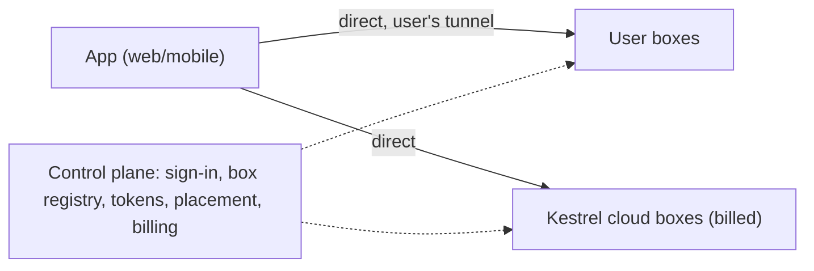

# Bring your own box, with Kestrel cloud overflow (design)

Status: direct transport for user-owned and managed boxes is implemented; cloud overflow/placement below remains a proposal.

## Goal

Anyone can use the Kestrel web and mobile apps for free on compute they own, reached through their own tunnel. When
their compute is full, new threads run on Kestrel cloud boxes, which is what we charge for. Self-hosted and cloud boxes
are the same box (`packages/server`) behind the same app, so moving to paid compute is a placement decision, not a
migration.

- Free: their boxes, their tunnel. We serve only sign-in, the box registry and tokens.
- Paid: Kestrel cloud compute (subscription with compute hours). Optionally later, our relay for boxes without a tunnel.
- Full local (Worker + box + Vite on one machine, `bun run dev`) stays a developer setup, not a product.

## Install your own box

The `kestrel-box` CLI installs the box as a service and pairs it with your account. The box always runs on Linux:
natively, inside WSL2 on Windows, or inside a Lima VM the CLI manages on macOS.

| OS | Install |
|---|---|
| Linux, WSL2 | `curl -fsSL https://raw.githubusercontent.com/jarenm1/kestrel/main/scripts/install-box.sh \| sh` or `npx kestrel-box login && npx kestrel-box install` |
| Windows | WSL2 only: `irm https://raw.githubusercontent.com/jarenm1/kestrel/main/scripts/install-box.ps1 \| iex` checks WSL2 and systemd, then runs the Linux installer inside it |
| macOS | `brew install lima`, then the same `curl … \| sh` (or `npx`): `install` creates the `kestrel-box` VM (Apple virtualization, Ubuntu LTS, half the CPUs and memory by default; `--cpus`, `--memory`), provisions it, and forwards port 8787 to the Mac |

1. `kestrel-box login` prints a pairing code and opens `/pair?code=…` in the app. Approve it there (name and URL are
   editable; "Use this box now" makes it your active box). The CLI then writes
   `~/.config/kestrel-box/config.json` (mode 600) with the box id and secret. The secret is never shown.
2. `kestrel-box install` runs `doctor`, copies itself to `~/.local/bin`, builds the desktop helper (`xdamage-capture`;
   needs a C compiler and the X11/Xdamage/Xfixes headers, otherwise the desktop is off), writes and starts the systemd
   user unit `kestrel-box.service`, and enables linger so it outlives logout. On macOS it does the same inside the VM.
3. The box listens on `127.0.0.1:8787` and is used from the same machine at `http://localhost:8787`. To use it from
   elsewhere, expose it over HTTPS/WSS with a private tunnel and reverse proxy, or an appropriate private-network
   service, and set that URL in Settings > Boxes. Public Cloudflare Tunnel routes have video-delivery restrictions;
   see [ingress guidance](box.md#https-ingress-and-private-tunnel). Do not expose `/mcp` or `/broker` publicly.

Other commands: `status`, `logs`, `doctor`, `config` (secret redacted), `run` (what the service executes),
`uninstall [--purge]` (macOS: `--delete-vm --yes`). The box needs `bwrap`, `git` and the agent CLIs (`claude`,
`codex`) on the host; the desktop also needs weston, Xwayland, openbox, hsetroot, xterm, xdotool and ffmpeg.

### What a user's box runs with

- Sandbox `basic` (see [box.md](box.md#agent-sandbox)): bubblewrap over the host's own tools, only the thread's
  workspace, home and `/tmp` writable, the real `$HOME` hidden. Kestrel's boxes keep `strict` with the Nix toolchain.
- Provisioning, from the shipped config: `guaranteed` (each thread is guaranteed 1 GB and an equal CPU share and may
  burst into whatever is idle), the whole box capped at 80% of memory and 80% of the cores, one agent run per core;
  runs past that wait in a queue shown in the thread. Edit `provisioning` in the config (`mode`: `guaranteed`,
  `pooled` or `per-thread`, plus the limits) and restart the service. The server's own defaults, used by Kestrel's
  shared box, stay hard per-thread caps.
- Software: no install tool (Kestrel's toolkits need its Nix flake). Install what agents should use on the host; the
  sandbox sees it read-only. Agents can install into their own home with `npm`, `uv` and the like, but cannot `sudo`
  (see [box.md](box.md#software-on-other-boxes)).
- Rendering: the live desktop uses the GPU only on native Linux with render nodes. WSL2 exposes the GPU as `/dev/dxg`,
  not a render node, and Linux VMs on macOS get no 3D GPU, so there the desktop renders and encodes (x264) on the CPU.

### Releasing

`bun run build:box` builds `dist/box/kestrel-box-{linux,darwin}-{x64,arm64}` (version from
`packages/server/package.json`, which `packages/kestrel-box/package.json` must match). Publish them as assets of a
GitHub release tagged `box-v<version>`. `install-box.sh` downloads `releases/latest/download/<asset>`; the npm launcher
and the macOS `install` (the Linux binary for the VM) download `releases/download/box-v<version>/<asset>`, so the tag
must match the package version. Then `npm publish` in `packages/kestrel-box`. Box releases are the repo's only
releases.

The Linux binaries must load through the standard `/lib` loader. `build:box` uses bun's `baseline` build for linux-x64
(when the target matches the host, bun would reuse its own runtime, and on NixOS that one loads through `/nix/store`),
and fails if a Linux binary names any other loader. Before publishing, `bun scripts/box-ubuntu/test.ts
dist/box/kestrel-box-linux-x64` (needs docker) runs the binary on Ubuntu 24.04 with Claude Code and Codex installed
under `$HOME`, and checks that the box answers, reads both CLIs' logins and starts a real agent run in the sandbox.

### Manual setup

Settings › Boxes › Add a box still works without the CLI: it shows the secret once, with
`CLOUDAGENTS_CONTROL_URL=… CLOUDAGENTS_BOX_ID=… CLOUDAGENTS_BOX_SECRET=… nix run .#box` for a Kestrel checkout.

Local test against a dev stack: `bun run build:box`, then
`dist/box/kestrel-box-linux-x64 login --control-url http://localhost:<app port> --url http://localhost:<box port>`,
approve, set `port` and `dataDir` in the config, and `run` (or `install`). A shell that already exports
`CLOUDAGENTS_*` variables (e.g. a dev shell entered from another checkout) wins over a `--env-file`; `run` sets them
from the config.

## Current transport

- Managed and user-owned boxes both serve their REST, WebSockets, attachments and previews directly. The control
  plane handles authentication, enrollment, grant issuance and automation coordination, not the data path.
- User-owned boxes use their enrolled id and shared secret to verify HS256 tokens offline and fetch their owner's
  credentials from `/box/self`. Managed boxes use ES256 grants and a separate service-authenticated credential
  endpoint; they do not share a user's box secret.
- The web app merges threads from every reachable box and routes each thread to its owner box. Mobile uses the
  active box. Selecting `null` means the managed box, whose URL comes from `BoxList.managedBox`.
- There is no outbound application relay socket or Worker API fallback. A deployment without a managed endpoint
  may still use its enrolled user-owned boxes.
- Threads, subscription logins (`<CLOUDAGENTS_DATA_DIR>/users/<login>/{claude,codex}`) and repo mirrors remain on the box.

## Design

### Control plane

- Sign-in and accounts stay on `app.kestrel-agent.com`.
- Box registry: per-user boxes, each with an id, a public URL and a secret. Boxes are owned by one user, who picks the
  active box their apps use (`null` is Kestrel's relayed box). Kestrel's own box keeps the shared `BOX_TOKEN` relay.
- Box tokens: short-lived (1 h) HS256 JWTs the control plane mints for the owner (claims: `sub` user, `aud` box id,
  `exp`, `cv` credentials version, `dev`), keyed by that box's secret (`packages/protocol/src/boxtoken.ts`). The box
  verifies them offline, so the control plane is not on the request path.
- Credentials: the box fetches its owner's connection secrets (GitHub token, API keys) from `GET /box/self` with its
  secret, and again only when a token's `cv` differs from what it holds.
- Later: each box keeps a low-traffic socket to the Hub (tagged per box id) for presence, capacity reports, automation
  triggers and cross-box thread messages. No thread data, events or desktop frames go over it.

### Direct data path

- The app calls each user box's URL directly (`/api/*`, WebSockets, attachments, preview) with the box token:
  `Authorization: Bearer`, or `?access_token=` where no header can be set (WebSockets, ``).
- The box's own port authenticates every request: valid signature for its secret, its own box id in `aud`, not expired,
  `sub` is its owner. CORS stays open: bearer tokens are not ambient credentials.
- Previews: the box mints preview sessions itself and serves the sandboxed frame at `<box url>/_preview/...`.
- Automations fire only on Kestrel's box for now; the apps show them as unavailable while a user box is active.
- Endpoints must be HTTPS (the app is HTTPS). Supported setups: Tailscale (`*.ts.net`, tailnet or Funnel), Cloudflare
  Tunnel, or the user's own domain. A tailnet-only address is a private-network target; Chrome asks before a public site
  reaches it. Public tunnels avoid that prompt; the mobile app is not affected.
- The web app shows the threads of every box at once. It opens one event stream per box (Kestrel's box through the
  Worker, each user box directly) and merges the lists; thread ids are globally unique UUIDs. Each thread's requests go
  to the box it lives on, found from the boxes' own listings. The control plane does not store the thread→box record
  yet. Box-level state (usage, CLI logins, box status, the box new threads start on) still follows the active box.
- The mobile app still uses only its active box.

### Placement and overflow

- A thread is pinned to the box it starts on (its workspace, checkouts and desktop are on that box's disk). The thread
  record in the control plane stores its box id.
- Boxes report free capacity (CPU and memory headroom against the per-thread slice limits, from the same data as
  `stats.ts`) over their control socket.
- When a thread starts, the control plane picks a box:
  1. A user box with room.
  2. If none (full or offline): a cloud box **automatically** when the user has a subscription with compute hours left.
  3. Otherwise: the app asks whether to upgrade. Declining queues nothing; the thread is not started.
- The user can always pick a box by hand for a thread.
- Existing threads never move automatically.

### Cloud boxes

- Shared multi-tenant machines: one cloud box serves many users' threads, packed by capacity. The box is already
  multi-user (threads, mirrors and CLI logins are per user), but its isolation was built for one trusted owner.
- Billed by compute hours used by the user's threads on cloud boxes.
- Model credentials: API keys are stored in the control plane's secret store and handed to the cloud box per run.
  Claude and ChatGPT subscription logins are per box; the user signs in once for Kestrel cloud, and that login is
  available on every cloud machine they are placed on (Settings › Connections shows which boxes are signed in).
- Repo mirrors are per box and per user; the first checkout on a cloud machine fetches from scratch.

### Multi-tenant sandboxing (separate workstream, required before cloud launch)

Today's per-thread isolation (bubblewrap, a systemd slice with memory/CPU/pids caps, and under `strict` a pasta network namespace) shares
the host kernel and assumes the users on a box trust the operator and not much else is at stake. Strangers on one
machine need more:

- A VM boundary per tenant or per thread (Firecracker, Cloud Hypervisor or gVisor), with bwrap kept inside it.
- Host-side work that runs with user secrets (mirror fetches, `git_push`, the GitHub tools, the broker, `toolkit_install`
  `nix build`s) isolated per tenant, so a compromised tenant cannot read another tenant's tokens, mirrors or CLI state.
- Per-tenant storage quotas and encryption at rest; workspaces wiped on release.
- Egress policy and abuse controls (rate limits, mining/spam detection) on the shared network.
- GPU sharing: there is no per-thread VRAM limit today; cloud desktops need a share or a cap.
- Noisy-neighbor limits on disk and network I/O, not just CPU and memory.

### Cross-box features

- `thread_list` / `thread_read` / `thread_send` span the user's boxes, routed through the control plane socket.
- Automations name a target box, or `auto` (the placement rules above).

## Work order

1. **Done:** direct mode. Per-user box registry and secrets in the Hub, box tokens, `/box/self`, the box's
   authenticated own port (REST, WebSockets, previews), web and mobile talking to the active box directly.
2. **Done:** `kestrel-box` install: single binary, pairing from the CLI, systemd user service (Linux, WSL2; Lima VM on
   macOS), `basic` sandbox on host tools, provisioning modes and a run queue.
3. Thread → box records; per-box event streams merged in the app.
4. Box control sockets: presence, capacity reports, automations on user boxes, provisioning edited from the app.
5. Placement, with auto-overflow for subscribers and the upgrade prompt for everyone else.
6. Multi-tenant sandboxing (VM boundary, per-tenant host isolation), in parallel with 3–5.
7. Cloud boxes: provisioning, credential handoff, metering and billing.
8. Later: cross-box thread tools, moving a thread between boxes, a paid relay for boxes without a tunnel.

## Protocol impact

Step 1 added the box registry types, `BOX_ID_HEADER`, `ControlPaths.boxes…boxSelf` and box tokens
(`boxtoken.ts`). Later steps add capacity reports, the thread's box id and control socket frames. Every package depends
on `packages/protocol`; the PR for each step calls this out.

## Open questions

- Paid relay for boxes without a tunnel: offer it, and how to meter the desktop stream.
- Orgs/teams owning boxes (out of scope here; boxes are single-owner).
- Moving a thread between boxes: conversation handoff like `core/handoff.ts`, workspace via its thread branch or a
  snapshot.
