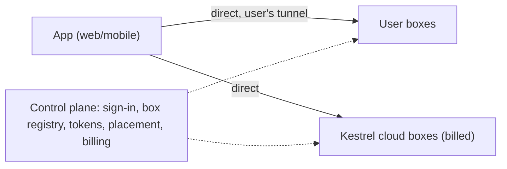

# Bring your own box, with Kestrel cloud overflow (design)

Status: proposal. Nothing here is implemented yet.

## Goal

Anyone can use the Kestrel web and mobile apps for free on compute they own, reached through their own tunnel. When
their compute is full, new threads run on Kestrel cloud boxes, which is what we charge for. Self-hosted and cloud boxes
are the same box (`packages/server`) behind the same app, so moving to paid compute is a placement decision, not a
migration.

- Free: their boxes, their tunnel. We serve only sign-in, the box registry and tokens.
- Paid: Kestrel cloud compute (subscription with compute hours). Optionally later, our relay for boxes without a tunnel.
- Full local (Worker + box + Vite on one machine, `bun run dev`) stays a developer setup, not a product.

## Today

- One Hub, one box: the Hub holds a single box socket (tag `"box"`, `hub.ts`); a new dial-in replaces the old one.
- One shared `BOX_TOKEN` (`control/src/env.ts`, `index.ts`); no per-user box enrollment.
- All app traffic, including the desktop stream, goes browser → Worker → Hub → relay → box. Every relayed request is a
  Durable Object request, which we pay for.
- The box learns the user only from relay headers (`BOX_USER_HEADER`); its own port serves no thread data.
- Threads, subscription logins (`<CLOUDAGENTS_DATA_DIR>/users/<login>/{claude,codex}`) and repo mirrors live on the box.
- The web app already separates `SERVER_URL` (API) from `APP_ORIGIN` (`/api/me`) but authenticates with cookies; the
  mobile app has a configurable `serverUrl` and sends an explicit session header.

## Design

### Control plane

- Sign-in and accounts stay on `app.kestrel-agent.com`.
- Box registry: per-user boxes, each with an id, a public URL (HTTPS), a kind (`user` or `cloud`) and an enrollment
  token replacing the shared `BOX_TOKEN`. Boxes are owned by one user.
- Each box keeps a low-traffic socket to the Hub (tagged per box id): presence, capacity reports, automation triggers,
  cross-box thread messages. No thread data, events or desktop frames go over it.
- Box tokens: the control plane signs short-lived JWTs for the app (claims: `sub` user, `aud` box id, `exp`). Boxes
  verify them with the control plane's public key (JWKS), so the control plane is not on the request path.

### Direct data path

- The app calls each box's URL directly (`/api/*`, event WebSocket, desktop stream) with the box JWT as a bearer token.
- The box's direct port authenticates every request: valid signature, its own box id in `aud`, not expired, `sub` is
  the box owner. It answers CORS only for the app origins.
- Endpoints must be HTTPS (the app is HTTPS). Supported setups: Tailscale (`*.ts.net`, tailnet or Funnel), Cloudflare
  Tunnel, or the user's own domain. A tailnet-only address is a private-network target; Chrome asks before a public site
  reaches it. Public tunnels avoid that prompt; the mobile app is not affected.
- Thread ids are scoped to a box; the app opens one event stream per box and merges the thread list.

### Placement and overflow

- A thread is pinned to the box it starts on (its workspace, checkouts and desktop are on that box's disk). The thread
  record in the control plane stores its box id.
- Boxes report free capacity (CPU and memory headroom against the per-thread slice limits, from the same data as
  `stats.ts`) over their control socket.
- When a thread starts, the control plane picks a box:
  1. A user box with room.
  2. If none (full or offline): a cloud box **automatically** when the user has a subscription with compute hours left.
  3. Otherwise: the app asks whether to upgrade. Declining queues nothing; the thread is not started.
- The user can always pick a box by hand for a thread.
- Existing threads never move automatically.

### Cloud boxes

- One box per user (same isolation model as today's single-owner box); provisioned on first overflow.
- Billed by compute hours used by the user's threads on cloud boxes.
- Model credentials: API keys are stored in the control plane's secret store and synced to the user's cloud box.
  Claude and ChatGPT subscription logins are per box, so the user signs in on the cloud box too (Settings ›
  Connections shows which boxes are signed in).
- Repo mirrors are per box; the first checkout on a cloud box fetches from scratch.

### Cross-box features

- `thread_list` / `thread_read` / `thread_send` span the user's boxes, routed through the control plane socket.
- Automations name a target box, or `auto` (the placement rules above).

## Work order

1. Per-box enrollment and registry in the Hub (replace the single `"box"` socket and `BOX_TOKEN`).
2. Box JWTs; direct authenticated box port; app and mobile talk to box URLs with bearer tokens.
3. Thread → box records; per-box event streams merged in the app.
4. Capacity reports and placement, with the upgrade prompt.
5. Cloud boxes: provisioning, credential sync, metering and billing, auto-overflow for subscribers.
6. Later: cross-box thread tools, moving a thread between boxes, a paid relay for boxes without a tunnel.

## Protocol impact

`packages/protocol` gains the box registry types, box JWT claims, capacity reports, the thread's box id, and control
socket frames. Every package depends on it; the PR for each step calls this out.

## Open questions

- Paid relay for boxes without a tunnel: offer it, and how to meter the desktop stream.
- Orgs/teams owning boxes (out of scope here; boxes are single-owner).
- Moving a thread between boxes: conversation handoff like `core/handoff.ts`, workspace via its thread branch or a
  snapshot.
