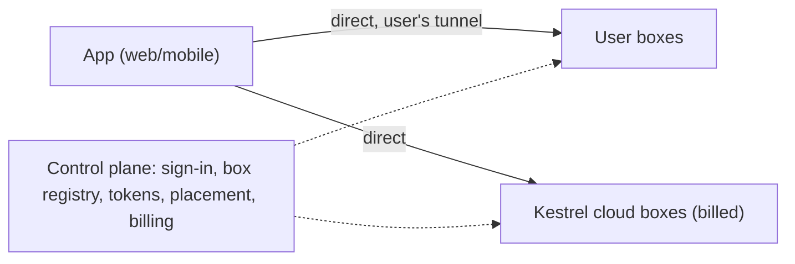

# Bring your own box, with Kestrel cloud overflow (design)

Status: step 1 (direct mode for a user's own box) is implemented; the rest is a proposal.

## Goal

Anyone can use the Kestrel web and mobile apps for free on compute they own, reached through their own tunnel. When
their compute is full, new threads run on Kestrel cloud boxes, which is what we charge for. Self-hosted and cloud boxes
are the same box (`packages/server`) behind the same app, so moving to paid compute is a placement decision, not a
migration.

- Free: their boxes, their tunnel. We serve only sign-in, the box registry and tokens.
- Paid: Kestrel cloud compute (subscription with compute hours). Optionally later, our relay for boxes without a tunnel.
- Full local (Worker + box + Vite on one machine, `bun run dev`) stays a developer setup, not a product.

## Use your own box (step 1)

1. In the app, Settings › Boxes › Add a box: a name and the URL the box will be reachable at (`https://…`, or
   `http://localhost:<port>` from the same machine). The app shows the box's secret once, with the command to run.
2. In a Kestrel checkout, start the box with that command:
   `CLOUDAGENTS_CONTROL_URL=https://app.kestrel-agent.com CLOUDAGENTS_BOX_ID=… CLOUDAGENTS_BOX_SECRET=… nix run .#box`.
   It listens on `127.0.0.1:8787` (`CLOUDAGENTS_PORT`). Without `CLOUDAGENTS_BOX_TOKEN` it opens no relay socket.
3. Make that port reachable at the box's URL, e.g. `tailscale serve 8787` or a Cloudflare Tunnel.
4. Use this box. Web and mobile now send box traffic to that URL; Settings › Boxes switches back to Kestrel's box.

Local test against a dev stack: add a box with `http://localhost:<port>`, then run a second box from
`packages/server` with `CLOUDAGENTS_PORT=<port>`, its own `CLOUDAGENTS_DATA_DIR`, `CLOUDAGENTS_CONTROL_URL` set to the
stack's worker port, and the box id and secret. Set the data dir explicitly: a shell that already exports
`CLOUDAGENTS_DATA_DIR` (e.g. a dev shell entered from another checkout) wins over `bun --env-file`.

## Before step 1

- One Hub, one box: the Hub holds a single box socket (tag `"box"`, `hub.ts`); a new dial-in replaces the old one. This
  still holds for Kestrel's own box.
- One shared `BOX_TOKEN` (`control/src/env.ts`, `index.ts`); no per-user box enrollment.
- All app traffic, including the desktop stream, goes browser → Worker → Hub → relay → box. Every relayed request is a
  Durable Object request, which we pay for.
- The box learns the user only from relay headers (`BOX_USER_HEADER`); its own port serves no thread data.
- Threads, subscription logins (`<CLOUDAGENTS_DATA_DIR>/users/<login>/{claude,codex}`) and repo mirrors live on the box.
- The web app already separates `SERVER_URL` (API) from `APP_ORIGIN` (`/api/me`) but authenticates with cookies; the
  mobile app has a configurable `serverUrl` and sends an explicit session header.

## Design

### Control plane

- Sign-in and accounts stay on `app.kestrel-agent.com`.
- Box registry: per-user boxes, each with an id, a public URL and a secret. Boxes are owned by one user, who picks the
  active box their apps use (`null` is Kestrel's relayed box). Kestrel's own box keeps the shared `BOX_TOKEN` relay.
- Box tokens: short-lived (1 h) HS256 JWTs the control plane mints for the owner (claims: `sub` user, `aud` box id,
  `exp`, `cv` credentials version, `dev`), keyed by that box's secret (`packages/protocol/src/boxtoken.ts`). The box
  verifies them offline, so the control plane is not on the request path.
- Credentials: the box fetches its owner's connection secrets (GitHub token, API keys) from `GET /box/self` with its
  secret, and again only when a token's `cv` differs from what it holds.
- Later: each box keeps a low-traffic socket to the Hub (tagged per box id) for presence, capacity reports, automation
  triggers and cross-box thread messages. No thread data, events or desktop frames go over it.

### Direct data path

- The app calls the active box's URL directly (`/api/*`, WebSockets, attachments, preview) with the box token:
  `Authorization: Bearer`, or `?access_token=` where no header can be set (WebSockets, ``).
- The box's own port authenticates every request: valid signature for its secret, its own box id in `aud`, not expired,
  `sub` is its owner. CORS stays open: bearer tokens are not ambient credentials.
- Previews: the box mints preview sessions itself and serves the sandboxed frame at `<box url>/_preview/...`.
- Automations fire only on Kestrel's box for now; the apps show them as unavailable while a user box is active.
- Endpoints must be HTTPS (the app is HTTPS). Supported setups: Tailscale (`*.ts.net`, tailnet or Funnel), Cloudflare
  Tunnel, or the user's own domain. A tailnet-only address is a private-network target; Chrome asks before a public site
  reaches it. Public tunnels avoid that prompt; the mobile app is not affected.
- Step 1 has one active box at a time. Later the app opens one event stream per box and merges the thread list (thread
  ids are already globally unique UUIDs).

### Placement and overflow

- A thread is pinned to the box it starts on (its workspace, checkouts and desktop are on that box's disk). The thread
  record in the control plane stores its box id.
- Boxes report free capacity (CPU and memory headroom against the per-thread slice limits, from the same data as
  `stats.ts`) over their control socket.
- When a thread starts, the control plane picks a box:
  1. A user box with room.
  2. If none (full or offline): a cloud box **automatically** when the user has a subscription with compute hours left.
  3. Otherwise: the app asks whether to upgrade. Declining queues nothing; the thread is not started.
- The user can always pick a box by hand for a thread.
- Existing threads never move automatically.

### Cloud boxes

- Shared multi-tenant machines: one cloud box serves many users' threads, packed by capacity. The box is already
  multi-user (threads, mirrors and CLI logins are per user), but its isolation was built for one trusted owner.
- Billed by compute hours used by the user's threads on cloud boxes.
- Model credentials: API keys are stored in the control plane's secret store and handed to the cloud box per run.
  Claude and ChatGPT subscription logins are per box; the user signs in once for Kestrel cloud, and that login is
  available on every cloud machine they are placed on (Settings › Connections shows which boxes are signed in).
- Repo mirrors are per box and per user; the first checkout on a cloud machine fetches from scratch.

### Multi-tenant sandboxing (separate workstream, required before cloud launch)

Today's per-thread isolation (bubblewrap, a systemd slice with memory/CPU/pids caps, a pasta network namespace) shares
the host kernel and assumes the users on a box trust the operator and not much else is at stake. Strangers on one
machine need more:

- A VM boundary per tenant or per thread (Firecracker, Cloud Hypervisor or gVisor), with bwrap kept inside it.
- Host-side work that runs with user secrets (mirror fetches, `git_push`, the GitHub tools, the broker, `toolkit_install`
  `nix build`s) isolated per tenant, so a compromised tenant cannot read another tenant's tokens, mirrors or CLI state.
- Per-tenant storage quotas and encryption at rest; workspaces wiped on release.
- Egress policy and abuse controls (rate limits, mining/spam detection) on the shared network.
- GPU sharing: there is no per-thread VRAM limit today; cloud desktops need a share or a cap.
- Noisy-neighbor limits on disk and network I/O, not just CPU and memory.

### Cross-box features

- `thread_list` / `thread_read` / `thread_send` span the user's boxes, routed through the control plane socket.
- Automations name a target box, or `auto` (the placement rules above).

## Work order

1. **Done:** direct mode. Per-user box registry and secrets in the Hub, box tokens, `/box/self`, the box's
   authenticated own port (REST, WebSockets, previews), web and mobile talking to the active box directly.
2. Thread → box records; per-box event streams merged in the app.
3. Box control sockets: presence, capacity reports, automations on user boxes.
4. Placement, with auto-overflow for subscribers and the upgrade prompt for everyone else.
5. Multi-tenant sandboxing (VM boundary, per-tenant host isolation), in parallel with 2–4.
6. Cloud boxes: provisioning, credential handoff, metering and billing.
7. Later: cross-box thread tools, moving a thread between boxes, a paid relay for boxes without a tunnel.

## Protocol impact

Step 1 added the box registry types, `BOX_ID_HEADER`, `ControlPaths.boxes…boxSelf` and box tokens
(`boxtoken.ts`). Later steps add capacity reports, the thread's box id and control socket frames. Every package depends
on `packages/protocol`; the PR for each step calls this out.

## Open questions

- Paid relay for boxes without a tunnel: offer it, and how to meter the desktop stream.
- Orgs/teams owning boxes (out of scope here; boxes are single-owner).
- Moving a thread between boxes: conversation handoff like `core/handoff.ts`, workspace via its thread branch or a
  snapshot.
