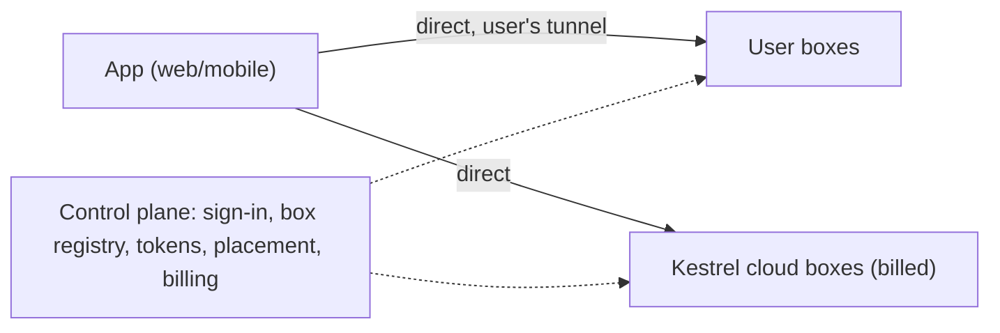

# Bring your own box, with Kestrel cloud overflow (design)

Status: step 1 (direct mode for a user's own box) is implemented; the rest is a proposal. For Kestrel's compute (the
Nest), hosts and billing, [goal-state.md](goal-state.md) is the current design.

## Goal

Anyone can use the Kestrel web and mobile apps for free on compute they own, reached through their own tunnel. When
their compute is full, new threads run on Kestrel cloud boxes, which is what we charge for. Self-hosted and cloud boxes
are the same box (`packages/server`) behind the same app, so moving to paid compute is a placement decision, not a
migration.

- Free: their boxes, their tunnel. We serve only sign-in, the box registry and tokens.
- Paid: Nest compute, billed by what it uses. Optionally later, our relay for boxes without a tunnel.
- Full local (Worker + box + Vite on one machine, `bun run dev`) stays a developer setup, not a product.

## Install your own box

The `kestrel-box` CLI installs the box as a service and pairs it with your account. The box always runs on Linux:
natively, inside WSL2 on Windows, or inside a Lima VM the CLI manages on macOS.

| OS | Install |
|---|---|
| Linux, WSL2 | `curl -fsSL https://raw.githubusercontent.com/jarenm1/kestrel/main/scripts/install-box.sh \| sh` or `npx kestrel-box login && npx kestrel-box install` |
| Windows | WSL2 only: `irm https://raw.githubusercontent.com/jarenm1/kestrel/main/scripts/install-box.ps1 \| iex` checks WSL2 and systemd, then runs the Linux installer inside it |
| macOS | `brew install lima`, then the same `curl … \| sh` (or `npx`): `install` creates the `kestrel-box` VM (Apple virtualization, Ubuntu LTS, half the CPUs and memory by default; `--cpus`, `--memory`), provisions it, and forwards port 8787 to the Mac |

1. `kestrel-box login` prints a pairing code and opens `/pair?code=…` in the app. Approve it there (name and URL are
   editable; "Use this box now" makes it your active box). The CLI then writes
   `~/.config/kestrel-box/config.json` (mode 600) with the box id and secret. The secret is never shown.
2. `kestrel-box install` runs `doctor`, copies itself to `~/.local/bin`, builds the desktop helper (`xdamage-capture`;
   needs a C compiler and the X11/Xdamage/Xfixes headers, otherwise the desktop is off), writes and starts the systemd
   user unit `kestrel-box.service`, and enables linger so it outlives logout. On macOS it does the same inside the VM.
3. The box listens on `127.0.0.1:8787` and is used from the same machine at `http://localhost:8787`. To use it from
   elsewhere (the mobile app, another computer), make that port reachable over HTTPS: a Cloudflare Tunnel, a reverse proxy on your own domain, or [Tailscale Serve](https://tailscale.com/docs/features/tailscale-serve). Those forward every path they are given, so do not point them at the box port directly. Point them at a local proxy that answers `/mcp` and `/broker` with 404 (the rules in `deploy/box-ingress.nix`; Caddy does this in a few lines). Then set that proxy's URL on the box in Settings › Boxes.

Other commands: `status`, `logs`, `doctor`, `config` (secret redacted), `run` (what the service executes),
`uninstall [--purge]` (macOS: `--delete-vm --yes`). The box needs `bwrap`, `git` and the agent CLIs (`claude`,
`codex`, OpenCode 2 as `opencode` from `npm i -g @opencode/cli` for its free models, and Antigravity CLI as `agy` from
`curl -fsSL https://antigravity.google/cli/install.sh | bash` for Google's) on the host; the desktop
also needs weston 14 or newer, Xwayland, openbox, hsetroot, xterm, xdotool and ffmpeg.

### What a user's box runs with

- Sandbox `basic` (see [box.md](box.md#agent-sandbox)): bubblewrap over the host's own tools, only the thread's
  workspace, home and `/tmp` writable, the real `$HOME` hidden. Kestrel's boxes keep `strict` with the Nix toolchain.
- Provisioning, from the shipped config: `guaranteed` (each thread is guaranteed 1 GB and an equal CPU share and may
  burst into whatever is idle), the whole box capped at 80% of memory and 80% of the cores, one agent run per core;
  runs past that wait in a queue shown in the thread. Edit `provisioning` in the config (`mode`: `guaranteed`,
  `pooled` or `per-thread`, plus the limits) and restart the service. The server's own defaults, used by Kestrel's
  shared box, stay hard per-thread caps.
- Software: no install tool (Kestrel's toolkits need its Nix flake). Install what agents should use on the host; the
  sandbox sees it read-only. Agents can install into their own home with `npm`, `uv` and the like, but cannot `sudo`
  (see [box.md](box.md#software-on-other-boxes)).
- Rendering: the live desktop uses the GPU only on native Linux with render nodes. WSL2 exposes the GPU as `/dev/dxg`,
  not a render node, and Linux VMs on macOS get no 3D GPU, so there the desktop renders and encodes (x264) on the CPU.

Desktop video, audio and input always use WebRTC, with no opt-in. The optional `webrtc` object in `config.json` sets its network; restart the box after editing it. Every field is optional. Without `iceServers`, the box and viewers use one STUN server, `stun:stun.cloudflare.com:3478`; set `iceServers` to replace it, or to `[]` to use none. An example:

```json
"webrtc": {
  "iceServers": [{ "urls": ["stun:stun.example.org:3478"] }],
  "turn": { "urls": ["turn:turn.example.org:3478"], "secret": "coturn static-auth-secret" },
  "icePolicy": "all",
  "portRange": "50000-50100",
  "hostAddresses": ["100.64.0.5"]
}
```

Which of these you need depends on your network, see [WebRTC desktop](box.md#webrtc-desktop). Kestrel relays no media. Your own TURN server, set with `turn`, is the only relay the box will use. If no path connects, the desktop does not stream: there is no WebSocket fallback.

### Releasing

`bun run build:box` builds `dist/box/kestrel-box-{linux,darwin}-{x64,arm64}` (version from
`packages/server/package.json`, which `packages/kestrel-box/package.json` must match). Publish them as assets of a
GitHub release tagged `box-v<version>`. `install-box.sh` downloads `releases/latest/download/<asset>`; the npm launcher
and the macOS `install` (the Linux binary for the VM) download `releases/download/box-v<version>/<asset>`, so the tag
must match the package version. Then `npm publish` in `packages/kestrel-box`. Box releases are the repo's only
releases.

The Linux binaries must load through the standard `/lib` loader. `build:box` uses bun's `baseline` build for linux-x64
(when the target matches the host, bun would reuse its own runtime, and on NixOS that one loads through `/nix/store`),
and fails if a Linux binary names any other loader. Before publishing, `bun scripts/box-ubuntu/test.ts
dist/box/kestrel-box-linux-x64` (needs docker) runs the binary on Ubuntu 24.04 with Claude Code, Codex and OpenCode
installed under `$HOME`, and checks that the box answers, reads both CLIs' logins and starts a real agent run in the sandbox.

### Manual setup

Settings › Boxes › Add a box still works without the CLI: it shows the secret once, with
`CLOUDAGENTS_CONTROL_URL=… CLOUDAGENTS_BOX_ID=… CLOUDAGENTS_BOX_SECRET=… nix run .#box` for a Kestrel checkout.

Local test against a dev stack: `bun run build:box`, then
`dist/box/kestrel-box-linux-x64 login --control-url http://localhost:<app port> --url http://localhost:<box port>`,
approve, set `port` and `dataDir` in the config, and `run` (or `install`). A shell that already exports
`CLOUDAGENTS_*` variables (e.g. a dev shell entered from another checkout) wins over a `--env-file`; `run` sets them
from the config.

## Before step 1

- One Hub, one box: the Hub holds a single box socket (tag `"box"`, `hub.ts`); a new dial-in replaces the old one. This
  still holds for Kestrel's own box.
- One shared `BOX_TOKEN` (`control/src/env.ts`, `index.ts`); no per-user box enrollment.
- All app traffic goes browser → Worker → Hub → relay → box, including the desktop's status and WebRTC signaling. Desktop media does not: it goes between the box and each viewer over WebRTC, never through the Hub. Every relayed request is a Durable Object request, which we pay for.
- The box learns the user only from relay headers (`BOX_USER_HEADER`); its own port serves no thread data.
- Threads, subscription logins (`<CLOUDAGENTS_DATA_DIR>/users/<login>/{claude,codex}`) and repo mirrors live on the box.
- The web app already separates `SERVER_URL` (API) from `APP_ORIGIN` (`/api/me`) but authenticates with cookies; the
  mobile app has a configurable `serverUrl` and sends an explicit session header.

## Design



### Control plane

- Sign-in and accounts stay on `app.kestrel-agent.com`.
- Box registry: per-user boxes, each with an id, a public URL and a secret. Boxes are owned by one user, who picks the
  active box their apps use. `null` means Kestrel's own box: its managed box when `BoxList.managedBox` is set, otherwise the legacy relay (see [box.md](box.md#managed-boxes-fleet)).
- Box tokens: short-lived (1 h) HS256 JWTs the control plane mints for the owner (claims: `sub` user, `aud` box id,
  `exp`, `cv` credentials version, `dev`), keyed by that box's secret (`packages/protocol/src/boxtoken.ts`). The box
  verifies them offline, so the control plane is not on the request path.
- Credentials: the box fetches its owner's connection secrets (GitHub token, API keys) from `GET /box/self` with its
  secret, and again only when a token's `cv` differs from what it holds.
- Later: each box keeps a low-traffic socket to the Hub (tagged per box id) for presence, capacity reports, automation
  triggers and cross-box thread messages. No thread data, events or desktop frames go over it.

### Direct data path

- The app calls each user box's URL directly (`/api/*`, WebSockets, attachments, preview) with the box token:
  `Authorization: Bearer`, or `?access_token=` where no header can be set (WebSockets, ``).
- The box's own port authenticates every request: valid signature for its secret, its own box id in `aud`, not expired,
  `sub` is its owner. CORS stays open: bearer tokens are not ambient credentials.
- The web app opens a WebRTC data channel to each user box for the API and sends those calls over it when it is open: everything under `/api/*` except file uploads, the event stream, attachments and previews, which stay on HTTP. It posts an SDP offer to `POST /api/webrtc/offer` with the box token; the box answers, binds the caller's identity to that channel and carries the same request frames the relay uses, in 16 KiB fragments. A connection serves one such channel. The channel closes when the token it was opened with expires (at most `BOX_TOKEN_TTL_SECONDS`, one hour); until then the box does not re-check the token, so a revoked credential keeps its channel for up to that long, while HTTP calls are checked on every request. Calls fall back to HTTP until the channel opens, and when it cannot be made. A refused or dropped channel is retried after 60 s. Browsers hide host candidates behind mDNS `.local` names that the box cannot resolve, so same-LAN paths may fall back to HTTP.
- Previews: the box mints preview sessions itself and serves the sandboxed frame at `<box url>/_preview/...`.
- Automations fire only on Kestrel's own boxes for now (managed or relayed); the apps show them as unavailable while a user box is active.
- Endpoints must be HTTPS (the app is HTTPS). Supported setups: Tailscale (`*.ts.net`, tailnet or Funnel), Cloudflare
  Tunnel, or the user's own domain. A tailnet-only address is a private-network target; Chrome asks before a public site
  reaches it. Public tunnels avoid that prompt; the mobile app is not affected.
- `/mcp`, `/broker` and `/gh/` are never public. The box serves them only to its own sandboxes, so the HTTPS front must answer them with 404.
- The web app shows the threads of every box at once. It opens one event stream per box (Kestrel's box through the
  Worker, each user box directly) and merges the lists; thread ids are globally unique UUIDs. Each thread's requests go
  to the box it lives on, found from the boxes' own listings. The control plane does not store the thread→box record
  yet. Box-level state (usage, CLI logins, box status, the box new threads start on) still follows the active box.
- The mobile app still uses only its active box.

### Placement and overflow

- A thread is pinned to the box it starts on (its workspace, checkouts and desktop are on that box's disk). The thread
  record in the control plane stores its box id.
- Boxes report free capacity (CPU and memory headroom against the per-thread slice limits, from the same data as
  `stats.ts`) over their control socket.
- When a thread starts, the control plane picks a box:
  1. A user box with room.
  2. If none (full or offline): a Nest box **automatically** when the user has billing set up and is under their spending cap.
  3. Otherwise: the app asks whether to upgrade. Declining queues nothing; the thread is not started.
- The user can always pick a box by hand for a thread.
- Existing threads never move automatically.

### The Nest

Kestrel's paid compute gives each user their own VM on a shared host, instead of shared multi-tenant boxes. Its box is
an ordinary single-owner box, so the VM is the boundary between users. See [goal-state.md](goal-state.md#the-nest) for
shapes, the host layer and billing.

### Cross-box features

- `thread_list` / `thread_read` / `thread_send` span the user's boxes, routed through the control plane socket.
- Automations name a target box, or `auto` (the placement rules above).

## Work order

1. **Done:** direct mode. Per-user box registry and secrets in the Hub, box tokens, `/box/self`, the box's
   authenticated own port (REST, WebSockets, previews), web and mobile talking to the active box directly.
2. **Done:** `kestrel-box` install: single binary, pairing from the CLI, systemd user service (Linux, WSL2; Lima VM on
   macOS), `basic` sandbox on host tools, provisioning modes and a run queue.
3. Thread → box records; per-box event streams merged in the app.
4. Box control sockets: presence, capacity reports, automations on user boxes, provisioning edited from the app.
5. Placement, with auto-overflow for subscribers and the upgrade prompt for everyone else.
6. The Nest: host layer, VM shapes, metering and billing ([build order](goal-state.md#build-order)).
7. Later: cross-box thread tools, moving a thread between boxes, a paid relay for boxes without a tunnel.

## Protocol impact

Step 1 added the box registry types, `BOX_ID_HEADER`, `ControlPaths.boxes…boxSelf` and box tokens
(`boxtoken.ts`). Later steps add capacity reports, the thread's box id and control socket frames. Every package depends
on `packages/protocol`; the PR for each step calls this out.

## Open questions

- Paid relay for boxes without a tunnel: offer one, and how to meter its media. Desktop video is WebRTC now, so such a relay would carry WebRTC media; Kestrel provides no media relay today ([box.md](box.md#webrtc-desktop)).
- Orgs/teams owning boxes (out of scope here; boxes are single-owner).
- Moving a thread between boxes: conversation handoff like `core/handoff.ts`, workspace via its thread branch or a
  snapshot.
