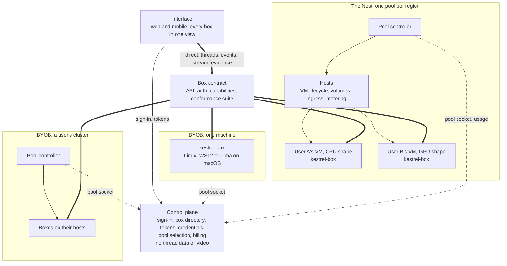
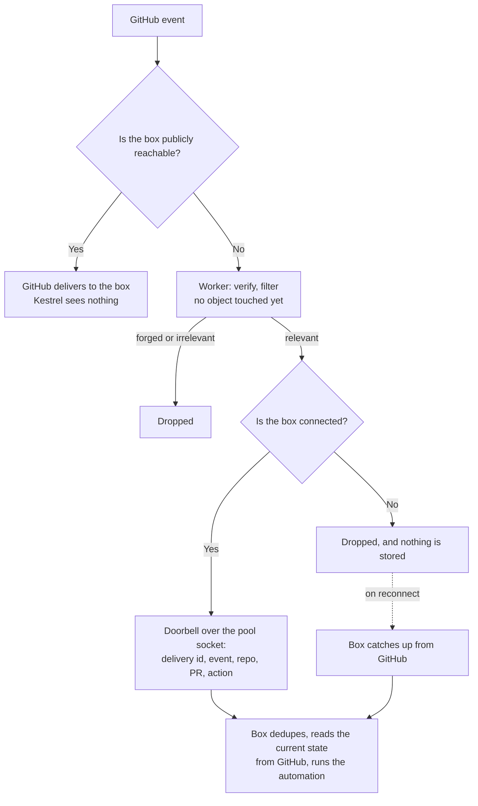
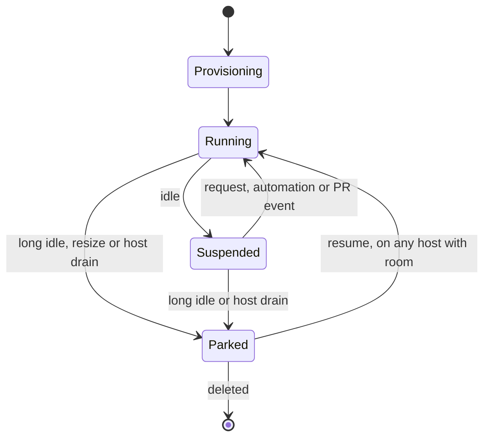

# Kestrel goal state

Status: proposal, written November 2026. Nothing here is built unless it says so. For what runs today see
[architecture.md](architecture.md) and [box.md](box.md). What the Nest needs for paying users, including where we buy
machines, costs, regions, load balancing and outage survival, is in [nest-production.md](nest-production.md).

## Product

Kestrel is two products:

- **The interface:** web and mobile apps for directing agents and checking their work across every box a person has.
  It is built for work you have to see: game development, 3D modelling and VFX.
- **The Nest:** Kestrel's slightly opinionated agent VMs, billed by use. Kestrel owns and operates it.

**BYOB** (bring your own box) connects a person's own compute to the interface instead of, or alongside, the Nest. That
compute can be a single machine or a whole cluster.

Kestrel's agents are the only consumers of this compute. There is no marketplace where third parties sell machines, and
no public API for renting raw compute.

Visual work is checked in two ways, and they do different jobs:

- **Live streaming** is for staying in the loop: watching, steering and taking control while the work happens.
- **Saved evidence** is for verifying afterwards: clips and screenshots tied to the run, so nobody has to watch live and
  a desktop does not have to stay up just in case someone looks.

## Requirements

1. **BYOB costs Kestrel next to nothing:** at most $0.01 per active user per month, enforced by quotas. Kestrel forwards
   small signals for a BYOB user and does the work nowhere: automations and webhooks run on the user's box, with the
   user's keys. Control-plane traffic never grows with agent activity or video. Thread data, events, video, evidence and
   webhook bodies do not pass through Kestrel. See [BYOB cost](#byob-cost).
2. **BYOB and the Nest work the same way.** Both are the same box behind the same contract. The Nest is effectively
   Kestrel's first BYOB customer, plus provisioning and billing.
3. **Nest billing follows real use.** People pay for what their VM uses, and an idle VM costs them close to nothing.
4. **Modular by contract.** The apps depend only on the box contract and the pool contract. A new kind of compute is a new
   pool, not a change to the apps.
5. **A Kestrel outage doesn't stop running work.** Running boxes depend on the control plane for neither video, data nor
   permission to keep running.

## System map



## Terms

| Term | Meaning |
|---|---|
| Box | One running `kestrel-box` with one owner: a person's machine, a VM on their cluster, or a Nest VM |
| Pool | A group of compute managed as a unit: one machine, one user's cluster or one Nest region |
| Pool controller | The program that schedules a pool's boxes across its hosts |
| Pool socket | One outbound WebSocket from a pool to the control plane, for lifecycle commands and status |
| Host | A machine in a pool that runs many VMs |
| Region | A Nest pool whose hosts are close enough for one low-latency experience |
| Shape | A VM's resource class, such as low-RAM CPU, standard CPU or GPU |
| Volume | A Nest user's persistent disk: threads, workspaces, repo mirrors and CLI logins |
| Evidence | A saved screenshot, clip or marked output file tied to a thread and run |

## The box contract

The contract is what the interface and control plane may assume about any box. It covers:

- The REST and WebSocket API, and offline verification of box tokens.
- Threads, runs, checkouts, diffs and files.
- MCP tools.
- The desktop stream and input.
- Evidence capture and retrieval.
- Automation and PR-watch wake-ups.

**Capabilities replace mode checks.** A box reports what it has, and the apps and agent tools adapt. Nothing branches on
"is this the Nest". The fields below are illustrative:

```ts
interface BoxCapabilities {
  readonly os: "linux" | "wsl" | "lima"
  readonly sandbox: "strict" | "basic" | "off"
  readonly desktop: boolean
  readonly gpuRendering: "hardware" | "software" | "none"
  readonly encoder: "nvenc" | "x264" | "none"
  readonly toolkits: readonly string[]
  readonly rollingEvidence: boolean
}
```

**A conformance suite enforces the contract.** It runs the same checks against a Linux box and a Nest VM, with reduced
expectations where a capability is absent. `scripts/box-ubuntu/test.ts` already starts a real agent run in Docker and is
the natural place to begin.

| Must match on every box | May differ, and is reported as a capability |
|---|---|
| API, auth and event streams | Sandbox level |
| Thread model and MCP tools | GPU and encoder |
| Stream and input protocol | Installed apps and toolkits |
| Evidence model | Rolling evidence buffer |
| Automations and PR watches | Capacity |

Gaps to close today:

- Automations and PR watches run only on Kestrel's boxes.
- Web and mobile list threads across boxes. Mobile web links without a box identifier still open on the active box.
- `toolkit_install` requires a box started from the Nix flake.
- Managed boxes have a separate credential path (`/box/credentials`) because one box serves many users. Per-user VMs
  remove it: every box uses `/box/self`.

## Pools

The box contract says what any box can do. The pool contract says who creates, wakes, suspends and destroys boxes. Keep
everything else internal, so that each kind of compute can work differently underneath.

| Pool | Controller | Lifecycle | Volumes and keys | Usage sent to Kestrel |
|---|---|---|---|---|
| One machine | None: the box is its own pool | None | Local | None |
| A user's cluster | On their infrastructure | What their driver supports | Theirs | None |
| A Nest region | On Kestrel's infrastructure, outside Cloudflare | All | Kestrel's | Yes, for billing |

A pool reports what it supports, and every lifecycle feature is optional. These fields are illustrative:

```ts
interface PoolCapabilities {
  readonly lifecycle: {
    readonly create: boolean
    readonly suspend: boolean
    readonly park: boolean
    readonly resize: boolean
  }
  readonly gpu: "none" | "static" | "on-demand"
  readonly workers: boolean
}

// Pool to Kestrel: hello, box state or URL changed, answers to the requests below
// Kestrel to pool: capacity request, create, wake, suspend, park, destroy, setLimits, gpu, webhook doorbell
```

Nothing on this socket is periodic except protocol pings, which don't wake the object holding it. Kestrel asks for capacity
when it needs to place something, rather than receiving regular reports.

Epochs, hosts and volumes stay private to the pool. `NestHostCommand` remains the internal protocol of Kestrel's
`kestrel-host` driver, not the public contract.

**Scheduling has two levels.** The control plane picks a pool when a thread starts, which is infrequent and cheap. The
pool's controller picks a host. So a cluster's size doesn't change what it costs Kestrel, as requirement 1 needs: traffic
through the pool socket follows lifecycle events, and never host count, agent activity or video.

**Drivers.** Start with one machine and `kestrel-host`, which the Nest needs anyway. `kestrel-host` currently expects NixOS
on bare metal with root, which many companies' clusters can't offer. A Kubernetes driver comes next if demand shows it,
and the contract must not assume VMs. It would likely lose suspend and GPU hot-plug, and bubblewrap inside pods needs
testing. A shared conformance suite covers every driver.

**A pool socket that drops** doesn't affect running boxes, since nothing they do passes through it. Kestrel can't send
wake-ups until it reconnects, and box tokens must come from the box's own refresh credential if the outage lasts
([details](nest-production.md#when-cloudflare-goes-down)).

**Policies between pools**

- **Overflow** from a user's pool into the Nest is opt-in per pool, and can be restricted per repository. A company's code
  may not be allowed to leave its cluster.
- **Shared clusters:** root on a host can read its VMs, including a box's GitHub tokens and model keys. Before a user's
  credentials reach a pool someone else operates, the app says so.
- **Ownership:** each pool has one owner at first, and that field is designed to hold an organization later.

Work needed in today's code:

- [Placement considers every connected host](../packages/control/src/nest-fleet.ts), since hosts have no owner. A user's
  host must not be connected until pools exist, or other users' boxes could land on it. Registration is operator-only today
  and has to stay that way until then.
- `NestFleet` takes its database and socket link as inputs, but it also touches `user_boxes` and `meter_hosts` directly.
  Those go behind an interface, so that it can run outside the Hub.
- `UserBox.nest` and the apps' checks on it become generic state with a list of available actions.
- [A host on another protocol version is refused](../packages/protocol/src/nest.ts). Controllers run by users need a
  version support window.

## Control plane

The control plane handles short requests only: sign-in, the box directory, box tokens, credentials, pool selection,
usage rollups and billing.

**Guardrails**

- Each pool holds at most one low-traffic dial-out socket. An idle pool doesn't wake the object holding it.
- Usage arrives as rollups, and only from the Nest. Raw records stay in object storage.
- The legacy relay is deleted once its remaining users have moved.

**Scale:** the Hub is one Durable Object for all users. Partition user data before BYOB grows large, and move host sockets
and Nest scheduling out into pool controllers. Meter records are the first limit to reach: they fill the Hub's 10 GB at
around 80 running or suspended VMs ([details](nest-production.md#control-plane-scale)).

## BYOB cost

Kestrel acts like a doorbell for a BYOB user, not a tunnel. It tells a box that something happened, and the box does the
work and fetches what it needs from the source.

| Kestrel may carry | Kestrel never carries or stores |
|---|---|
| Sign-in, the box directory, box tokens | API calls, event streams, files, previews |
| Pairing and credential updates | Desktop video, audio or input |
| WebRTC signaling, a few messages per session | Thread data and evidence |
| Lifecycle commands and capacity requests | Webhook bodies |
| Webhook doorbells | Usage records |

A general tunnel for all of a box's traffic isn't free BYOB, because its cost would grow with agent activity. That's what
the legacy relay does today, and why it goes away. A box that needs one uses the operator's own Tailscale, Cloudflare Tunnel
or TURN server, or pays for Kestrel's if that's ever offered.

### Webhooks on a BYOB box

Delivery takes the cheapest route that works:



- **A stateless Worker does the checking.** The webhook URL is `/webhooks/github/<poolId>/<route token>`. The route token is
  an HMAC of the pool id, and the GitHub secret is derived from a Worker-held key plus the pool and repository. So the
  Worker verifies a delivery with no database lookup, and forged or irrelevant traffic never wakes an object.
- **The body stops at the Worker.** Only the small doorbell goes on. This suits the existing rule that an agent inspects
  the current PR state and doesn't treat a payload as an instruction. It also means Kestrel holds no one's code or comments.
- **GitHub is the durable queue.** Kestrel stores no deliveries for BYOB. A box that was offline catches up when it
  reconnects by re-reading the open PRs it watches and listing recent deliveries with the owner's token. GitHub
  [doesn't retry failed deliveries](https://docs.github.com/en/webhooks/using-webhooks/handling-failed-webhook-deliveries)
  and [shows the past 3 days](https://docs.github.com/en/webhooks/testing-and-troubleshooting-webhooks/viewing-webhook-deliveries)
  in its UI. Confirm the API's window. Past that, the re-read of PR state still finds what matters for a watch, although
  a one-off `pull_request` trigger can be missed.
- **The box creates and owns the hook,** with host-side GitHub credentials, as for its other GitHub operations.

**Scheduled automations run on the box too.** The box stores them and fires them from its own scheduler, so the Hub keeps no
alarm for a BYOB user. A box that's off misses its schedule, and each automation says whether to run once on return or skip.
The apps read and edit them directly on the box. On the Nest, a box tells its controller when it next needs waking before it
suspends.

### Cost budget

Estimates, using an assumed active user: 2,000 webhook doorbells, 60 desktop sessions and 300 other control calls a month.
Prices are [Workers](https://developers.cloudflare.com/workers/platform/pricing/) and
[Durable Objects](https://developers.cloudflare.com/durable-objects/platform/pricing/) list prices.

| Cost | Per user per month | At 100,000 users |
|---|---|---|
| Worker requests, about 2,600 | $0.0008 | $78 |
| Object requests, about 2,600 | $0.0004 | $39 |
| Worker CPU, about 1 ms each | Under $0.0001 | $5 |
| Object duration, at most 64 shards always awake | At most $0.0026 | At most $263 |
| **Total** | **About $0.004** | **About $385** |

Up to about 380 such users, requests fit in the 1 million object requests included in the $5 Workers plan.

**Duration is the trap.** A Durable Object is billed for wall-clock time while it's awake, and a wake keeps it in memory for a
short time afterwards. If each of 2,600 wakes lingered for 10 seconds on its own per-user object, duration alone would cost
about $0.04, which is four times the budget. So **BYOB users share a fixed set of shards**, chosen by a hash of the user.
An always-awake object costs at most about $4.10 a month, however many users it serves, and that caps the total.

Measure the real wake time and socket limits per object before relying on these figures.

### Enforcing it

- **Quotas per pool:** a limit on doorbells per minute and per month, and on pools per account. Past a limit, doorbells for
  one PR are combined, and then dropped, since the box can catch up from GitHub.
- **Cheap rejection:** the Worker caps body size and rate-limits by route token before doing any signature work.
- **A cost meter:** count Worker and object requests per pool, and alert when the budget is at risk. Any feature that adds
  control-plane traffic per agent action fails review against requirement 1.

### What this changes in today's code

- [Every webhook delivery looks up the hook in the Hub](../packages/control/src/webhooks.ts) before checking its signature,
  and reads the whole body first with no size cap. So any unauthenticated POST whose JSON names a repository costs a Hub
  request, whether or not that repository has a hook. This should be fixed whatever else happens.
- Automations, their schedule and PR-watch queues live in the Hub, and today they run only on Kestrel's boxes.
- The app posts WebRTC offers straight to the box. Moving signaling onto the pool socket, a few messages per session, removes
  the need for a tunnel on boxes that can make a direct connection.
- [Cross-box thread tools](byo-box.md#cross-box-features) were planned through the control plane. They must go directly
  between boxes, since agent traffic can't pass through Kestrel for BYOB.

## BYOB

### Reachability

Today a BYOB user needs their own HTTPS tunnel and a local proxy that blocks `/mcp` and `/broker`. Both should go:

1. **Separate the sandbox listener.** `/mcp` and `/broker` share the box's main server (`packages/server/src/main.ts`).
   Move them to a listener only sandboxes can reach, so a tunnel can point straight at the public listener.
2. **WebRTC for the API, spiked.** The app posts its offer to `POST /api/webrtc/offer` on the box's own port, so signaling
   needs the same direct route as the API and does not use the dial-out socket yet. Once open, the data channel carries API
   calls and HTTP stays the fallback ([byo-box.md](byo-box.md#direct-data-path)). The desktop stream is on WebRTC as well,
   signaled over the desktop WebSocket ([Streaming](#streaming)). The tunnel stays optional only once the reach question below is answered.
3. **Keep tunnels as the fallback.** Tailscale, Cloudflare Tunnel or the user's own domain still work, and the installer
   should automate as much of this as it can.

**Media relay rule:** free BYOB never uses a relay Kestrel pays for. At 3 Mbps, video is about 1.35 GB per viewing hour,
so a paid relay is the one thing that could break requirement 1. When a direct connection fails, the user adds a tunnel
or pays for Kestrel's relay.

### Platform tiers

Native Linux is the main target. WSL2 and macOS are supported with narrower expectations, and the box reports its limits
as capabilities.

| Platform | Live streaming and evidence | GPU rendering | Apps agents can drive | Priority |
|---|---|---|---|---|
| Native Linux | Yes, NVENC or x264 | Goal: hardware | Linux | Full support |
| WSL2 | Yes, x264 on the CPU | Software today, hardware is a later experiment | Linux only | Keep it reliable |
| macOS (Lima) | Yes, x264 on the CPU | Software only: the VM gets no 3D GPU | Linux only | Works, slowly |

Windows-only apps cannot appear on a WSL box's desktop, because the box captures its own Linux display. The apps and
product copy should say so plainly.

**Work needed**

- **Ship the desktop dependencies.** The desktop needs weston 14 or newer, but Ubuntu 24.04 ships 13. A stock Ubuntu box
  on either native Linux or WSL therefore needs a manual install today.
- **Fix the first start on WSL.** The first desktop start can time out while NVENC fails and falls back to x264. Skip
  NVENC there, or do not count the failed attempt against the startup timeout.
- **Fix hardware graphics on native Linux.** The sandbox exposes host drivers only at `/run/opengl-driver`, and the docs
  say that hardware GL and Vulkan are NixOS-only. Test Ubuntu with NVIDIA, then fix what fails.
- **Later, try GPU on WSL.** The sandbox does not expose `/dev/dxg` or `/usr/lib/wsl` today. Treat this as an experiment,
  since WSL boxes are expected to be rare.

## The Nest

The Nest is a set of regional pools. The [production design](nest-production.md) covers suppliers, costs, regions, load
balancing, outages, backups, billing, abuse and the launch checklist. The [host design](nest.md) covers how one host works.
This section holds the product decisions.

### Per-user VMs on shared hosts

Each user gets their own VM, and one host runs VMs for many users.

- The VM is the boundary between users. Inside it, threads keep their bubblewrap sandboxes as on BYOB, using `guaranteed`
  provisioning, because one owner shares the VM.
- The box in the VM is an ordinary single-owner box, with a row in the same registry as a BYOB box. The `managed` mode and
  shared-box assignment go away.
- This replaces the shared multi-tenant cloud boxes that `byo-box.md` used to propose. Host-side secret isolation,
  per-tenant mirrors and most of that sandboxing workstream are no longer needed.

### Shapes

A shape is a VM's resource class. The names and sizes will come from measurement, but the shapes are:

| Shape | For | Desktop |
|---|---|---|
| Low-RAM CPU | Light agent work, reviews, automations | None, or a light software-rendered one |
| Standard CPU | Builds, tests and browser work | Software rendering, x264 |
| GPU | Game, 3D and VFX work | Hardware rendering, NVENC |

**GPUs are lent to VMs whole, through passthrough, while needed.** A VM hot-plugs a dedicated GPU when work needs one
and returns it when done (see [nest.md](nest.md#resource-policy-host-agent)), so the GPU is tied up only while attached,
and GPU time is priced from attach to detach. Fractional GPUs (vGPU, MIG, SR-IOV or paravirtualized graphics) are a
later cost optimization, and each needs testing with Blender and Godot before it is offered. Today's shared GPU was an
MVP shortcut and does not carry forward.

### Changing shape

A shape is a set of limits, not a VM type. The host resizes a running VM inside its limits (vCPU hot-add and removal,
virtio-mem memory) and lends it a GPU by hot-plugging one while it is needed, so changing shape needs no restart. The
design is in [nest.md](nest.md#resource-policy-host-agent).

- **One primary box per user.** A thread that needs a GPU asks for one; the box restarts its desktop on the GPU renderer,
  and agent runs, shells and files carry on.
- **Agents can lease short-lived workers** beyond that box, within a budget the user sets
  ([design](nest-production.md#agent-compute-leases)). A worker is an ordinary box with a parent and a time limit.
- **Threads stay pinned to their box.** They never move automatically while running.

### VM lifecycle



- **Running:** the VM holds its CPU, memory and any GPU.
- **Suspended:** the VM's memory is saved to the local disk, and it resumes quickly on the same host. Open apps survive on
  CPU shapes.
- **Parked:** the volume is in object storage and only disk is held. It resumes as a clone of a booted template VM with
  the volume attached, so open apps are gone but everything on disk stays.

A VM with a GPU attached cannot be snapshotted, so suspend detaches the GPU first: the desktop falls back to software
rendering, and evidence matters more on GPU work.

**When a VM is idle:** it has no agent run, no viewer, no recording and no recent input. The box's activity socket
(`packages/server/src/activity.ts`) already reports runs and desktops, which is a good starting point. A guest that lies
about being busy only pays for its own time, so this signal can come from the guest.

**Waking:** the interface, automations and PR watches can all wake a VM. A request that reaches ingress for a suspended VM
triggers a resume, and the apps show that state. The control plane asks a box's pool to wake it before dispatching an
automation.

### Regions

Each box has a home region, suggested from latency the app measures and changed only by the user. The app then connects
directly to the box's host. Placement within a region is the load balancer, and running VMs move only to drain or recover
a host. See [connecting people](nest-production.md#connecting-people-to-a-nearby-cluster) and
[load balancing](nest-production.md#load-balancing).

### Billing

The goal is simple: **charge for what a VM actually uses, and let an idle VM cost almost nothing.**

| VM state | Charged for |
|---|---|
| Running | CPU time used, memory held, GPU attached, disk, network egress |
| Suspended | Disk, including the saved memory image |
| Parked | Disk |
| Deleted | Nothing |

How the meters work:

- **CPU:** core-seconds from the VM's host cgroup.
- **Memory:** GB-hours held. Ballooning or `virtio-mem` hands unused memory back, so that the bill follows real use. This
  needs testing with real workloads, and a small minimum may be necessary.
- **GPU:** seconds attached, not seconds busy, because an attached GPU is unavailable to anyone else. The way to pay less is
  to detach sooner, and stopping idle desktops does that.
- **Disk and egress:** GB-months and GB.

Rates must cover the unused capacity on a host. The margin comes from good packing and overcommit, not from charging for
idle VMs. Proposed rates and the cost model are in [nest-production.md](nest-production.md#what-it-costs). BYOB pools send
no usage and are never billed.

**Protections against overcharging**

- Idle VMs suspend automatically. The default should favour saving the user's money.
- Each user has a spending cap. Reaching it stops new work and suspends the VM, and never deletes anything.
- The apps show a running total per box and an estimate per thread. Only the VM-level meter is authoritative.
- Usage records are idempotent, so a retry cannot double-charge.
- The meter runs without charging first, so that rates and bills can be checked before billing goes live.

This replaces the "agent hours" in `PLANS` (`packages/protocol/src/index.ts`). Those charge the same for an idle hour and a
busy one, and billing is not live yet, so nobody has to migrate. Subscriptions can stay as a monthly credit against metered
usage. Model usage stays on the user's own key or subscription.

## Streaming

Desktop video, audio and input are on WebRTC: H.264 video and Opus audio sent directly from the box to each viewer, input over data channels, and signaling on the desktop WebSocket. The damage-driven capture sends almost nothing while the desktop is still, and the encoder stops shortly after the last viewer leaves. The current design is in [box.md](box.md#webrtc-desktop).

- **Done:** WebRTC from box to viewer. The fMP4 WebSocket path is deleted; WebSocket media is not kept as a fallback.
- **No fallback, by decision:** keeping the WebSocket stream for a tunnel-only box would have sent video through the Hub or another relay Kestrel pays for, which breaks requirement 1. The tradeoff: a box reachable only over an HTTPS tunnel, with no LAN, tailnet or public UDP path and no operator-configured TURN, cannot stream. It needs a direct UDP path or its operator's TURN server.
- **Relay:** the Hub carries only desktop signaling and status for boxes on the legacy relay, a handful of requests per session. No media passes through it, so it adds no media cost.
- **Every platform streams.** WSL and Lima boxes use x264 on the CPU, so their limit is frame rate and resolution, which the apps should set from the encoder capability.

## Saved evidence

Evidence is a first-class output of a run, shown in the thread and attached to its PR.

| Kind | Example | Status |
|---|---|---|
| Screenshot | Agent's desktop screenshot in the transcript | Built (#154), kept as a tool-call image |
| Video clip | An animation, physics glitch or frame-rate drop | Not built |
| Output file | Rendered frames, a `.blend` or a game build | Downloadable from Files, not marked as a result |
| Run summary | Before/after shots and clips with captions | Not built |

### Capture

Clips reuse the desktop's H.264 stream, recorded on the box outside the sandbox. There are two ways to capture:

- **Explicit recording:** the agent or user starts and stops a recording. Every box supports this.
- **Rolling buffer:** the box keeps the last few minutes, and the agent or user saves "the last 20 seconds". This catches
  things nobody expected. It runs only where the `rollingEvidence` capability is set, which is the default with a hardware
  encoder.

The encoder currently stops when nobody is watching. So a recorder has to count as an encoder subscriber, and a rolling
buffer keeps an encoder running while a run uses the desktop. That costs little while the screen is still, but x264 under
continuous motion uses real CPU. Measure this before turning it on by default. At 3 Mbps, continuous motion is about
22 MB per minute. A viewer changing the stream quality also restarts the encoder today, so a recording must survive that
or use its own fixed-quality encoder.

Illustrative tools: `evidence_record_start`, `evidence_record_stop`, `evidence_clip` and `evidence_mark` (for an output
file). Each takes a caption.

### What evidence can prove

Capture happens on the host side, so an agent cannot alter a clip once it is recorded. The agent still controls what is on
screen and which moments it saves, so a clip supports its claim without proving it. Source (`agent`, `user` or `auto`) is
recorded on each item, and the rolling buffer lets a reviewer look beyond what the agent chose.

### Storage and sharing

| Where | Stored | Viewing |
|---|---|---|
| BYOB | On the box, counted against the task's storage limit | Only while the box is online, at no cost to Kestrel |
| Nest | On the volume, and copied to object storage | Without waking the VM, billed as storage |
| PR | Through the user's GitHub account | Follows the repository's access |

GitHub may only render video for files uploaded through its own web attachment flow, not arbitrary URLs. Confirm this first.
If it holds, a PR gets a poster image or short animated preview that links to the full clip.

### Keeping desktops idle less

With evidence available, a desktop no longer has to stay up in case someone wants to look later. Once a run ends with nobody
watching or recording, the desktop should stop after a short timeout. Its evidence stays, and on the Nest this ends GPU
charges and frees the GPU for someone else.

## Security

- The VM is the boundary between Nest users, and bubblewrap remains the boundary between an agent and its box.
- Agents never hold real credentials on either kind of box: the broker and host-side GitHub tools stay.
- The host agent holds no user secrets. Credentials reach a box from the control plane using that box's own secret.
- The Nest needs per-VM bandwidth limits, abuse detection (mining and spam) and volume encryption, with volumes wiped when
  released.
- Hosts are trusted by users' VMs. Encrypted volumes limit exposure on disk, but this does not protect against a
  compromised host. This is why a third-party marketplace isn't part of the design, and why the app warns before a user's
  credentials reach a pool someone else operates.

## Build order

Two tracks can run side by side. The Nest track's steps are detailed in
[nest-production.md](nest-production.md#build-order), and the two share the pool work.

**Contracts and BYOB**

1. **Box contract:** define capabilities, report them from the box, and build the conformance suite.
2. **BYOB reach:** split the sandbox listener and run the WebRTC spike.
3. **Relay:** finish the cutover and delete it.
4. **Platform tiers:** ship desktop dependencies, fix WSL setup, and get hardware graphics working on Ubuntu.
5. **Evidence:** explicit recording, clips and run summaries first, then the rolling buffer and desktop idle stop.
6. **Pools:** host ownership, the pool contract, generic box state in the apps, and one socket per pool.
7. **Parity at no cost:** a stateless webhook Worker with doorbells, automations and PR watches running on the box, WebRTC
   signaling over the pool socket, quotas and the cost meter, and multi-box support on mobile.
8. **BYOB clusters:** a self-hosted controller, using the same library as the Nest and `kestrel-host` on the user's metal.
9. **Cross-pool placement:** overflow rules and worker leases.
10. **Other drivers,** such as Kubernetes, when demand shows which ones.

**The Nest**

1. Stop the worst risks: long leases, soft fence and meter rollups.
2. Provider acceptance, including the GPU test and contract terms.
3. Backups: at suspend, every 15 minutes, in a second provider.
4. Regional controller, on the pool contract.
5. Placement, drain and failover.
6. Abuse controls.
7. Cloudflare independence.
8. Regions.
9. Billing, starting with at least 30 days of shadow billing.
10. Closed beta, then paid launch.

## Protocol impact

Each step needs a heads-up in its PR, because every package depends on `packages/protocol`. Expected additions:
capabilities, the pool contract and its version window, box-issued refresh credentials, evidence types and paths, signaling
and presence frames, host commands and capacity reports, VM states on box records, regions, and usage rollups. `UserBox.nest`
becomes generic. `PLANS` changes when billing arrives.

## Open questions

- **Economics:** peak share and memory per running VM decide whether the rates work
  ([model](nest-production.md#what-it-costs)).
- **BYOB clusters:** what most users' clusters look like, and so how soon Kubernetes matters.
- **Resume times:** what suspend and resume cost in practice decides how aggressive the idle timeout can be.
- **Memory billing:** whether ballooning returns enough memory to bill close to real use.
- **Fractional GPUs:** which option works with our apps, and whether it is worth its licensing and setup.
- **WebRTC reach:** how often a direct connection fails on real networks. The API channel is tested on one host (a managed box on loopback, with HTTP fallback). The desktop stream has no fallback, so its failure rate on real networks is the open question.
- **Evidence in PRs:** what GitHub actually renders, and how long Nest evidence is retained.
- **Free tier:** whether the Nest has one, given that a free VM has a real cost even when suspended.
- **Teams:** whether a team shares a pool, and whether it shares boxes or each seat gets its own. Boxes are single-owner in
  this design.
- **Current managed boxes:** when they migrate to VMs. They keep running until the host layer can replace them.
