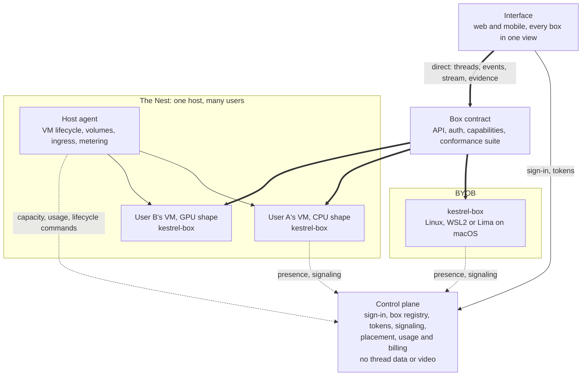
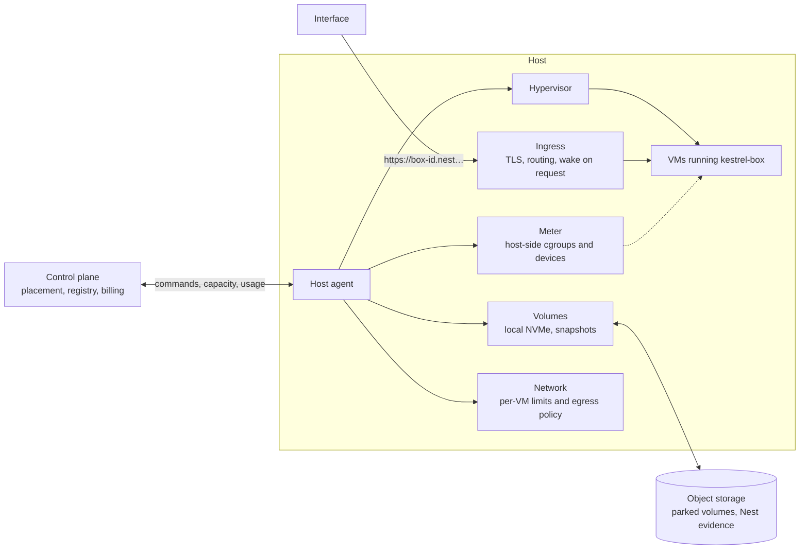
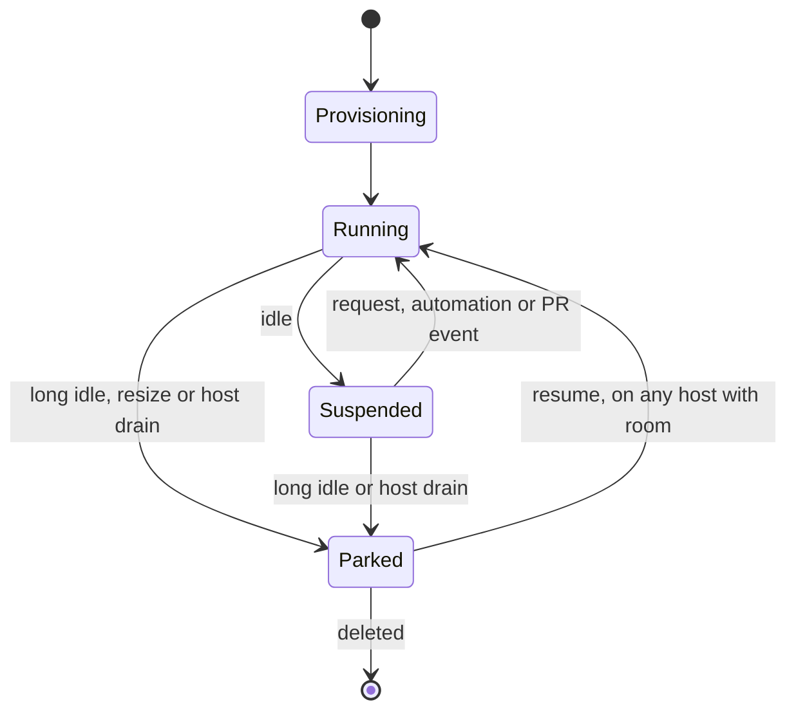

# Kestrel goal state

Status: proposal, written November 2026. Nothing here is built unless it says so. For what runs today see
[architecture.md](architecture.md) and [box.md](box.md).

## Product

Kestrel is two products:

- **The interface:** web and mobile apps for directing agents and checking their work across every box a person has.
  It is built for work you have to see: game development, 3D modelling and VFX.
- **The Nest:** Kestrel's slightly opinionated agent VMs, billed by use.

**BYOB** (bring your own box) connects a person's own machines to the interface instead of, or alongside, the Nest.

Visual work is checked in two ways, and they do different jobs:

- **Live streaming** is for staying in the loop: watching, steering and taking control while the work happens.
- **Saved evidence** is for verifying afterwards: clips and screenshots tied to the run, so nobody has to watch live and
  a desktop does not have to stay up just in case someone looks.

## Requirements

1. **BYOB costs Kestrel next to nothing.** Control-plane traffic grows with sign-ins and sessions, never with agent
   activity or video. Thread data, events, video and evidence do not pass through Kestrel for a BYOB user.
2. **BYOB and the Nest work the same way.** Both are the same box behind the same contract. The Nest is effectively
   Kestrel's first BYOB customer, plus provisioning and billing.
3. **Nest billing follows real use.** People pay for what their VM uses, and an idle VM costs them close to nothing.

## System map



## Terms

| Term | Meaning |
|---|---|
| Box | One running `kestrel-box` with one owner: a person's machine, or a Nest VM |
| Host | A physical or rented machine in the Nest that runs many VMs for different users |
| Shape | A VM's resource class, such as low-RAM CPU, standard CPU or GPU |
| Volume | A Nest user's persistent disk: threads, workspaces, repo mirrors and CLI logins |
| Evidence | A saved screenshot, clip or marked output file tied to a thread and run |

## The box contract

The contract is what the interface and control plane may assume about any box. It covers:

- The REST and WebSocket API, and offline verification of box tokens.
- Threads, runs, checkouts, diffs and files.
- MCP tools.
- The desktop stream and input.
- Evidence capture and retrieval.
- Automation and PR-watch wake-ups.

**Capabilities replace mode checks.** A box reports what it has, and the apps and agent tools adapt. Nothing branches on
"is this the Nest". The fields below are illustrative:

```ts
interface BoxCapabilities {
  readonly os: "linux" | "wsl" | "lima"
  readonly sandbox: "strict" | "basic" | "off"
  readonly desktop: boolean
  readonly gpuRendering: "hardware" | "software" | "none"
  readonly encoder: "nvenc" | "x264" | "none"
  readonly toolkits: readonly string[]
  readonly rollingEvidence: boolean
}
```

**A conformance suite enforces the contract.** It runs the same checks against a Linux box and a Nest VM, with reduced
expectations where a capability is absent. `scripts/box-ubuntu/test.ts` already starts a real agent run in Docker and is
the natural place to begin.

| Must match on every box | May differ, and is reported as a capability |
|---|---|
| API, auth and event streams | Sandbox level |
| Thread model and MCP tools | GPU and encoder |
| Stream and input protocol | Installed apps and toolkits |
| Evidence model | Rolling evidence buffer |
| Automations and PR watches | Capacity |

Gaps to close today:

- Automations and PR watches run only on Kestrel's boxes.
- The mobile app talks only to the active box, while web merges them all.
- `toolkit_install` requires a box started from the Nix flake.
- Managed boxes have a separate credential path (`/box/credentials`) because one box serves many users. Per-user VMs
  remove it: every box uses `/box/self`.

## Control plane

The control plane handles short requests only: sign-in, the box registry, box tokens, credentials, placement, usage
records and billing.

**Cost guardrails**

- No thread data, event streams, video or evidence for BYOB users.
- Every box holds at most one low-traffic dial-out socket for presence, wake-ups and WebRTC signaling. Keep-alives use
  Durable Object hibernation and auto-responses, so an idle box does not wake the Hub.
- Usage arrives in batches, every few minutes, not per sample.
- The legacy relay is deleted once its remaining users have moved.

An active BYOB user costs on the order of a few thousand control requests a month, which is well under a cent at current
Workers and Durable Objects pricing. Check the current price list before relying on the exact figure.

**Scale:** the Hub is one Durable Object for all users. That is fine now, but presence sockets for many boxes make it the
first thing to outgrow. Split per-user data into per-user objects before BYOB grows large.

## BYOB

### Reachability

Today a BYOB user needs their own HTTPS tunnel and a local proxy that blocks `/mcp` and `/broker`. Both should go:

1. **Separate the sandbox listener.** `/mcp` and `/broker` share the box's main server (`packages/server/src/main.ts`).
   Move them to a listener only sandboxes can reach, so a tunnel can point straight at the public listener.
2. **Spike WebRTC for the stream and the API.** Signaling goes through the box's dial-out socket. If a direct connection
   proves reliable, the tunnel becomes optional.
3. **Keep tunnels as the fallback.** Tailscale, Cloudflare Tunnel or the user's own domain still work, and the installer
   should automate as much of this as it can.

**Media relay rule:** free BYOB never uses a relay Kestrel pays for. At 3 Mbps, video is about 1.35 GB per viewing hour,
so a paid relay is the one thing that could break requirement 1. When a direct connection fails, the user adds a tunnel
or pays for Kestrel's relay.

### Platform tiers

Native Linux is the main target. WSL2 and macOS are supported with narrower expectations, and the box reports its limits
as capabilities.

| Platform | Live streaming and evidence | GPU rendering | Apps agents can drive | Priority |
|---|---|---|---|---|
| Native Linux | Yes, NVENC or x264 | Goal: hardware | Linux | Full support |
| WSL2 | Yes, x264 on the CPU | Software today, hardware is a later experiment | Linux only | Keep it reliable |
| macOS (Lima) | Yes, x264 on the CPU | Software only: the VM gets no 3D GPU | Linux only | Works, slowly |

Windows-only apps cannot appear on a WSL box's desktop, because the box captures its own Linux display. The apps and
product copy should say so plainly.

**Work needed**

- **Ship the desktop dependencies.** The desktop needs weston 14 or newer, but Ubuntu 24.04 ships 13. A stock Ubuntu box
  on either native Linux or WSL therefore needs a manual install today.
- **Handle WSLg.** WSLg mounts `/tmp/.X11-unix` read-only, and the documented fix is a manual root `umount` that
  `wsl --shutdown` reverts. The box should make this work without either step.
- **Fix the first start on WSL.** The first desktop start can time out while NVENC fails and falls back to x264. Skip
  NVENC there, or do not count the failed attempt against the startup timeout.
- **Fix hardware graphics on native Linux.** The sandbox exposes host drivers only at `/run/opengl-driver`, and the docs
  say that hardware GL and Vulkan are NixOS-only. Test Ubuntu with NVIDIA, then fix what fails.
- **Later, try GPU on WSL.** The sandbox does not expose `/dev/dxg` or `/usr/lib/wsl` today. Treat this as an experiment,
  since WSL boxes are expected to be rare.

## The Nest

### Per-user VMs on shared hosts

Each user gets their own VM, and one host runs VMs for many users.

- The VM is the boundary between users. Inside it, threads keep their bubblewrap sandboxes as on BYOB, using `guaranteed`
  provisioning, because one owner shares the VM.
- The box in the VM is an ordinary single-owner box, with a row in the same registry as a BYOB box. The `managed` mode and
  shared-box assignment go away.
- This replaces the shared multi-tenant cloud boxes that `byo-box.md` used to propose. Host-side secret isolation,
  per-tenant mirrors and most of that sandboxing workstream are no longer needed.

### Shapes

A shape is a VM's resource class. The names and sizes will come from measurement, but the shapes are:

| Shape | For | Desktop |
|---|---|---|
| Low-RAM CPU | Light agent work, reviews, automations | None, or a light software-rendered one |
| Standard CPU | Builds, tests and browser work | Software rendering, x264 |
| GPU | Game, 3D and VFX work | Hardware rendering, NVENC |

**GPU VMs start with a dedicated GPU through passthrough.** This is simple and isolates users fully, but it ties up a whole
GPU, so GPU time is priced accordingly. Fractional GPUs (vGPU, MIG, SR-IOV or paravirtualized graphics) are a later cost
optimization, and each needs testing with Blender and Godot before it is offered. Today's shared GPU was an MVP shortcut
and does not carry forward.

### Changing shape

The volume is separate from the VM, so changing shape means stopping the VM and starting a new one with the same volume.

- **Start with one box per user,** resized only when it is idle.
- **If a thread needs a GPU while others are running,** ask the user to wait for the box to go idle, or start a second box
  for that thread. The web app already merges threads from several boxes. Cross-box thread tools would come later.
- **Threads stay pinned to their box.** They never move automatically while running.

### Host layer

A new package (`packages/host`) runs on each host. It dials out to the control plane and handles no user secrets.



| Part | Job |
|---|---|
| Hypervisor | Runs VMs. Cloud Hypervisor is the first candidate because it supports both VFIO passthrough and snapshots. Firecracker has no GPU passthrough. |
| VM image | NixOS built from the flake, so the Nest gets `strict` sandboxing and toolkits. The Nix store can be shared read-only between VMs. |
| Volumes | Local NVMe while a VM runs, with snapshots in object storage so that a parked user can resume on another host. |
| Ingress | Routes each box's HTTPS URL to its VM and starts the wake flow when a request reaches a suspended one. |
| Meter | Measures from the host, because the guest belongs to the user and cannot be trusted for billing. |
| Network | Limits per-VM bandwidth, and applies egress policy and abuse controls. |

**VM lifecycle**



- **Running:** the VM holds its CPU, memory and any GPU.
- **Suspended:** the VM's memory is saved to the local disk, and it resumes quickly on the same host. Open apps survive on
  CPU shapes.
- **Parked:** the volume is in object storage and only disk is held. It starts as a fresh boot, so open apps are gone but
  everything on disk stays.

GPU state generally cannot be snapshotted through passthrough, so assume GPU VMs skip Suspended until tested. They stop the
desktop, save what can be saved and park, which makes evidence matter more on that shape.

**When a VM is idle:** it has no agent run, no viewer, no recording and no recent input. The box's activity socket
(`packages/server/src/activity.ts`) already reports runs and desktops, which is a good starting point. A guest that lies
about being busy only pays for its own time, so this signal can come from the guest.

**Waking:** the interface, automations and PR watches can all wake a VM. A request that reaches ingress for a suspended VM
triggers a resume, and the apps show that state. The Hub wakes a VM through its host agent before dispatching an
automation.

### Load balancing

The control plane places VMs. Its inputs are capacity reports from host agents.

- **Place at start and resume,** which are natural moments that interrupt nothing. Most balancing happens this way.
- **Pack by CPU, memory and GPU.** CPU can overcommit, memory only cautiously with ballooning, and GPUs not at all.
- **Move only idle VMs.** A VM parks and resumes elsewhere. Live migration is out of scope, and passthrough GPUs generally
  cannot do it.
- **Drain hosts for maintenance** by parking idle VMs and placing nothing new there.
- **Keep a spare margin on every host,** so that a resume on the same host rarely has to wait.

### Billing

The goal is simple: **charge for what a VM actually uses, and let an idle VM cost almost nothing.**

| VM state | Charged for |
|---|---|
| Running | CPU time used, memory held, GPU attached, disk, network egress |
| Suspended | Disk, including the saved memory image |
| Parked | Disk |
| Deleted | Nothing |

How the meters work:

- **CPU:** core-seconds from the VM's host cgroup.
- **Memory:** GB-hours held. Ballooning or `virtio-mem` hands unused memory back, so that the bill follows real use. This
  needs testing with real workloads, and a small minimum may be necessary.
- **GPU:** seconds attached, not seconds busy, because an attached GPU is unavailable to anyone else. The way to pay less is
  to detach sooner, and stopping idle desktops does that.
- **Disk and egress:** GB-months and GB.

Rates must cover the unused capacity on a host. The margin comes from good packing and overcommit, not from charging for
idle VMs.

**Protections against overcharging**

- Idle VMs suspend automatically. The default should favour saving the user's money.
- Each user has a spending cap. Reaching it stops new work and suspends the VM, and never deletes anything.
- The apps show a running total per box and an estimate per thread. Only the VM-level meter is authoritative.
- Usage records are idempotent, so a retry cannot double-charge.
- The meter runs without charging first, so that rates and bills can be checked before billing goes live.

This replaces the "agent hours" in `PLANS` (`packages/protocol/src/index.ts`). Those charge the same for an idle hour and a
busy one, and billing is not live yet, so nobody has to migrate. Subscriptions can stay as a monthly credit against metered
usage. Model usage stays on the user's own key or subscription.

## Streaming

Today's stream is fMP4 over WebSocket, either through the Hub or direct to the box. The damage-driven capture sends almost
nothing while the desktop is still, and the encoder stops shortly after the last viewer leaves.

- **Goal:** WebRTC directly from box to viewer, for lower latency and better behaviour on poor networks. WebSocket stays as
  the fallback, so a tunnel-only box still streams.
- **Relay:** the legacy Hub path goes away with the relay.
- **Every platform streams.** WSL and Lima boxes use x264 on the CPU, so their limit is frame rate and resolution, which the
  apps should set from the encoder capability.

## Saved evidence

Evidence is a first-class output of a run, shown in the thread and attached to its PR.

| Kind | Example | Status |
|---|---|---|
| Screenshot | Agent's desktop screenshot in the transcript | Built (#154), kept as a tool-call image |
| Video clip | An animation, physics glitch or frame-rate drop | Not built |
| Output file | Rendered frames, a `.blend` or a game build | Downloadable from Files, not marked as a result |
| Run summary | Before/after shots and clips with captions | Not built |

### Capture

Clips reuse the desktop's H.264 stream, recorded on the box outside the sandbox. There are two ways to capture:

- **Explicit recording:** the agent or user starts and stops a recording. Every box supports this.
- **Rolling buffer:** the box keeps the last few minutes, and the agent or user saves "the last 20 seconds". This catches
  things nobody expected. It runs only where the `rollingEvidence` capability is set, which is the default with a hardware
  encoder.

The encoder currently stops when nobody is watching. So a recorder has to count as an encoder subscriber, and a rolling
buffer keeps an encoder running while a run uses the desktop. That costs little while the screen is still, but x264 under
continuous motion uses real CPU. Measure this before turning it on by default. At 3 Mbps, continuous motion is about
22 MB per minute. A viewer changing the stream quality also restarts the encoder today, so a recording must survive that
or use its own fixed-quality encoder.

Illustrative tools: `evidence_record_start`, `evidence_record_stop`, `evidence_clip` and `evidence_mark` (for an output
file). Each takes a caption.

### What evidence can prove

Capture happens on the host side, so an agent cannot alter a clip once it is recorded. The agent still controls what is on
screen and which moments it saves, so a clip supports its claim without proving it. Source (`agent`, `user` or `auto`) is
recorded on each item, and the rolling buffer lets a reviewer look beyond what the agent chose.

### Storage and sharing

| Where | Stored | Viewing |
|---|---|---|
| BYOB | On the box, counted against the task's storage limit | Only while the box is online, at no cost to Kestrel |
| Nest | On the volume, and copied to object storage | Without waking the VM, billed as storage |
| PR | Through the user's GitHub account | Follows the repository's access |

GitHub may only render video for files uploaded through its own web attachment flow, not arbitrary URLs. Confirm this first.
If it holds, a PR gets a poster image or short animated preview that links to the full clip.

### Keeping desktops idle less

With evidence available, a desktop no longer has to stay up in case someone wants to look later. Once a run ends with nobody
watching or recording, the desktop should stop after a short timeout. Its evidence stays, and on the Nest this ends GPU
charges and frees the GPU for someone else.

## Security

- The VM is the boundary between Nest users, and bubblewrap remains the boundary between an agent and its box.
- Agents never hold real credentials on either kind of box: the broker and host-side GitHub tools stay.
- The host agent holds no user secrets. Credentials reach a box from the control plane using that box's own secret.
- The Nest needs per-VM bandwidth limits, abuse detection (mining and spam) and volume encryption, with volumes wiped when
  released.
- Hosts are trusted by users' VMs. Encrypted volumes limit exposure on disk, but this does not protect against a
  compromised host.

## Build order

Each step is useful by itself, and the Nest work comes after the BYOB and evidence work it reuses.

1. **Contract:** define capabilities, report them from the box, and build the conformance suite.
2. **BYOB reach:** split the sandbox listener and run the WebRTC spike.
3. **Relay:** finish the cutover and delete it.
4. **Platform tiers:** ship desktop dependencies, fix WSL setup, and get hardware graphics working on Ubuntu.
5. **Evidence:** explicit recording, clips and run summaries first, then the rolling buffer and desktop idle stop.
6. **Parity:** automations and PR watches on BYOB through the dial-out socket, and multi-box support on mobile.
7. **Host layer:** one host and one CPU shape, with suspend and resume, running the meter without charging.
8. **Shapes:** low-RAM and GPU shapes, volumes in object storage, and parking.
9. **Scheduler:** multiple hosts, placement at resume, and draining.
10. **Billing:** rate setting from the metered data, spending caps, then charging.

A short GPU test belongs alongside step 1, since its result affects what GPU shapes can cost: passthrough, suspend behaviour
and one fractional GPU option, on one host.

## Protocol impact

Each step needs a heads-up in its PR, because every package depends on `packages/protocol`. Expected additions:
capabilities, evidence types and paths, signaling and presence frames, host commands and capacity reports, VM states on box
records, and usage records. `PLANS` changes when billing arrives.

## Open questions

- **Resume times:** what suspend and resume cost in practice decides how aggressive the idle timeout can be.
- **Memory billing:** whether ballooning returns enough memory to bill close to real use.
- **Fractional GPUs:** which option works with our apps, and whether it is worth its licensing and setup.
- **WebRTC reach:** how often a direct connection fails, and whether the API can reliably use it as well as the stream.
- **Evidence in PRs:** what GitHub actually renders, and how long Nest evidence is retained.
- **Free tier:** whether the Nest has one, given that a free VM has a real cost even when suspended.
- **Teams:** whether a team shares boxes or each seat gets its own. Boxes are single-owner in this design.
- **Current managed boxes:** when they migrate to VMs. They keep running until the host layer can replace them.
