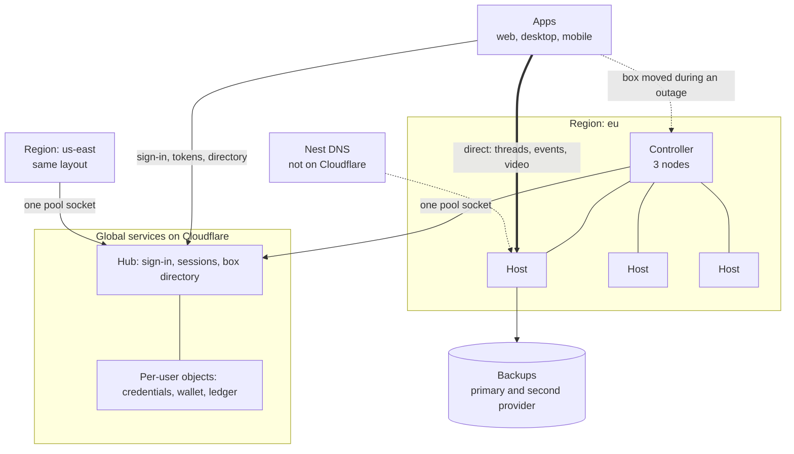
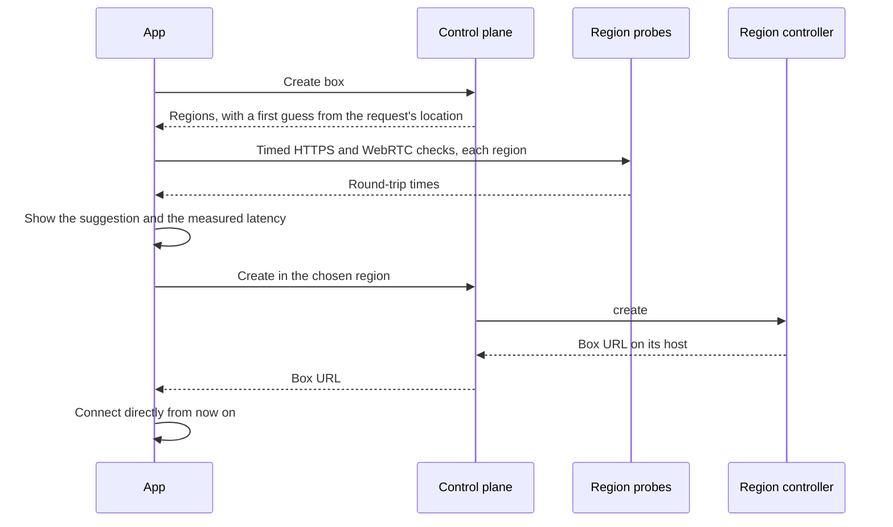
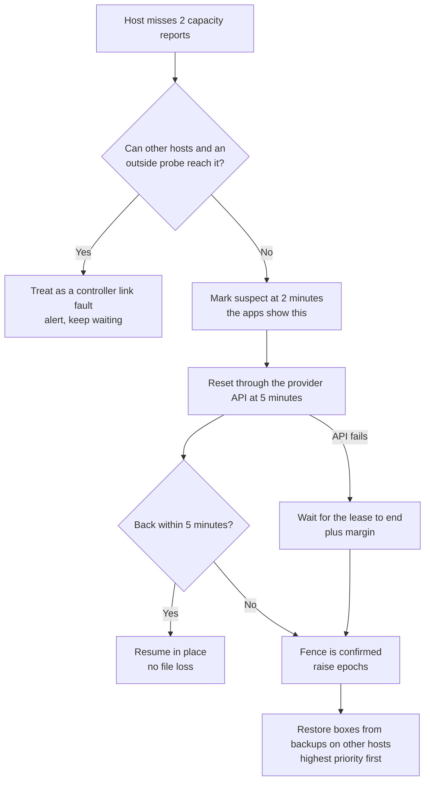

# The Nest in production

Status: proposal, written November 2026. It describes what the Nest should be when it takes paying users. Nothing here
is built unless it says so. The product goals are in [goal-state.md](goal-state.md), and the host layer as it exists
today is in [nest.md](nest.md).

Prices were checked in November 2026 and exclude tax. Memory prices are moving quickly, so check them again before you
order anything. Every capacity and cost figure below is an estimate from the stated assumptions, not a measurement.

## Decisions

| Question | Decision |
|---|---|
| Who uses this compute? | Only Kestrel's agents. There is no marketplace and no public compute API. |
| What is a Nest region? | A pool, in the sense of [goal-state.md](goal-state.md#pools), with its own controller. BYOB clusters use the same contract. |
| Where do we buy machines? | Rented bare metal from at least two providers. Hetzner for the EU, OVHcloud for US East, Latitude.sh for hourly burst. |
| Where do we launch? | EU and US East. Three CPU hosts in each, and one GPU host in the EU. |
| What schedules VMs? | A controller in each region, running outside Cloudflare. It owns host sockets, leases and placement. |
| What does Cloudflare still do? | Sign-in, the box directory, credentials, billing and automations. No running box depends on it minute to minute. |
| How do people reach a nearby cluster? | The app measures latency and suggests a home region. The box then lives there, and the app connects directly to its host. |
| How do we balance load? | Mostly by placing well at create and resume. Running VMs move only to drain or recover a host. |
| What is the worst case we design for? | A six-hour total Cloudflare outage, with no running work lost. |

## Architecture



Three rules hold the design together:

- **User work never passes through the control plane.** The app talks directly to the box.
- **A region runs by itself.** Losing the link to Cloudflare stops new sign-ins and new boxes in that region, but it does
  not stop running boxes.
- **Hosts are disposable, and so are running VMs' memory images.** Volumes are what we protect.

| Term | Meaning |
|---|---|
| Region | A group of hosts close enough for one low-latency experience, run as one pool |
| Controller | The region's scheduler: three small nodes that keep host leases, placement and box state |
| Pool socket | The one outbound WebSocket from a controller to Kestrel's control plane |
| Lease | Permission a controller gives a host to keep running VMs until a stated time |
| Fence | Stopping a host's VMs so that a box can safely start somewhere else |
| Cordon | Marking a host so that nothing new is placed on it |
| Failure domain | Things that can fail together: a host, a data center, a provider or a region |

## Where we buy machines

### Provider requirements

A provider qualifies only if a real server passes all of these. The acceptance test is a script run on one rented
server before any larger order.

| Requirement | Why |
|---|---|
| Bare metal with KVM | Cloud Hypervisor needs direct virtualization |
| IOMMU and VFIO on GPU models | GPUs are hot-plugged through passthrough. This is untested on every model below. |
| API for reset or power control | Failover is much faster when we can fence a dead host ourselves |
| Rescue boot, so that NixOS can be installed | The host module is NixOS |
| Routed IPv6 | Gives each VM a direct WebRTC address |
| Mirrored NVMe and a usable NIC | Volumes and memory images are local |
| Unmetered or high-allowance egress | Egress must not be able to surprise us |
| Terms that allow reselling VMs to agents | **Not yet confirmed with any provider.** Read each contract and ask in writing. |

### Current options

Hetzner, in euros, from its [AX](https://www.hetzner.com/dedicated-rootserver/matrix-ax/) and
[GPU](https://www.hetzner.com/dedicated-rootserver/matrix-gpu/) price lists. Traffic is listed as unlimited, except on
the 10G uplink add-on, which charges beyond 20 TB.

| Model | CPU | RAM | Monthly | Setup | Use |
|---|---|---|---|---|---|
| AX102 | 16-core Ryzen 9 7950X3D | 128 GB | €159 | €129 | Small regions and desktop-heavy hosts |
| AX162 | 48-core EPYC 9454P | 128 GB, up to 512 GB | from €319, up to €614 | €304 | **Default EU CPU host** |
| GEX45 | RTX PRO 4000, 24 GB VRAM | 64 GB | €214 | €209 | **First GPU host** |
| GEX63 | RTX PRO 6000, 96 GB VRAM | 128 GB | €999 | €999 | Heavy rendering |
| GEX131 | RTX PRO 6000, 96 GB VRAM | from 256 GB | from €1,499 | €1,499 | Heavy rendering with many VMs |

OVHcloud US, from its [price list](https://us.ovhcloud.com/bare-metal/prices/) and
[Scale page](https://us.ovhcloud.com/bare-metal/scale/). Its pages list US data centers in Vint Hill, Virginia and
Hillsboro, Oregon. Check which models each one stocks. They also say traffic is unmetered by default.

| Model | CPU | RAM | Monthly | Setup | Use |
|---|---|---|---|---|---|
| Advance-5 | 24-core EPYC 8224P | from 96 GB | $504 | $504 | **Default US CPU host** |
| Advance-4 (2026) | 16-core EPYC 4585PX | from 64 GB | $383 | $383 | Only with a RAM upgrade |
| Scale-a2 | 24-core EPYC 9254 | 128 GB | $740 | Free | Compare once drives are priced: it lists no storage drive |

Latitude.sh, from its [pricing page](https://www.latitude.sh/pricing). Each plan includes 20 TB of outbound traffic. Its
overage rate isn't on that page, so get it before relying on this. Its region names aren't there either.

| Plan | CPU | RAM | Hourly | Monthly | Use |
|---|---|---|---|---|---|
| m4.metal.medium | 16-core EPYC 9124 | 128 GB | $0.62 | $456 | **Burst capacity** and a second US provider |
| c4.metal.large | 96-core EPYC 9655P | 384 GB | $4.00 | $2,920 | Large hosts, if the workload is CPU-heavy |

### Buying strategy

- **Memory is the scarce resource.** OVHcloud says [DDR5 costs six times what it did a year ago](https://blog.ovhcloud.com/en/posts/dedicated-servers-pricing-update-h2-2026/).
  Size hosts by memory, and treat large RAM upgrades as expensive until proven otherwise.
- **Prices can change under us.** Hetzner [keeps current prices on running servers](https://www.hetzner.com/pressroom/standardization-and-price-adjustment-of-our-server-products/),
  though not after a rescale, so an early order is partly a hedge. OVHcloud [reprices at renewal but offers prepaid terms](https://blog.ovhcloud.com/en/posts/dedicated-servers-pricing-update-h2-2026/)
  that lock a rate. Keep a price-review step in every capacity order.
- **Base load is monthly, spikes are hourly.** Monthly hosts cover the expected daily peak. Hourly hosts cover surprises,
  and every provider sits behind one adapter (`provision`, `install`, `reset`, `destroy`, `status`).
- **Never depend on one provider inside a region's recovery plan.** A provider can suspend an account after an abuse
  report. Backups and controllers therefore live with a different company from the hosts they protect.
- **Do not buy hardware yet.** Reconsider owned machines in colocation at about 100 stable hosts, using prices at that
  time. Until then, renting is what keeps our capacity flexible.

## What it costs

### Assumptions

These are what the model is most sensitive to. Replace them with metered data as soon as the shadow meter runs.

| Assumption | Value |
|---|---|
| Exchange rate | $1.15 per € (assumed) |
| Sellable memory per host | 115 GiB of 128 GB, 85 GiB of 96 GB |
| Average memory per running VM | 3 GiB |
| Spare hosts | 1 per region at launch, 2 at growth, 3 at scale |
| Running time for an active user | 60 hours a month |
| Average CPU while running | 0.3 cores |
| Disk per user | 20 GB |
| Peak share | 15% of active users running at the daily peak |

CPU is not the limit on these hosts: at 3 GiB per VM, the memory runs out first even with moderate CPU overcommit.

### Cost of memory

| Host | Cost per sellable GiB-hour when full | At 50% used | At 35% used |
|---|---|---|---|
| Hetzner AX162 (EU) | $0.0044 | $0.0087 | $0.0125 |
| OVH Advance-5 (US East) | $0.0081 | $0.0162 | $0.0232 |
| Latitude m4.metal.medium, hourly | $0.0054 | Released when idle | Released when idle |

**US capacity costs nearly twice what EU capacity does.** For comparison, [E2B lists](https://docs.e2b.dev/faq/calculate-sandbox-price.md)
$0.0162 per GiB-hour and $0.0504 per vCPU-hour. So a US host at 50% use only just covers its memory at that rate. Either
US prices are higher than EU prices, or we find cheaper US hosts. Compare Latitude's monthly plan and Scale-a2 first.

### Monthly cost by stage

| Item | Launch | Growth | Scale |
|---|---|---|---|
| EU CPU hosts | 3: $1,101 | 10: $3,670 | 50: $18,350 |
| US East CPU hosts | 3: $1,512 | 10: $5,040 | 50: $25,200 |
| GPU hosts, at the GEX45 price | 1: $246 | 4: $984 | 20: $4,920 |
| Controllers | $322 | $322 | $1,000 |
| Backups, stored twice | 5 TB: $150 | 50 TB: $1,500 | 300 TB: $9,000 |
| DNS, monitoring, status, other tools | $300 | $1,000 | $5,000 |
| **Total per month** | **about $3,630** | **about $12,500** | **about $64,500** |
| Memory available after spares | 400 GiB | 1,600 GiB | 9,400 GiB |
| VMs running at peak | about 133 | about 533 | about 3,130 |
| Active users supported | about 890 | about 3,550 | about 20,900 |
| **Infrastructure cost per active user** | **about $4.10** | **about $3.50** | **about $3.10** |

Notes:

- One-time setup at launch is about $2,800: three AX162s and a GEX45 at €1,121, and three Advance-5s at $1,512.
- Controllers are priced as three [Hetzner Cloud CCX13](https://bex.co/blog/2026/08/18/hetzner-dram-hbm-price-hikes-own-hardware-thesis)
  VMs per region, at €42.99 in Europe and €50.49 in the US, from a third-party report. That works for US East, whose hosts
  are on OVHcloud. EU controllers must not be on Hetzner, because EU hosts are, so that price is a placeholder for another
  provider.
- Backups use [R2's $0.015 per GB-month](https://developers.cloudflare.com/r2/pricing/). The model assumes the second
  copy costs the same, which needs a real quote.
- US GPU hosts aren't priced. The model uses the EU GEX45 price for every GPU host, which probably understates them.
- This leaves out staff, support, payment fees and bad debt.

### Proposed rates

These are starting points for shadow billing, not a price list.

| Meter | Proposed rate | Note |
|---|---|---|
| CPU | $0.05 per core-hour **used** | Other sandboxes commonly charge for wall-clock time, so this is lower for agents |
| Memory | $0.016 per GiB-hour held | Near E2B's list price |
| Local disk | $0.10 per GB-month | Running and suspended boxes |
| Parked disk | $0.04 per GB-month | Covers two backup copies plus operations |
| GPU | $1.20 per hour attached, RTX PRO 4000 class | The GEX45 costs about $0.96 an hour at 35% use |
| Egress | First 100 GB a month included, then $0.05 per GB | Mostly an abuse limit |

At these rates, the assumed user generates about $5.80 a month: $3.80 of compute and $2.00 of disk. That leaves about
$1.70 at launch before staff and fees, and the result depends heavily on peak share:

| Peak share | Users supported at launch | Cost per user | Margin at $5.80 |
|---|---|---|---|
| 10% | about 1,330 | about $2.70 | about $3.10 |
| 15% | about 890 | about $4.10 | about $1.70 |
| 21% | about 630 | about $5.80 | Break-even |
| 25% | about 530 | about $6.80 | **About -$1.00** |

**Agents running overnight help, and agents all starting at 9 a.m. hurt.** Peak share is the first number to measure,
along with memory per running VM.

### Hard limits on spend

- Every capacity order needs a named person's approval. Automation may add hourly burst hosts only up to a daily ceiling.
- Payment is prepaid credit with optional top-up. A new account can't accumulate a bill it never pays.

## Connecting people to a nearby cluster

### Choosing a home region

A box holds state on local disk, so anycast and geographic DNS can't send a user to whichever host is closest. Each box
has a **home region** instead.



1. **First guess:** the Worker offers the region nearest to the request's location.
2. **Measure:** the app times requests to `probe.<region>.<nest domain>`, which each region serves from at least two hosts.
   It also does a WebRTC connectivity check, since video is what the latency affects.
3. **Choose:** the app suggests the lowest-latency region that has capacity. The user can override it, and an account or
   repository policy can restrict it for data-residency reasons.
4. **Connect:** the box URL remains `https://<boxId>.<host slug>.<nest domain>`. It resolves straight to the host, with no
   proxy or load balancer between them.

Initial latency targets, to be tuned against real desktop sessions:

| Round-trip time | Treatment |
|---|---|
| Under 50 ms | Good for everything |
| 50 to 100 ms | Good for agents, and usable for live desktop control |
| 100 to 150 ms | The app warns before GPU and desktop-heavy use |
| Over 150 ms | The app recommends another region, or adding one |

### Moving a box

- **Never automatic.** A traveller's box stays where it is until they choose to move it.
- **Prompted by data.** If a user's measured latency stays above target for several sessions, the app offers a move.
- **Done as park and restore.** The box's data is restored in the new region before the switch, because lazy restore
  over a long distance would make it slow right after it moves.
- **Workers stay close.** A worker VM goes to its parent's region, then to other regions only if policy allows.

### Video paths

The existing rule stands: Kestrel relays no media for free BYOB. In the Nest, try these in order:

1. Direct UDP to the VM's public IPv6 address.
2. Direct UDP to the host's coturn relay, on a public IPv4 address.
3. TURN over TCP or TLS on that same host, for restrictive networks.

The coturn relay runs on the VM's own host, so a relayed stream adds no extra hop or central relay. Restrictive networks
often allow only port 443, which Caddy already holds on each host. Reaching TURN there needs either a second IP address or
routing by TLS server name, and the current module doesn't do either yet.

### Adding a region

Add one when at least 15% of a region's sessions are above the 100 ms target, and those users would be under target from
the new region. Expect US West next, on OVHcloud Hillsboro, and Asia after that. Check traffic limits first: OVHcloud
says its Asia-Pacific data centers have a monthly traffic cap.

A new region needs at least three CPU hosts and its own controller, backup bucket and DNS.

## Load balancing

Traffic isn't what needs balancing here. Each box belongs to one host, so **placement** is the load balancer.

| Level | Decision | Made by | When |
|---|---|---|---|
| Pool | The user's own hardware, or the Nest | Control plane, under user policy | Thread start |
| Region | Which region | The user's home region, or a choice they make | Box creation, or an explicit move |
| Host | Which host | Region controller | Create, and resume from parked |
| Inside a host | How big the VM is now | Host agent ([resource policy](nest.md#resource-policy-host-agent)) | Continuously |

### Placement

Today's placement picks the host with the [most free memory](../packages/control/src/nest-control.ts) and considers
nothing else. Production placement filters first, then scores.

**Filters.** A host must:

- Be connected, leased and not cordoned.
- Have the box's guest image available.
- Have memory for the box's expected size, not just its boot size.
- Have disk for that memory image plus the box's volume.
- Have a free GPU, if the box needs one at start. A box that may want one later should prefer a GPU host.
- Be under the CPU limit: start at 4 vCPUs per thread, and adjust it from `cpu.pressure`.

**Expected size** is a box's recent 95th-percentile memory, or a default for its shape while it has no history. Booking only
1.5 GiB for a VM that may grow to 8 GiB, which is what happens today, is how a host ends up suspending other users' work.

**Score.** Prefer, in order:

1. The host that already has the box's local volume, since it resumes without a restore.
2. The fullest host that still fits, so that other hosts can empty and be released.
3. A host that doesn't already hold the user's other boxes, so that a single failure doesn't take all of them.

### Headroom

| Reservation | Size | Why |
|---|---|---|
| Spare hosts | 1 per region at launch | Survive one host failing without a capacity crisis |
| Per-host resume margin | 15% of memory | A suspended VM can usually resume on its own host |
| Suspend disk reserve | All plugged memory | Already designed: every running VM can be suspended |

When a host can't resume its suspended VM within 30 seconds, the box starts on another host from its backup. The user
loses open apps but keeps their files. Backing up at suspend, described under [Backups](#backups), makes this safe.

### Admission and storms

Most outages end with everyone returning at once, so admission control is part of balancing:

- **One queue per region,** indexed and FIFO, with GPU requests in their own queue. Today, [every capacity report retries every waiting box](../packages/control/src/nest-fleet.ts), and each retry looks at every host.
- **Retry only when capacity is freed,** and not on every report.
- **A concurrency limit per host** for lazy restores and memory-image restores.
- **Randomized delay** on reconnects, meter shipments and backup catch-up.
- **Clear answers.** A user waiting for capacity sees their state and an estimate. An automation waits in the queue with a
  deadline. Neither fails silently.

### Moving running work

| Situation | What happens |
|---|---|
| Idle box | Parks and resumes elsewhere |
| Active box on a host being drained | Cordon, then wait for idle. After the deadline, warn the user and suspend or park |
| Security fix that can't wait | Same, with a short deadline and a clear notice |
| Host under memory pressure | The [existing policy](nest.md#resource-policy-host-agent) suspends the least recently active VMs |

Live migration stays out of the launch. Evaluate it for CPU VMs once drains are common, since it would spare active users
from those interruptions. GPU VMs generally cannot live-migrate.

### Capacity planning

- Order monthly hosts when the projected peak for the next two weeks exceeds 70% of memory, after spares.
- Add hourly hosts automatically when the queue wait exceeds 60 seconds, up to the daily ceiling.
- Release a host when the region would stay under 50% without it for seven days. Cordon it and let it empty naturally.
- Track provider lead times and any stock limits. Memory shortages may make machines hard to get quickly.

## Regional controller

Each region has a controller that is the [pool](goal-state.md#pools) from Kestrel's point of view. The same program runs
a BYOB cluster, so that the Nest stays Kestrel's first BYOB customer.

**Today** this logic runs in the Hub as `NestFleet`, which already takes its database and socket link as inputs.

- **Extract it into a library.** It also reads and writes `user_boxes` and reads `meter_hosts` directly, and those need to
  go behind an interface first.
- **Keep it synchronous on the leader.** `FleetSql` is synchronous, and placement relies on that to record a decision in
  one step. A networked SQL client would change that. The spike should test embedded Raft over local SQLite, and a
  decision may be sent to a host only after a quorum has committed it.
- **Three small nodes.** At launch, each region's controllers run on a different provider from its hosts. Nodes in
  different data centers are better where latency allows.
- **Socket fan-in.** Hosts connect only to their controller. The controller holds one pool socket to Kestrel.

If the controller work isn't ready by launch, an interim setup is possible: keep `NestFleet` in the Hub, with the long
leases and soft fence below. The region then can't place boxes during a Cloudflare outage, but running VMs survive one
of up to about 30 minutes.

### What the controller owns

| Owned by the controller | Owned by the global control plane |
|---|---|
| Hosts, leases, epochs, placement, drain | Accounts, sessions, box tokens |
| Box state and current URL | Box directory, updated from the controller |
| Region queue | Pool selection and policy |
| Spending allowance while disconnected | Wallet and ledger |

## Surviving outages

### Service targets

Proposed targets for a paid launch, measured per region. Check them against real data before publishing any as an SLA.

| Target | Goal |
|---|---|
| Running box available | 99.9% of minutes per month, excluding the user's own actions |
| Suspended box resumes | 95% within 5 seconds |
| Parked box resumes | 95% within 60 seconds |
| Recovery after a host dies | Box running elsewhere within 10 minutes, when capacity allows |
| Data loss when a host dies | None for suspended or parked boxes, at most 15 minutes for running ones |
| Thread data lost in a Cloudflare outage | None |

### When Cloudflare goes down

Two major Cloudflare outages in late 2025 lasted [25 minutes](https://blog.cloudflare.com/5-december-2025-outage/) and
[almost six hours](https://blog.cloudflare.com/18-november-2025-outage/). So the design target is six hours of total loss,
covering Workers, Durable Objects, R2 and Cloudflare DNS together. That is deliberately harsher than either incident.

**Today, a Hub outage of more than five minutes kills every VM on every host.** Leases come only from the Hub, and the
[watchdog](../packages/host/src/fence.ts) sends SIGKILL when one lapses. Fixing this is the first thing on the build list.

| Depends on Cloudflare today | Production design |
|---|---|
| Host leases from the Hub | Leases from the regional controller |
| Box tokens, valid for one hour | The box issues a refresh credential, and the app refreshes against the box itself |
| Web app served from Workers | Second static host on a domain outside Cloudflare. Desktop and native mobile already bundle the app |
| Box list in the Hub | The apps cache it, and a regional directory gives current URLs |
| Credentials from `/box/self` | Already cached on the box, fetched again only when they change |
| Backups only in R2 | Copied to a second provider |
| Nest DNS, if hosted on Cloudflare | Hosted elsewhere, with a second provider. Host names don't use Cloudflare's proxy |
| Certificates through DNS-01 | Use the non-Cloudflare DNS provider. Renew well before expiry, so that an outage never matters |
| Usage records to the Hub | Already held in an outbox on the host. Add a size alarm, and retries with random delay |
| Spending caps in the Hub | Each user's controller holds a pre-approved allowance |
| Automations and webhooks | Replay missed work on recovery |

**What a user sees during an outage:**

| Action | Works? |
|---|---|
| Keep watching and steering a running box | Yes |
| Agents keep running | Yes, unless the model provider or GitHub is also down |
| Wake a suspended box | Yes, once the app has a valid box credential |
| Reopen the app | Yes on desktop and native mobile, and on web through the fallback address |
| Resume a parked box | Yes when a backup copy is reachable |
| Sign in on a new device | **No** |
| Create a box or change billing | **No** |
| Scheduled automations and PR wake-ups | **Delayed,** replayed afterwards |

**Box-issued refresh.** Box tokens are short-lived, so a long outage would otherwise lock everyone out after an hour.

1. When the app gets a box token, it also asks the box for a refresh credential, which the box signs with its own secret.
2. The credential lasts 24 hours and works only on that box, for that user, for minting box tokens.
3. The box refuses a refresh when it can reach the control plane and learns that the session has been revoked.

The tradeoff: during an outage, a revocation can't reach the box. A signed-out or stolen session could therefore keep
access to that box for up to 24 hours. The credential must go through a security review before it ships.

**Recovery.** When Cloudflare returns:

1. Controllers reconnect with random delay and send what changed: box states, URLs and new epochs.
2. Hosts ship their held meter records. Records are idempotent, so retries are safe.
3. The Hub replays automations it missed under each automation's policy: run once, or skip.
4. The Hub asks GitHub for failed webhook deliveries and processes them. Confirm how far back GitHub keeps them.
5. Any box state that the two sides disagree on is resolved in the controller's favour, since it was the one making decisions.

Keep a nightly encrypted export of Hub data outside Cloudflare, so that a permanent loss is survivable.

### When a host goes offline

Today, nothing moves a box off a dead host. [`NEST_FENCE_MARGIN_MS`](../packages/protocol/src/nest.ts) is defined but never
used, so these boxes wait for the host to return, however long that takes.



**Fencing has two paths.** A provider reset is fast, but only if a rebooted host starts no VM until its controller tells
it to. Today a valid `lease.json` survives a reboot, and a host may wake a suspended box on its own while it holds a valid
lease, so the agent must discard its lease at boot. Waiting out the lease is slow, but it works even if the provider's API
or network is down.

**Keep the old copy.** When a host returns after its boxes have moved, today's `evict` deletes the local volume. In
production, move it to quarantine for seven days first. It may hold up to 15 minutes of work that never reached a backup,
and support can recover that for a user who asks.

**Tell the user.** A box restored from an earlier backup says so in the app, and gives the time of that backup. Runs that
were interrupted are marked failed, as they are after any box restart today. Local commits that weren't pushed may be
lost, which is one more reason for frequent backups.

**Offer a choice.** During the wait for a reset, the app can offer "restore now from a backup from 09:42", so that a user
under time pressure can accept the loss and carry on.

### Leases and soft fencing

| Setting | Today | Production |
|---|---|---|
| Who issues leases | Hub | Regional controller |
| Lease length | 5 minutes | 30 minutes |
| Renewal | Every 60 seconds | Same |
| Before expiry | Nothing | **Soft fence with 10 minutes left** |
| At expiry | SIGKILL every VM | Same, for whatever is still running |

**Soft fencing** uses operations that already exist. With 10 minutes left and no renewal, the host detaches GPUs and
suspends VMs, a limited number at a time. Those VMs lose nothing, since their memory images are on disk, and they resume
once a lease returns. SIGKILL remains as the final safety measure, for when the agent itself is stuck.

So a controller that's down for an hour costs users a pause, instead of their running processes.

### Failure table

| Failure | How we notice | What happens | User impact |
|---|---|---|---|
| VM crashes | Host agent | Restart from the local volume | Run fails, files stay |
| Host agent crashes | systemd, and its socket drops | Restart, re-adopt live VMs | None |
| Host dies | See above | Reset, restore elsewhere | Up to 10 minutes, up to 15 minutes of writes |
| One NVMe fails | Disk alerts | Mirror keeps serving. Cordon, drain, replace | None, or a planned move |
| Both NVMes fail | Host agent, I/O errors | Treat as a dead host | As for host death |
| Host loses network | Peers and outside probes | Host soft fences itself, control plane resets it, boxes move | As for host death |
| Host disk full | Capacity reports | Park rather than suspend, evict caches, stop placing | Possibly a slower resume |
| One controller node dies | Quorum health | The other two carry on | None |
| Controller loses quorum | Lease renewal stops | Soft fence after 20 minutes, and an urgent page | Pause after 20 minutes, no file loss |
| Cloudflare down | Outside probes | See above | New sign-ins and new boxes stop |
| R2 down | Backup errors | Backups continue to the second store. Restores use it | Possibly slower |
| Nest DNS provider down | Outside probes | The second DNS provider answers | None |
| Certificate renewal fails | Expiry alarm, 30 days out | Retry, then fall back to a second certificate authority | None |
| A whole data center is lost | Multiple hosts lost together | Restore into the region's other locations, if any. Otherwise into another region, with the user's approval | Up to a few hours for that region |
| Provider suspends the account | Provider notice, mass host loss | Restore elsewhere from the second-provider backups | Up to a few hours for that provider's users |
| A bad release | Canary health | Automatic halt and rollback | One canary host at worst |
| Queue backlog | Wait-time alert | Add hourly hosts, then show users their place | Slower resumes |
| GitHub or a model provider down | Tool failures | Out of our control. The app says what's failing | Agents stall |

### Practice

An outage plan that hasn't been run doesn't count.

- **Every week:** an automated restore of a sample of backups into a throwaway VM. A backup that fails to restore pages someone.
- **Every month:** kill a production host on purpose, during working hours.
- **Every quarter:** cut one region from Cloudflare for an hour, using firewall rules. Fail over DNS. Run a restore from
  only the second-provider backups.
- **Before launch:** every failure in the table above has been caused at least once, and has a written runbook.

## Backups

`kestrel-volume` already does encrypted, incremental, chunked backups. Production adds to it:

| Change | Why |
|---|---|
| Back up at suspend, shortly after the VM stops | Makes a suspended box able to move, and limits its loss to nothing |
| Back up running VMs every 15 minutes, not every hour | A smaller maximum loss. Backups are incremental, so this should cost little. Measure it. |
| Second copy with a different provider, within 15 minutes | Survives Cloudflare, or a provider suspending our account. Needs a second store in the tool |
| Keep recent manifests, plus daily and weekly ones | Recovery from mistakes, not just failures |
| Garbage collector | Orphaned chunks [aren't cleaned up today](nest.md#storage), and they cost money forever |
| Per-box keys from the control plane | Today, one fleet key on every host can decrypt every backup |
| Regional buckets | Data residency, and faster restores |
| Stated deletion deadline | When a box is deleted, its backups are gone from both stores within 30 days |

A chunk upload costs little: 1 GB of changes is 256 chunks, or about $0.001 at [R2's Class A rate](https://developers.cloudflare.com/r2/pricing/).
Storage is the real cost, so retention needs care.

## Control plane scale

| Limit | When we hit it | Fix |
|---|---|---|
| Meter data filling the Hub's [10 GB](https://developers.cloudflare.com/durable-objects/platform/limits) | About 80 running or suspended VMs, over 90 days, at an estimated 1 KB per row. At the limit, **all Hub writes fail**, including sign-in state | Raw records go to object storage, and hourly per-VM rollups go to the ledger |
| One object for everyone | Long before the soft limit of about [1,000 requests per second](https://developers.cloudflare.com/durable-objects/platform/limits), since the one object handles every user's requests in turn | Partition by user: Nest wallets and ledgers per user, and BYOB users on [fixed shards](goal-state.md#cost-budget) to keep their cost down |
| Host sockets on the Hub | With many hosts | Hosts connect to regional controllers, and regions hold one socket each |

At [Durable Objects prices](https://developers.cloudflare.com/durable-objects/platform/pricing/), this split should keep
control-plane costs small compared with hosts. Check that once it runs.

## Metering and billing

The meter's foundations are good: measured on the host, immutable, idempotent, and reconciled. These things are missing:

| Gap today | Fix |
|---|---|
| Parked disk emits no usage, since [the meter reads disk only on running and suspended VMs](../packages/host/src/meter.ts) and a parked box may have no host at all | The controller or control plane bills parked storage from the backup manifest |
| Memory images aren't counted, although nest.md says they are | Add them to the disk reading |
| Egress isn't measured | Add it, from `nftables` or `tc` counters on each tap |
| No payments, wallet or caps | Prepaid credit in the ledger, through a payment provider |
| One record per minute per VM | Rollups, as above, with raw records kept in object storage for audit |

**The billing pipeline:**

```text
Host cgroups -> host outbox -> region object storage (raw, immutable)
                                 |
                                 v
                          hourly rollup per VM -> user ledger -> invoice or credit
                                 |
                                 v
                          reconciliation report: gaps, overlaps, unexpected usage
```

- **Never charge for a gap.** Time with missing data is left unbilled and is reported internally.
- **Stop a charge that fails reconciliation.** Hold that VM's bill for review instead of guessing.
- **Caps are enforced with allowances.** A controller holds a pre-approved amount for a user, enough for about an hour at
  their current rate. It asks for more as it's used. Out of allowance means new work stops and the VM suspends. Nothing is
  ever deleted for reaching a cap.
- **Shadow billing comes first.** Run for at least 30 days, with reports compared with real provider invoices, before
  charging anyone.
- **Replace `PLANS`.** Today's plans still sell agent hours, which the goal state retires.

## Agent compute leases

An agent can ask for more compute than its box has. Today `delegate_task` always runs on the same box, which by default
has 4 vCPUs and 8 GiB.

```ts
delegate_task({
  prompt,
  compute: { vcpus: 8, memoryGiB: 16, gpu: "none", ttlMinutes: 60, budgetUsd: 2 },
})
```

- **A worker is an ordinary box** with a parent, a time limit and a budget. It clones from a template, does the work, pushes
  a branch, returns a summary and is destroyed.
- **The control plane reserves the budget before anything starts,** and enforces it. The user sets limits per run and per
  month, and anything larger needs approval. A prompt-injected agent must not be able to spend a user's money without limit.
- **It goes through placement policy.** The user's own pool first where configured, then the Nest if overflow is allowed.
- **Launch CPU-only.** Add GPU workers once GPU attach is proven, and limit concurrency per user.

## Abuse and security

Each of these is required before outside users can create VMs. An abuse report can cost a whole provider account, which
makes it an availability problem as well as a security one.

**Network**

- Block outbound SMTP (ports 25 and 465). [Today's firewall rule](../packages/host/nix/host-module.nix) allows every port to
  any public address.
- Egress: 200 Mbit/s per VM is the default today, on hosts whose uplink may be 1 Gbit/s. Lower the default, add fair queueing
  across a host, and set a monthly allowance.
- Limit new outbound connections per VM, to contain scanning and spam.

**Abuse detection**

- Watch for sustained full CPU with no viewer and no agent run, known mining pools, and port-scanning patterns.
- Graduated response: throttle, then suspend, then a human review. Never delete a user's data automatically.
- Publish an abuse contact, with a target of answering provider complaints within a few hours.
- New accounts have stricter limits: no GPU, lower egress, one box, until they've paid and have some history.

**Host and secrets**

- Per-box backup keys, so that a compromised host exposes only the boxes it runs.
- Rotate host secrets, and store them hashed. `meter_hosts.secret` holds the plain value today.
- Nest domain on the Public Suffix List, as [nest.md](nest.md#security) already says. It also gives each host's domain its
  own [Let's Encrypt rate limit](https://letsencrypt.org/docs/rate-limits/) of 50 certificates per 7 days.
- All operator access to hosts is through short-lived certificates, and logged outside the host.
- Hosts accept no inbound SSH from the public internet.
- Kernel and Cloud Hypervisor fixes within 7 days, or 48 hours for anything actively exploited.

**Legal and user trust**

- Data-processing agreement, a list of subprocessors, and a published location for each region.
- State plainly that root on a host can read a VM. Operators need a logged reason to access a host, and users are told about
  any access to their box's data.
- Publish the backup and deletion policy.

## Operating it

**Rollouts**

| Change | How it rolls out |
|---|---|
| Host agent | One canary host, then 10% of a region, then that region, then the next. Stops automatically on errors |
| Guest image | New VMs first, then at park. Add a maximum age, after which an idle box is moved at its next suspend |
| Controller | One node at a time, keeping quorum |
| Host kernel | Cordon, drain, reboot, health check, uncordon. One host per region at a time |
| Protocol | Each side supports the current and previous version, enforced by a compatibility test. BYOB controllers run by users need this too |

**Monitoring**

- Monitoring and status pages run outside Cloudflare and outside the Nest.
- Outside probes check every region and host from multiple networks.
- Page on: user impact, lease renewal failures, backup age, restore-test failures, queue wait, disk reserve, unreconciled
  billing, and abuse complaints.
- Publish a status page per region. Any user can see whether a problem is theirs or ours.

**People**

- Name an on-call person from the first paying user. With few people, limit launch size to what they can support.
- Every page has a runbook. Every outage gets a written review.
- Keep a clear record of who may order machines, access hosts and touch billing.

## Build order

Each step is usable by itself. The order puts what could lose user work first.

| # | Step | Finished when |
|---|---|---|
| 1 | **Stop the worst risks:** longer leases, soft fence, meter rollups | Stopping the control plane for an hour pauses VMs without killing them |
| 2 | **Provider acceptance:** test Hetzner, OVHcloud and one GPU host, including contract terms | Each passes the script, GPU passthrough is proven, and terms are confirmed in writing |
| 3 | **Backups:** at suspend, every 15 minutes, a second provider, garbage collection, restore tests | A weekly automated restore passes from both stores |
| 4 | **Pools:** host ownership, the pool contract, generic box state in the apps | A box's actions come from its pool, with no Nest checks in the UI |
| 5 | **Regional controller:** library extraction, then quorum | Killing any one node causes no user impact |
| 6 | **Placement and failover:** scoring, queue, drain, provider adapter, host-death recovery | A killed host's boxes run elsewhere within 10 minutes |
| 7 | **Abuse controls:** SMTP, egress, detection, account tiers | A red-team account can't send mail or mine unnoticed |
| 8 | **Cloudflare independence:** box-issued refresh, second web host, Nest DNS, regional directory, replay | A one-hour simulated outage passes with the table above |
| 9 | **Regions:** home region, probes, US East | Users get sensible suggestions, and video meets its targets |
| 10 | **Billing:** complete meters, shadow billing, wallet, caps, payments | 30 days of reconciled reports that match provider invoices |
| 11 | **Closed beta:** invited users, one person on call | Service targets met for 30 days |
| 12 | **Paid launch** | Every item below is done |
| 13 | **Compute leases and burst capacity** | Agents can use a worker within a budget |

Run the GPU test early, as part of step 2. Its result sets what GPU shapes cost, or whether they are viable at all.

## Launch checklist

This is the state of `main` in November 2026, from reading the code. Nothing has run at production scale.

| Requirement | State today |
|---|---|
| VM lifecycle on one host | **Built,** tested in one nested NixOS VM test |
| Epochs and fencing | **Built** |
| Encrypted incremental backups and lazy restore | **Built** |
| Host-side metering with reconciliation | **Partly built:** it misses parked disk, memory images and egress |
| Multi-host placement | **Basic:** memory and disk only |
| GPU passthrough | **Code exists,** not tested on real hardware |
| Measured resume times and memory return | **Not measured** |
| Failover from a dead host | **Not built** |
| Drain | **Not built** for Nest hosts |
| Regions and home-region selection | **Not built** |
| Regional controller | **Not built** |
| Survives a Cloudflare outage | **No:** VMs are killed after five minutes |
| Second backup provider | **Not built** |
| Backup garbage collection | **Not built** |
| Per-box backup keys | **Not built** |
| Payments, wallet, caps | **Not built** |
| Abuse detection and SMTP blocking | **Not built** |
| Monitoring, status page, runbooks | **Not built** |
| Provider acceptance and contract review | **Not done** |

## Open questions

- **Peak share and memory per VM:** these decide the economics, and only the shadow meter can answer them.
- **US host choice:** OVHcloud Advance-5, OVHcloud Scale or Latitude.sh monthly, once RAM, drives and overage are priced.
- **Provider terms:** whether each provider's contract permits this use, and how each handles abuse reports.
- **GPU passthrough:** whether it works on Hetzner's and others' GPU models, with NVENC, and at what suspend cost.
- **Controller storage:** which embedded Raft option keeps `FleetSql` synchronous, or whether to redesign that interface.
- **Refresh credentials:** whether a 24-hour revocation gap during an outage is acceptable, or whether it should be shorter.
- **Second backup provider:** which one, and what it costs.
- **Free tier:** whether the Nest has one at all, given the abuse risk and the cost per user.
- **Teams:** whether a team shares a pool, and how a member learns that its operator can read their box.

## Sources

Checked November 2026.

- Hetzner: [AX servers](https://www.hetzner.com/dedicated-rootserver/matrix-ax/), [GPU servers](https://www.hetzner.com/dedicated-rootserver/matrix-gpu/), [June 2026 price adjustment](https://www.hetzner.com/pressroom/standardization-and-price-adjustment-of-our-server-products/)
- Hetzner Cloud prices, a third-party report: [Bex](https://bex.co/blog/2026/08/18/hetzner-dram-hbm-price-hikes-own-hardware-thesis)
- OVHcloud: [US prices](https://us.ovhcloud.com/bare-metal/prices/), [Scale](https://us.ovhcloud.com/bare-metal/scale/), [Advance](https://us.ovhcloud.com/bare-metal/advance/), [H2 2026 price change](https://blog.ovhcloud.com/en/posts/dedicated-servers-pricing-update-h2-2026/)
- Latitude.sh: [pricing](https://www.latitude.sh/pricing)
- Cloudflare: [R2 pricing](https://developers.cloudflare.com/r2/pricing/), [Durable Objects pricing](https://developers.cloudflare.com/durable-objects/platform/pricing/), [Durable Objects limits](https://developers.cloudflare.com/durable-objects/platform/limits), [18 November 2025 outage](https://blog.cloudflare.com/18-november-2025-outage/), [5 December 2025 outage](https://blog.cloudflare.com/5-december-2025-outage/)
- E2B: [pricing](https://docs.e2b.dev/faq/calculate-sandbox-price.md)
- Let's Encrypt: [rate limits](https://letsencrypt.org/docs/rate-limits/)
