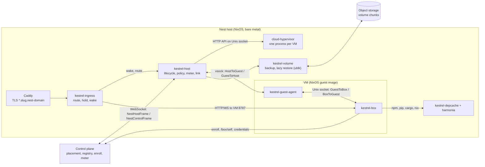
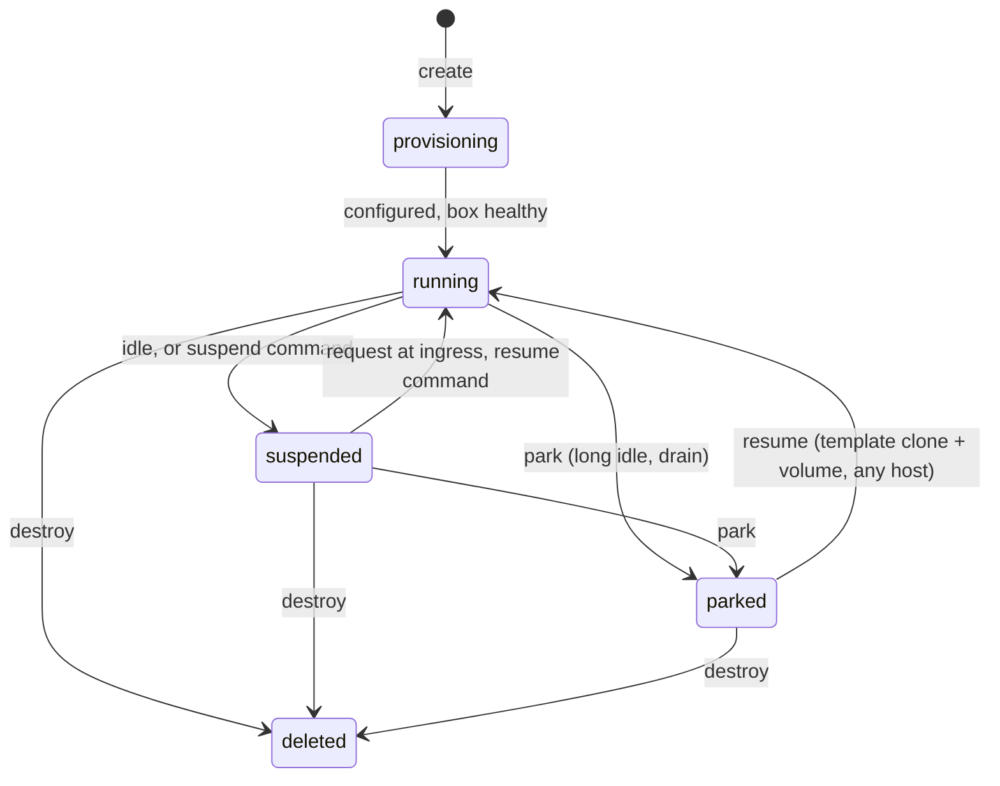

# The Nest: per-user VMs (design and contracts)

How Kestrel runs boxes in its own VMs. The product goals are in [goal-state.md](goal-state.md#the-nest); this is how
they are built. Wire formats live in `packages/protocol/src/nest.ts` (host and control plane) and
`packages/protocol/src/guest.ts` (inside the VM); this document names every other interface between the parts.

BYOB is unaffected: a user's own machine runs `kestrel-box` directly and none of this. The box adapts through
capabilities (`gpu`, `suspend`), never through "is this the Nest" checks.

## Parts

| Part | Where | Language | Runs as |
|---|---|---|---|
| Host agent `kestrel-host` | `packages/host/src` | TypeScript (Effect, Bun) | root, on each host |
| Guest agent `kestrel-guest-agent` | `packages/host/crates/guest-agent` | Rust, static | root, in each VM |
| Volume tool `kestrel-volume` | `packages/host/crates/volume` | Rust | root, on each host |
| Ingress `kestrel-ingress` | `packages/host/crates/ingress` | Rust | `kestrel-ingress` user, behind Caddy |
| Dependency cache `kestrel-depcache` | `packages/host/crates/depcache` | Rust | `kestrel-depcache` user |
| Guest image, host NixOS module, VM test | `packages/host/nix` | Nix | |
| Control plane side | `packages/control` | TypeScript | Worker + Hub |
| Box side (platform service) | `packages/server` | TypeScript | the box, in the VM |

Every Nest-only part lives under `packages/host`, so it can move to its own repository by path. The box never imports
from `packages/host`; it talks to the guest agent through `guest.ts` only. Each Rust crate is its own Cargo package
with its own `Cargo.lock` (no shared workspace).



## Hypervisor

Cloud Hypervisor (pinned from nixpkgs, v54 or newer), driven only through its HTTP API on a Unix socket. Each VM is
one `cloud-hypervisor` process in its own systemd scope `kestrel-vm-<boxId>.scope` under `kestrel-vms.slice`, so its
cgroup is the meter (CPU `cpu.stat usage_usec`, memory `memory.current`).

Features the design depends on, and their constraints (from Cloud Hypervisor's `docs/snapshot_restore.md` and
`docs/hotplug.md`):

| Feature | Use | Constraint |
|---|---|---|
| `memory_restore_mode=ondemand` | Resume pages in lazily (userfaultfd) | No VFIO, vhost-user or vDPA devices at snapshot; host process needs `/dev/userfaultfd` (ACL for the agent) |
| `virtio-mem` (`hotplug_method=virtio-mem`, `hotplug_size`) | Memory follows pressure | Guest boots with `memhp_default_state=online_movable` so unplug succeeds |
| `resize --cpus` | vCPUs follow load | Boot with `cpus boot=1,max=<template max>` |
| `virtio-balloon` with free page reporting | Freed guest pages return to the host continuously | |
| `add-device` / `remove-device` (VFIO) | GPU borrowed while needed | Pins all guest memory while attached; detach before suspend |
| `add-disk` | Volume hot-plugged into a template clone | |
| `restore` with `net_fds` | Each clone gets its own tap | |
| VM Generation ID | Clones of a template reseed the kernel RNG | Guest `CONFIG_VMGENID=y` |
| `virtio-pmem` | Read-only Nix store image shared through the host page cache (DAX) | `discard_writes=on` |

`copyonwrite` restore (page-cache sharing of the template's memory) is incompatible with virtio-mem, so it is not
used; the default is `ondemand` + virtio-mem.

## The guest image

Built by `packages/host/nix/guest.nix` from the flake (output `packages.<system>.nest-guest`):

- `kernel` (bzImage), `initrd`, `store.erofs` (the system closure, read-only), `cmdline` (a file), `manifest.json`
  (`{ imageId, kernel, initrd, store, cmdline }`, `imageId` = the store hash, which names templates).
- Boot: direct kernel boot. The initrd mounts `/dev/pmem0` (`store.erofs`, DAX) at `/nix/.ro-store`, a tmpfs root,
  and an overlay `/nix/store` whose upper layer moves to the volume once it is mounted (`NEST_VOLUME_MOUNT/.nix-rw`),
  so packages a user installs persist.
- Kernel: `VIRTIO_{PCI,BLK,NET,MEM,BALLOON,PMEM,VSOCKETS}`, `LIBNVDIMM`, `FS_DAX`, `EROFS_FS`, `OVERLAY_FS`, `VMGENID`,
  `HW_RANDOM_VIRTIO`, `PTP_1588_CLOCK_KVM`, `MEMORY_HOTPLUG`, `MEMORY_HOTREMOVE`, `HOTPLUG_PCI_ACPI`, `ZSWAP`, `NO_HZ_IDLE`.
- Command line: `console=hvc0 memhp_default_state=online_movable zswap.enabled=1 zswap.compressor=zstd`.
- Services: `kestrel-guest-agent` (root), `kestrel-box` (user `kestrel`, not started until `configure`), chrony with the
  `ptp_kvm` reference clock, `systemd-oomd`, zswap with a swapfile on the volume. The NVIDIA open kernel modules ship in
  the image and load only when a GPU is hot-plugged; Mesa provides software rendering otherwise.
- Package managers point at the host's dependency cache and Nix binary cache when `configure` names them.

## Host layout

```
/var/lib/kestrel-host/
  host.json                      { hostId, slug }
  templates/<imageId>/           snapshot of a booted, unconfigured guest (config.json, state.json, memory-ranges)
  vms/<boxId>/vm.json            VM record (state machine below), atomic writes
  vms/<boxId>/volume.raw         the volume (sparse raw file on XFS; reflink baseline volume.base for backups)
  vms/<boxId>/snapshot/          memory image while suspended
  vms/<boxId>/api.sock           cloud-hypervisor API
  vms/<boxId>/vsock.sock         hybrid vsock
/run/kestrel-host/api.sock       host agent local API (ingress, operators)
```

Host secrets (control plane host secret, object storage keys, volume encryption key) are files under
`/etc/kestrel-host/` readable by root only, never in the repository.

## Lifecycle



**Template.** For each guest `imageId` the host boots the image once with no volume (`cpus boot=1,max=MAX_VCPUS`,
`memory size=1G,hotplug_size=MAX_MEMORY-1G,hotplug_method=virtio-mem`, balloon with free page reporting, pmem store,
one net device, vsock), waits for the guest agent's `hello`, sends nothing else, pauses and snapshots it. The template
holds no secret and no identity.

**Create / resume from parked.** Restore the template (`ondemand`, `net_fds` = a new tap) → `add-disk` the volume with
serial `kestrel-volume` (local file, or the `ublk` device `kestrel-volume restore-lazy` exposes) → resume → vsock
`configure` (network, identity, `enrollToken` only on create) → the guest mounts the volume, writes the box env and
starts the box → reply once the box answers `/api/health` → `running`.

**Suspend.** Detach any GPU (below) → `prepareSuspend` (box quiesces, guest syncs and drops caches) → `pause` →
`snapshot` to `vms/<boxId>/snapshot` → stop the process → `suspended`. A memory image can always be discarded safely,
because the volume was synced first.

**Resume from suspended.** `restore` (`ondemand`) → `resume` → vsock `resumed` with the wall clock → `running`. A
restore that fails falls back to a template clone with the same volume (the VM's processes are lost, its files are not).

**Park.** From running: `shutdown` over vsock, wait for exit; from suspended: discard the memory image. Then
`kestrel-volume backup` → `volumeRef` → `parked`. The local volume stays as a cache until the host needs the space.

**Destroy.** Stop, delete the volume, its backups and records → `deleted`.

## Resource policy (host agent)

Runs every `GUEST_STATUS_INTERVAL_MS` per running VM from the guest's `status` frame:

- **Memory**: target = `memTotal - memAvailable` + headroom (max(512 MiB, 25%)), rounded up to 128 MiB, within
  `[1 GiB, maxMemoryBytes]`. Grow at once when `memAvailable` < headroom/2 or `memSomeAvg10` > 10; shrink at most one
  step per 30 s and only after 60 s below target.
- **CPU**: vCPUs = clamp(ceil(load + 1), 1, maxVcpus); grow at once when `cpuSomeAvg10` > 20, shrink after 60 s.
- **Idle**: a VM is idle when the box reports no runs, desktops, viewers or recordings, the last activity is older than
  `idleSuspendAfter` (default 10 min), and ingress reports no open connection. Idle → suspend. Suspended longer than
  `parkAfter` (default 7 days) → park. Both are host config, and the control plane can override with commands.
- **Host pressure** (host `/proc/pressure/memory` some avg10 > 20): suspend the idle-longest running VM first, then
  shrink every VM to its target with no headroom.
- **GPU**: `gpuWanted: true` from the guest, or `gpuAttach` from the control plane, attaches a free host GPU (bound to
  `vfio-pci` at host boot) with `add-device`, then sends `gpuAttached`. No free GPU: the request fails and the box shows
  it; moving to another host is a park and a resume there. `gpuWanted: false`, `gpuDetach`, or the desktop idle →
  `gpuDetach` over vsock → `remove-device`. Suspend always detaches first.

## Storage

- **Volumes**: sparse raw files on XFS (mirrored NVMe), `virtio-blk` with `num_queues` = max vCPUs, `direct=on`. The
  guest formats ext4 on first mount (`noatime,lazytime,discard`).
- **Backups** (`kestrel-volume backup`): reflink `volume.raw` to a point-in-time copy, compare its extents with the
  previous baseline (FIEMAP shared extents are unchanged), upload changed 4 MiB chunks, encrypted (AES-256-GCM, host
  fleet key), keyed `boxes/<boxId>/chunks/<sha256>`, and a manifest `boxes/<boxId>/manifests/<n>.json`. Chunks are never
  shared between boxes.
- **Lazy restore** (`kestrel-volume restore-lazy`): a `ublk` block device backed by a local sparse file and a chunk
  bitmap. A read of a missing chunk fetches it (peer host first, then object storage), writes it locally, then serves
  it; a background task hydrates the rest. Once complete the VM switches to the plain file at its next restart.

### `kestrel-volume` CLI

All output is one JSON object on stdout; errors exit non-zero with a message on stderr.

```
kestrel-volume create  --path P --size-bytes N
kestrel-volume backup  --path P --box BOX --store URL [--key-file F]        -> { volumeRef, bytesUploaded, chunks }
kestrel-volume restore --ref REF --box BOX --store URL --dest P [--key-file F]  -> { bytes }
kestrel-volume restore-lazy --ref REF --box BOX --store URL --dest P [--key-file F]
                                     -> prints { device: "/dev/ublkbN" } once ready, keeps serving until SIGTERM
kestrel-volume delete  --box BOX --store URL
```

`URL` is `file:///dir` (tests, single host) or `s3://bucket/prefix` with `KESTREL_S3_ENDPOINT`,
`KESTREL_S3_ACCESS_KEY_ID`, `KESTREL_S3_SECRET_ACCESS_KEY` (Cloudflare R2 in production).

## Networking

- One tap per VM (`kn-<n>`), routed, no bridge: the host side has `169.254.0.1/32`, the guest gets a unique
  `10.77.x.y/32` with its default route on-link via `169.254.0.1`, and the host routes that /32 to the tap. Template
  clones share a MAC, which is harmless on point-to-point links.
- nftables: guests reach the internet through masquerade; they cannot reach each other, the host, or private ranges,
  except the host's dependency cache, Nix cache and DNS ports on `169.254.0.1`. Ingress reaches each VM's port 8787.
- `tc` limits each tap's egress (default 200 Mbit/s).
- WebRTC: each VM's public IPv6 address when the host has a routed prefix; otherwise coturn on the host as the TURN
  server the box offers.

## Ingress

Caddy terminates TLS for `*.<slug>.<nest domain>` (DNS challenge) and proxies everything to `kestrel-ingress` on
`127.0.0.1:8081`. `kestrel-ingress` takes the box id from the first DNS label, answers `/mcp` and `/broker` 404, and:

- running → proxies to the VM (HTTP/1.1 and WebSocket upgrades);
- suspended or parked here → holds the request, asks the host agent to wake the box, then proxies (wake timeout 60 s,
  then 503 with `Retry-After`);
- unknown → 404.

It reports per-box open connections and the last request time to the host agent every 5 s.

### Host agent local API

HTTP on `/run/kestrel-host/api.sock` (root and the `kestrel-ingress` group):

| Route | Answer |
|---|---|
| `GET /v1/boxes/:boxId/route` | `{ state, upstream }`, `upstream` = `http://10.77.x.y:8787` or null |
| `POST /v1/boxes/:boxId/wake` | waits until running; `{ upstream }`, or 503 `{ error }` |
| `POST /v1/ingress/activity` | body `{ boxes: [{ boxId, openConnections, lastRequestAt }] }` → 204 |
| `GET /v1/vms` | `NestVmReport[]`, for operators |

## Dependency cache

`kestrel-depcache` listens on `169.254.0.1:3141` (reachable from every VM, from nothing else). It is read-only for VMs:
it fetches from the origin itself over TLS and stores only what verifies.

| Path | Origin | Verified against |
|---|---|---|
| `/npm/` | registry.npmjs.org | the tarball's `dist.integrity` in the packument |
| `/pypi/simple/`, `/pypi/files/` | pypi.org, files.pythonhosted.org | the `sha256` in the index link |
| `/crates/index/`, `/crates/dl/` | index.crates.io, static.crates.io | `cksum` in the sparse index |

Metadata (packuments, indexes) is cached for 5 minutes; artifacts forever (content-addressed by hash). Requests with
credentials are refused (private packages bypass the cache by going to the origin directly). Nix: `harmonia` serves the
host's `/nix/store` on `169.254.0.1:5000`, signed with the host's key; guests trust that key and cache.nixos.org.

## Control plane

- Hosts are the existing meter host registrations (id and secret). A host dials `nestHostConnect`; the Hub accepts it
  as a hibernatable WebSocket, sends `refused` and closes on a bad secret or protocol.
- A Nest box is a `UserBox` with a `nest` record (host, state, limits, `volumeRef`). Its URL is
  `https://<boxId>.<host slug>.<nest domain>` and changes when it moves hosts.
- **Create**: pick the connected host with the most free memory that fits `1 GiB + headroom` (and a free GPU when the
  user asks for one at creation), insert the box with a fresh secret hash and a one-time enroll token (hashed), send
  `create`. The box later calls `nestEnroll` and gets the secret.
- **Resume**: suspended → its host; parked → any host with room (`resume` with `volumeRef`, new `vmId`); a host that is
  offline holds the box until it returns.
- **Wake before work**: automation dispatch to a Nest box sends `resume` and waits for `running` (60 s) first.
- Usage records keep flowing through `meterRecords`; the host agent emits them from cgroups.

## Metering

The host agent replaces `scripts/nest-meter/collector.ts`: same records (`meter.ts`), same outbox, measured from the VM
scope's cgroup (CPU core-seconds from `cpu.stat`, memory byte-seconds from `memory.current`), disk from allocated
blocks of the volume and the memory image, GPU device-seconds while attached.

## Security

- The VM is the boundary between users; bubblewrap stays the boundary between an agent and its box.
- The host never holds a box secret: enrollment tokens are single-use and expire in an hour.
- Cloud Hypervisor runs with its seccomp filter, as root only because taps, VFIO and ublk need it; each VM process is
  in its own cgroup with `MemoryMax` = its limit + 256 MiB of VMM overhead.
- The dependency cache only stores what its origin served and its hash verified; VMs cannot write to it.
- Backups are encrypted with the host fleet key and never deduplicated across boxes.

## Testing

`packages/host/nix/test.nix` is a NixOS VM test: a host VM (nested KVM) imports the host module, builds a template,
creates a box against a fake control plane, waits for the box's health check through ingress, suspends it, wakes it
with a request, resizes it under a memory load, parks and resumes it with a `file://` store. Run it with
`nix build .#checks.x86_64-linux.nest`. GPU passthrough cannot be tested without a GPU host.
