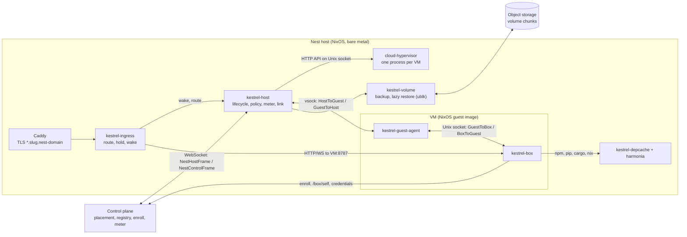
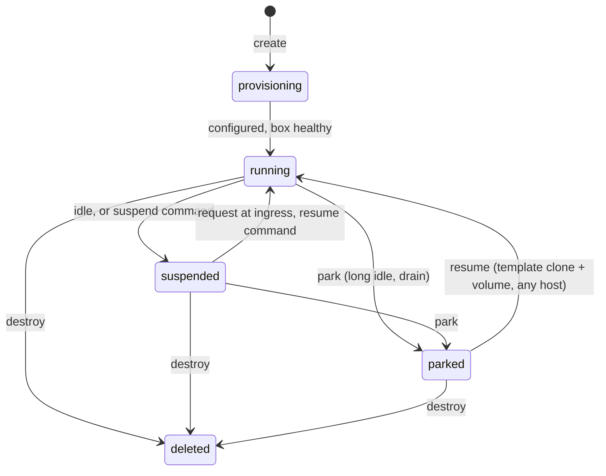

# The Nest: per-user VMs (design and contracts)

How Kestrel runs boxes in its own VMs. The product goals are in [goal-state.md](goal-state.md#the-nest); this is how
they are built. Wire formats live in `packages/protocol/src/nest.ts` (host and control plane) and
`packages/protocol/src/guest.ts` (inside the VM); this document names every other interface between the parts.

BYOB is unaffected: a user's own machine runs `kestrel-box` directly and none of this. The box adapts through
capabilities (`gpu`, `suspend`), never through "is this the Nest" checks.

## Parts

| Part | Where | Language | Runs as |
|---|---|---|---|
| Host agent `kestrel-host` | `packages/host/src` | TypeScript (Effect, Bun) | root, on each host |
| Guest agent `kestrel-guest-agent` | `packages/host/crates/guest-agent` | Rust, static | root, in each VM |
| Volume tool `kestrel-volume` | `packages/host/crates/volume` | Rust | root, on each host |
| Ingress `kestrel-ingress` | `packages/host/crates/ingress` | Rust | `kestrel-ingress` user, behind Caddy |
| Dependency cache `kestrel-depcache` | `packages/host/crates/depcache` | Rust | `kestrel-depcache` user |
| Guest image, host NixOS module, VM test | `packages/host/nix` | Nix | |
| Control plane side | `packages/control` | TypeScript | Worker + Hub |
| Box side (platform service) | `packages/server` | TypeScript | the box, in the VM |

Every Nest-only part lives under `packages/host`, so it can move to its own repository by path. The box never imports
from `packages/host`; it talks to the guest agent through `guest.ts` only. Each Rust crate is its own Cargo package
with its own `Cargo.lock` (no shared workspace).



## Hypervisor

Cloud Hypervisor (pinned from nixpkgs, v54 or newer), driven only through its HTTP API on a Unix socket. Each VM is
one `cloud-hypervisor` process in its own systemd scope `kestrel-vm-<boxId>.scope` under `kestrel-vms.slice`, so its
cgroup is the meter (CPU `cpu.stat usage_usec`, memory `memory.current`).

Features the design depends on, and their constraints (from Cloud Hypervisor's `docs/snapshot_restore.md` and
`docs/hotplug.md`):

| Feature | Use | Constraint |
|---|---|---|
| `memory_restore_mode=ondemand` | Resume pages in lazily (userfaultfd) | No VFIO, vhost-user or vDPA devices at snapshot; host process needs `/dev/userfaultfd` (ACL for the agent) |
| `virtio-mem` (`hotplug_method=virtio-mem`, `hotplug_size`) | Memory follows pressure | Guest boots with `memhp_default_state=online_movable` so unplug succeeds |
| `resize --cpus` | vCPUs follow load | Boot with `cpus boot=1,max=<template max>` |
| `virtio-balloon` with free page reporting | Freed guest pages return to the host continuously | |
| `add-device` / `remove-device` (VFIO) | GPU borrowed while needed | Pins all guest memory while attached; detach before suspend |
| `add-disk` | Volume and swap disk hot-plugged into a template clone, after it resumes | Fixed disk `id`s (`volume`, `swap`) |
| `restore` with `net_fds` | Each clone gets its own tap | Applied only to a net device that was fd-backed when snapshotted: the template boots with `--net id=net0,fd=[N],mac=…` |
| VM Generation ID | Clones of a template reseed the kernel RNG | Guest `CONFIG_VMGENID=y` |
| `virtio-pmem` | Read-only Nix store image shared through the host page cache (DAX) | `discard_writes=on` |

`copyonwrite` restore (page-cache sharing of the template's memory) is incompatible with virtio-mem, so it is not
used; the default is `ondemand` + virtio-mem.

**Restore sources.** A restore takes no path overrides (only `source_url`, `memory_restore_mode`, `net_fds` and a few
others), and the vsock device refuses to bind a socket path that exists. So every restore (a template clone or a
suspended VM) restores from a per-VM directory `vms/<boxId>/restore/`: `memory-ranges` and `state.json` reflinked (or
hard-linked) from the source, and `config.json` rewritten with this VM's vsock socket, console path and disk paths.
Upstream allows editing `config.json` between snapshot and restore.

**Memory images stay valid while in use.** `ondemand` keeps reading the source file until every page has been
touched, and poisons guest memory if it fails. So a snapshot is written to `snapshot.<gen>.tmp`, fsynced and renamed to
`snapshot.<gen>`, and the previous generation is deleted only after the process restored from it has exited. A template
is reference-counted the same way: it is deleted only when no live process was restored from it, and its guest image is
a Nix GC root while any template or suspended VM references it.

## The guest image

Built by `packages/host/nix/guest.nix` from the flake (output `packages.<system>.nest-guest`):

- `kernel` (bzImage), `initrd`, `store.erofs`, `cmdline` (a file), `manifest.json` (`{ imageId, kernel, initrd, store,
  cmdline }`, `imageId` = the store hash of the system closure, which names templates). `store.erofs` holds `store/`
  (the closure's store entries, the overlay's lower layer) and `registration` (the closure's Nix database rows, loaded
  at boot).
- Boot: direct kernel boot. The initrd mounts `/dev/pmem0` (`store.erofs`, DAX, read-only) at `/nix/.ro-store`, a tmpfs
  root, and an overlay `/nix/store` (lower `/nix/.ro-store/store`, upper on tmpfs). `kestrel-nix-db` loads `registration`
  into the Nix database on every boot. On `configure` the guest agent mounts the volume at `NEST_VOLUME_MOUNT`, moves the
  overlay's upper layer to `NEST_VOLUME_MOUNT/.nix-rw/upper` (copied from the tmpfs layer on first use; the agent's
  default lower and upper paths are this image's layout, so the agent passes no layout flags), then starts `kestrel-box`,
  whose `requires` starts `kestrel-volume`, which binds the Nix database to `NEST_VOLUME_MOUNT/.nix-var` (copied on first
  use), registers the image's paths in it, and so packages a user installs persist.
- Kernel: `VIRTIO_{PCI,BLK,NET,MEM,BALLOON,PMEM,VSOCKETS}`, `LIBNVDIMM`, `FS_DAX`, `EROFS_FS`, `OVERLAY_FS`, `VMGENID`,
  `HW_RANDOM_VIRTIO`, `PTP_1588_CLOCK_KVM`, `MEMORY_HOTPLUG`, `MEMORY_HOTREMOVE`, `HOTPLUG_PCI_ACPI`, `ZSWAP`, and
  `NO_HZ_IDLE` (stock nixpkgs sets `NO_HZ_FULL`; the image overrides it so an idle vCPU stops its tick).
- Command line: `console=hvc0 memhp_default_state=online_movable zswap.enabled=1 zswap.compressor=zstd`.
- Services: `kestrel-guest-agent` (root, started at boot), `kestrel-box` (user `kestrel-box`, started by the agent after
  `configure` once `box.env` exists), `kestrel-volume` (started through `kestrel-box`'s `requires`), chrony with the
  `ptp_kvm` reference clock, `systemd-oomd`, and zswap backed by the swap disk (`kestrel-swap`, virtio-blk serial
  `kestrel-swap`), which the agent formats and enables on every boot or clone. The NVIDIA open kernel modules ship in
  the image and load only when a GPU is hot-plugged; Mesa provides software rendering otherwise.
- Package managers point at the host's dependency cache and Nix binary cache when `configure` names them. The box's
  home is `NEST_VOLUME_MOUNT/home`, where `configure` writes those configs.
- Box environment: `configure` writes `/var/lib/kestrel/box.env` (root, 0600, read by `kestrel-box.service`) with
  `CLOUDAGENTS_BOX_ID`, `CLOUDAGENTS_CONTROL_URL`, `CLOUDAGENTS_GUEST_AGENT_SOCKET` (its presence marks a Nest VM),
  `CLOUDAGENTS_DATA_DIR` (`/var/lib/kestrel/box`), `CLOUDAGENTS_BOX_PUBLIC_URL`, and `CLOUDAGENTS_NEST_ENROLL_TOKEN`
  while the box is not enrolled. Enrollment needs `CLOUDAGENTS_BOX_ID` and `CLOUDAGENTS_CONTROL_URL`; the box stores
  its secret in its data dir, ignores the token afterward, and sends `enrolled` on every connection once the secret is stored, so the guest drops the token from the file. The box never reads `CLOUDAGENTS_BOX_PUBLIC_URL` yet.

## Host layout

```
/var/lib/kestrel-host/
  host.json                      { hostId, slug }
  templates/<imageId>/           snapshot of a booted, unconfigured guest (config.json, state.json, memory-ranges)
  vms/<boxId>/vm.json            VM record: state, ownerEpoch, volumeRef of the local copy, command results; atomic
  vms/<boxId>/volume.raw         the volume (sparse raw file on XFS)
  vms/<boxId>/swap.raw           swap disk (sparse, local only, recreated on every clone)
  vms/<boxId>/snapshot.<gen>/    memory image while suspended (see "Memory images stay valid while in use")
  vms/<boxId>/restore/           per-restore source with rewritten config.json
  vms/<boxId>/api.sock           cloud-hypervisor API
  vms/<boxId>/vsock.sock         hybrid vsock (the host only connects; it never listens on vsock.sock_<port>)
/run/kestrel-host/api.sock       host agent ingress API (kestrel-ingress group)
/run/kestrel-host/operator.sock  host agent operator API (root only)
```

Host secrets (control plane host secret, object storage keys, the fleet volume key) are files under `/etc/kestrel-host/`
readable by root only, never in the repository or the Nix store.

## Lifecycle



**Template.** For each guest `imageId` the host boots the image once with no volume (`cpus boot=1,max=MAX_VCPUS`,
`memory size=1G,hotplug_size=MAX_MEMORY-1G,hotplug_method=virtio-mem`, balloon with free page reporting, pmem store,
`net id=net0,fd=[tap]`, vsock), waits for the guest agent's `hello`, sends nothing else, pauses and snapshots it. The
template holds no secret and no identity.

**Create / resume from parked.** Prepare `vms/<boxId>/restore/` from the template → restore (`ondemand`, `net_fds` =
the VM's own tap) → `resume` → `add-disk` the volume (id `volume`, serial `kestrel-volume`: the local file, or the
`ublk` device `kestrel-volume restore-lazy` exposes) and the swap disk (id `swap`, serial `kestrel-swap`) → vsock
`configure` (clock, `cloneId`, network, identity, `enrollToken` only while not enrolled) → the guest waits for the
disks, mounts the volume, writes the box env and starts the box → reply once the box answers `/api/health` →
`running`. The local volume is used only when its recorded backup equals the command's `volumeRef`.

**Suspend.** Detach any GPU (below) → `prepareSuspend` (box quiesces, guest syncs, drops caches and freezes the volume; 30 s;
a timeout aborts the suspend: the host sends `thawVolume` and the VM keeps running) → `pause` → `snapshot` to a new generation
→ stop the process → `suspended`. The volume stays frozen in the image; `resumed` thaws it. A memory image can always be
discarded safely, because the volume was synced and frozen before it: no write lands after the sync, so an unsynced disk is
never snapshotted.

**Resume from suspended.** Prepare `restore/` from the latest generation (disk paths rewritten) → restore
(`ondemand`; `copy` when `/dev/userfaultfd` is unavailable) → `resume` → vsock `resumed` with the wall clock; the
guest replies once the box is healthy → `running`. A restore that fails falls back to a template clone with the same
volume (the VM's processes are lost, its files are not).

**Park.** From running: `prepareSuspend` (as for suspend; a timeout or failure aborts the park with `thawVolume` and the VM
keeps running) → `pause` → stop the process, discarding its memory. The volume is frozen from the sync until the process
stops, so no write can land between the sync and the backup. From suspended: discard the memory image. Then
`kestrel-volume backup` → `volumeRef` (recorded in `vm.json`) → `parked`. The local volume stays as a cache until the host
needs the space or the control plane sends `evict`.

**Periodic backup of a running VM** (every `backupInterval`, default 1 h, when the volume changed): `freezeVolume` →
host reflinks `volume.raw` to `<state>/<boxId>.frozen` → `thawVolume` → `kestrel-volume backup --path <state>/<boxId>.frozen
--state-dir <state>` → delete the copy → report `volumeRef`, `backedUpAt`. The freeze covers only the reflink; the backup
reads the copy, which the CLI reflinks again to its own snapshot.

**Destroy.** Stop, delete the volume, its backups and records → `deleted`. **Evict**: stop, delete local state only.

### Ownership and recovery

- **Epochs.** Every placement has an `ownerEpoch`. A host refuses commands for a lower epoch than it holds. A host with no
  record of a box refuses every command except `create` and `resume`, which create it at the epoch they carry. The control
  plane sends `evict` once the host's `inventory` is complete, for every VM it reports with an epoch below the box's
  current one. So a host that was partitioned while its box moved cannot bring the old copy back.
- **Leases.** The host may wake a `suspended` box from an ingress request by itself only while its last `lease` is
  valid. A `parked` box, or any box without a lease, is woken only by `resume`: the host sends `wakeRequest` and holds
  the request until the control plane answers. Past `validUntil` the host fences: it stops every running VM at once
  without a sync and wakes nothing. The control plane moves a box off a host it cannot reach only after that host's last
  `validUntil` plus `NEST_FENCE_MARGIN_MS`.
- **A second placement.** A parked box with no claim has no VM on any host, so control places it on a host with room with
  a higher epoch and a new `vmId`. The previous host refuses commands below that epoch and evicts its copy on the first
  inventory that shows it at a lower epoch. Control does not wait for the old host to fence. A copy the old host started
  at its own epoch, before it learned of the move, runs until that inventory. Parked volumes are synced and frozen, so no
  write from that copy can reach the volume after the move. A box leaves a host only after its claim is released (a
  `park` result, or a timed-out destroy of a parked box), never while a resume to that host is pending.
- **Fence watchdog.** The agent writes each lease's `validUntil` to `lease.json` in the host state dir before it acts on
  the lease, and it starts no VM and wakes no box without a valid one. A separate systemd service (`kestrel-fence`, shipped
  by the host module with `Restart=always`, not dependent on the agent) stops every `kestrel-vm-*.scope` once the clock
  passes that `validUntil`; a missing or unreadable `lease.json` counts as expired. So a hung or dead agent cannot keep a
  VM serving. The stop is the same fence: no sync.
- **Commands.** One queue per box serializes commands and policy actions. Results are stored in `vm.json` by
  `commandId`; a resent command gets the stored result, and results that finished while disconnected follow `hello`,
  before the `inventory` chunks.
- **Agent restart.** At startup the agent re-adopts live `kestrel-vm-*.scope` processes through their `api.sock` and
  reconnects to their guests. A VM recorded as `running` whose process is gone becomes `parked` with its local volume
  (memory lost, files kept), and is reported.
- **Guest replies** time out per `GUEST_REPLY_TIMEOUT_MS`, and the host then acts without the guest. Lines longer than
  `MAX_GUEST_FRAME_BYTES` drop the connection; replies to unknown ids are ignored.
- **Freezes.** `prepareSuspend` and `freezeVolume` leave the volume frozen. The guest never thaws it on its own: the host
  ends every freeze with `thawVolume`, with `resumed`, or by stopping the VM. The host records a freeze in `vm.json` before
  it sends one, so an agent restart that finds an unfinished freeze stops that VM instead of resuming it, and a lapsed
  lease stops every running VM as above. A frozen volume is consistent, so only memory is lost.

## Resource policy (host agent)

Runs every `GUEST_STATUS_INTERVAL_MS` per running VM from the guest's `status` frame:

- **Memory**: target = `memTotal - memAvailable` + headroom (max(512 MiB, 25%)), rounded up to 128 MiB, within
  `[1 GiB, maxMemoryBytes]`. Grow at once when `memAvailable` < headroom/2 or `memSomeAvg10` > 10; shrink at most one
  step per 30 s and only after 60 s below target.
- **CPU**: vCPUs = clamp(ceil(load + 1), 1, maxVcpus); grow at once when `cpuSomeAvg10` > 20, shrink after 60 s.
- **Idle**: a VM is idle when the box reports no runs, desktops, viewers or recordings, the last activity is older than
  `idleSuspendAfter` (default 10 min), and ingress reports no open connection. Idle → suspend. Suspended longer than
  `parkAfter` (default 7 days) → park. Both are host config, and the control plane can override with commands.
- **Host pressure** (host `/proc/pressure/memory` some avg10 > 20): suspend running VMs in order of least recent
  activity as the host measured it (ingress requests, cgroup CPU), not as the guest reports it, then shrink every VM to
  its target with no headroom.
- **Disk**: capacity reserves room to suspend every running VM (its plugged memory). Below the reserve the host parks
  instead of suspending, evicts cached volumes of parked boxes, and reports less free space so nothing new is placed.
- **GPU**: `gpuWanted` from the guest (with the box's request `id`; honoured only when `limits.gpu` is `on-demand`, at
  most one attach per 5 min, held at least 5 min), or `gpuAttach` from the control plane, attaches a free host GPU
  (bound to `vfio-pci` at host boot) with `add-device` once the host has room for the VM's whole `maxMemoryBytes` (an
  attached device pins all guest memory), then sends `gpuAttached`. The host answers every `gpuWanted` with
  `gpuDecision` for the same `id`. Denied (no free GPU, no room, or the rate limit): the guest replies to the box's
  request with the reason, and the box shows it; moving to another host is a park and a resume there. Granted: the
  guest replies `ok` once the device is usable. `gpuWanted: false`, `gpuDetach`, or the desktop idle → `gpuDetach` over
  vsock → `remove-device`; the box's request is answered once released. Suspend always detaches first. GPU time is
  billed from attach to detach.

## Storage

- **Volumes**: sparse raw files on XFS (mirrored NVMe), `virtio-blk` with `num_queues` = boot vCPUs (Cloud Hypervisor rejects more queues than boot vCPUs, and every VM restores with the template's boot count of 1), `direct=on`. The
  guest formats ext4 on first mount (`noatime,lazytime,discard`).
- **Backups** (`kestrel-volume backup --state-dir S`): reflink `volume.raw` to `S/<boxId>.snap` (FICLONE only; there is
  no copy fallback, so the volume and `S` must be on a reflink filesystem), compare its extents with the baseline
  `S/<boxId>.base` from the previous backup (FIEMAP shared extents are unchanged), and upload changed 4 MiB chunks. The
  baseline advances only after the manifest is stored; `S/<boxId>.base.ref` names the manifest it describes, and a
  missing or mismatched baseline makes the backup read every chunk. A `flock` on `S/<boxId>.lock` serializes backups of
  one box on a host. Each box has two keys, both HKDF-SHA256 from the fleet key: a name key (`info =
  "kestrel-volume/name/<boxId>"`) names each chunk `boxes/<boxId>/chunks/<HMAC-SHA256(name key, plaintext)>`, so names
  reveal only equality; a seal key (`info = "kestrel-volume/seal/<boxId>"`) encrypts chunks and manifests with
  AES-256-GCM (random 96-bit nonce per object, the object's key as AAD). The last chunk is zero-padded to 4 MiB before
  it is named and sealed, so every stored chunk has the same size. Manifests are `boxes/<boxId>/manifests/<n>-<16 hex
  random>.json`, sealed the same way, so a tampered, renamed or replayed manifest fails to open, and a key is never
  reused after deletion: the `volumeRef` of a deleted manifest fails to restore. Chunks are never shared between boxes.
  Limitations: deleting the newest manifest rolls a box back to an older one (the control plane's pinned `volumeRef` is
  what detects that), and chunks uploaded by a backup whose manifest put failed are orphaned until a garbage collector
  exists (none yet).
- **Lazy restore** (`kestrel-volume restore-lazy`): a `ublk` block device backed by a local sparse file and a chunk
  bitmap. A read of a missing chunk fetches it from object storage, writes it locally, then serves it; a background
  task hydrates the rest. Once complete the VM switches to the plain file at its next restore (the disk path is
  rewritten in `restore/config.json`). A backup reads `volume.raw` only once hydration is complete: the periodic backup
  skips a hydrating volume that round (`backedUpAt` unchanged), and park waits for hydration before its backup.
  A lock on `<dest>.lock` is held while the device is served. A second `restore-lazy` of the same `dest` fails at once, so
  two processes never serve one image from separate presence maps. `restore` (eager) holds the same `<dest>.lock` for the
  whole restore. It writes the image as an unnamed file in `dest`'s directory (`O_TMPFILE`) and links it to `dest` with
  `linkat`, which fails if `dest` exists, so no staging name is ever opened or truncated. The lock file is left beside `dest`.
  Sidecars are never replaced blindly: `<dest>.bitmap` is replaced only when it is a bitmap for the same restore (left by an
  interrupted create), and any other file there is refused and left untouched. Temp files for state writes use a fresh
  random name created exclusively, so no existing file is opened or truncated.

### `kestrel-volume` CLI

All output is one JSON object on stdout; errors exit non-zero with a message on stderr.

```
kestrel-volume create  --path P --size-bytes N
kestrel-volume backup  --path P --state-dir S --box BOX --store URL [--key-file F]  -> { volumeRef, bytesUploaded, chunks }
kestrel-volume restore --ref REF --box BOX --store URL --dest P [--key-file F]  -> { bytes }
kestrel-volume restore-lazy --ref REF --box BOX --store URL --dest P [--key-file F]
                                     -> prints { device: "/dev/ublkbN" } once ready, keeps serving until SIGTERM
kestrel-volume delete  --box BOX --store URL
```

`URL` is `file:///dir` (tests, single host) or `s3://bucket/prefix` with `KESTREL_S3_ENDPOINT`,
`KESTREL_S3_ACCESS_KEY_ID`, `KESTREL_S3_SECRET_ACCESS_KEY` (Cloudflare R2 in production).
`BOX` must match `[A-Za-z0-9_-]{1,128}`; the control plane generates box IDs as UUIDs, which satisfy it. Other IDs are
rejected before any object is touched.

## Networking

- One tap per VM (`kn-<n>`), routed, no bridge: the host side has `169.254.0.1/32`, the guest gets a unique
  `10.77.x.y/32` with its default route on-link via `169.254.0.1`, and the host routes that /32 to the tap. Template
  clones share a MAC, which is harmless on point-to-point links.
- nftables (`inet kestrel`): tap traffic is dropped unless its source is that VM's assigned address. The host agent
  adds each tap to the `tap_addrs` set (`ifname . ipv4_addr`) when it creates the tap
  (`nft add element inet kestrel tap_addrs { "kn-<n>" . <vm-ip> }`); the `tap_source` chain enforces the set on forward
  and input. Guests reach public internet addresses only, through masquerade on the uplink, never private, CGNAT,
  loopback or link-local ranges. They cannot reach each other or the host, except the host's dependency cache, Nix
  cache and DNS on `169.254.0.1` (TCP 3141, 5000, 53; UDP 53). Everything else from a tap, including SSH and ping, is
  dropped. Ingress reaches each VM's port 8787.
- DNS: `unbound` on `169.254.0.1:53` answers `10.77.0.0/16` and refuses everything else. The host agent sends
  `dns: ["169.254.0.1"]` in `configure`.
- `tc` limits each tap's egress (default 200 Mbit/s).
- WebRTC: each VM's public IPv6 address when the host has a routed prefix; otherwise coturn on the host, with
  short-lived credentials (TURN REST API secret held by the host agent, handed to the box per session) and
  `denied-peer-ip` for every private, CGNAT, loopback and link-local range (IPv4 and IPv6). The output chain drops
  coturn's traffic to the host's own addresses (`meta skuid <turnserver> fib daddr type local`).

## Ingress

Caddy terminates TLS for `*.<slug>.<nest domain>` (DNS challenge) and proxies everything to `kestrel-ingress` on
`127.0.0.1:8081`. `kestrel-ingress` takes the box id from the first DNS label, answers `/mcp` and `/broker` 404, and:

- running → proxies to the VM (HTTP/1.1 and WebSocket upgrades);
- suspended here with a valid lease → holds the request, asks the host agent to wake the box, then proxies (wake
  timeout 60 s, then 503 with `Retry-After`); parked, or no lease → the host agent sends `wakeRequest` and the request
  waits the same way for the control plane's `resume`. A resume placed on another host ends that wait with 503 and
  `Retry-After` on the request's old host, and the app refetches the box list, which carries the new URL;
- unknown → 404.
- `GET /api/health` (the app's health poll) never wakes a box and is not activity. Running → proxied to the VM without
  counting; suspended, parked or otherwise not running → 503 `{ "ok": false, "state": "<state>" }` with `Retry-After`;
  unknown → 404. A box that is running but refuses the connection answers 503 with `"state": "unreachable"`.

It reports per-box open connections and the last request time to the host agent every 5 s. `GET /api/health` is a
background poll, not use: ingress leaves it out of the last request time, and it never wakes a suspended box for it
(a suspended box answers 503 to it). The box does the same in its own activity (`lastActivityAt`).

### Host agent local API

Two Unix sockets under `/run/kestrel-host/`; the directory is 0750 and group `kestrel-ingress`.

`api.sock` (0660, `kestrel-ingress` group) is the ingress surface only:

| Route | Answer |
|---|---|
| `GET /v1/boxes/:boxId/route` | `{ state, upstream }`, `upstream` = `http://10.77.x.y:8787` or null |
| `POST /v1/boxes/:boxId/wake` | waits until running; `{ upstream }`, or 503 `{ error }` |
| `POST /v1/ingress/activity` | body `{ boxes: [{ boxId, openConnections, lastRequestAt }] }` → 204 |

`operator.sock` (0600, root) is the operator surface. The `kestrel-ingress` group cannot connect to it, so a compromised
ingress cannot suspend, park or destroy a box or touch its backups:

| Route | Answer |
|---|---|
| `GET /v1/vms` | `NestVmReport[]` |
| `GET /v1/boxes/:boxId` | VM report, or 404 |
| `POST /v1/boxes/:boxId/suspend` / `park` / `destroy` | `{ ok, error, vm }`; 409 when refused |

## Dependency cache

`kestrel-depcache` listens on `169.254.0.1:3141` (reachable from every VM, from nothing else). It is read-only for VMs:
it fetches from the origin itself over TLS and stores only what verifies.

| Path | Origin | Verified against |
|---|---|---|
| `/npm/` | registry.npmjs.org | the tarball's `dist.integrity` in the packument |
| `/pypi/simple/`, `/pypi/files/` | pypi.org, files.pythonhosted.org | the `sha256` in the index link |
| `/crates/index/`, `/crates/dl/` | index.crates.io, static.crates.io | `cksum` in the sparse index |

Metadata (packuments, indexes) is cached for 5 minutes. Artifacts are stored by hash, but served only while metadata
fetched within that window still lists them with the same hash, so a package the registry pulled stops being served.
Requests with credentials are refused (private packages bypass the cache by going to the origin directly).

Nix: the host keeps a static binary cache directory holding only the guest image closure and a pinned package set,
served read-only on `169.254.0.1:5000`. The host's own store (its services and configuration) is never exposed.
Populate and sign it with `nix copy --to 'file:///var/cache/kestrel-nix?secret-key=<secretKeyFile>'`. The signing key
is `services.kestrel-nest.nixCache.secretKeyFile` (default `/etc/kestrel-host/nix-cache-secret-key`); its public half
is `nixCache.publicKey`, which the host agent sends to guests at `configure` as `nixCachePublicKey`. Guests trust that
key and cache.nixos.org.

## Control plane

- Hosts are the existing meter host registrations (id and secret). A host dials `nestHostConnect`; the Hub accepts it
  as a hibernatable WebSocket, sends `refused` and closes on a bad secret or protocol, and answers `hello` and every
  `capacity` with a `lease`.
- A Nest box is a `UserBox` with a `nest` record (host, `ownerEpoch`, state, limits, `volumeRef`, image). Its URL is
  `https://<boxId>.<host slug>.<nest domain>` and changes when it moves hosts; the apps refetch the box list when a box
  stops answering.
- **Create**: pick the connected host with the most free memory that fits `1 GiB + headroom` (and a free GPU when the
  user asks for one at creation), insert the box with a fresh secret and an enroll token (hashed), epoch 1, send
  `create`. The box later calls `nestEnroll` and gets the secret; enrollment is idempotent until the box first
  authenticates, and a resent `create` carries a fresh token.
- **Resume**: suspended → its host; parked → the host its URL names when that host has room (the request reached its
  ingress), otherwise any host with room (`resume` with `volumeRef`, new `vmId`, epoch + 1; the box's URL moves to the new
  host's slug). A host that is offline holds a parked box that has a claim until it returns. `wakeRequest` from a host is
  treated as a resume request.
- **Reconcile**: `result` frames are applied as they arrive; when the last `inventory` chunk arrives, VMs with a stale
  epoch are evicted, and a VM the control plane does not know is logged and left alone.
- **Wake before work**: automation dispatch to a Nest box sends `resume` and waits for `running` (60 s) first.
- Usage records keep flowing through `meterRecords`; the host agent emits them from cgroups.

## Metering

The host agent replaces `scripts/nest-meter/collector.ts`: same records (`meter.ts`), same outbox, measured from the VM
scope's cgroup (CPU core-seconds from `cpu.stat`, memory byte-seconds from `memory.current`), disk from allocated
blocks of the volume and the memory image, GPU device-seconds while attached.

## Security

- The VM is the boundary between users; bubblewrap stays the boundary between an agent and its box.
- Hosts are trusted with the boxes they run: root on a host can read a VM's memory and volume. Enrollment tokens keep
  box secrets out of the control plane's commands and logs; they do not protect a box from its own host.
- The guest is untrusted input to the host: every reply has a deadline, frames are size-capped, GPU requests are gated
  by limits and rate, and placement decisions under pressure use host-measured signals.
- Cloud Hypervisor runs with its seccomp filter, as root only because taps, VFIO and ublk need it; each VM process is
  in its own cgroup with `MemoryMax` = its limit + 256 MiB of VMM overhead.
- The dependency cache only serves what its origin served, its hash verified and current metadata still lists; VMs
  cannot write to it. The Nix cache exposes only the guest closure and a pinned set.
- Backups use a per-box key derived from the fleet key, content-hiding chunk names, and are never deduplicated across
  boxes. (Later: per-box keys issued by the control plane, so a host holds keys only for boxes it runs.)
- Ingress serves every box under `*.<slug>.<nest domain>`; the Nest domain must be on the Public Suffix List (or the
  box must set only host-only `__Host-` cookies) so one box cannot set cookies for another.

## Operations

- DNS: at host registration the operator creates `*.<slug>.<nest domain>` A/AAAA records to the host. Certificates
  use the DNS-01 challenge: the host's `acme.dnsProvider` (`cloudflare` or `route53`) selects the Caddy plugin built
  into the host, and the provider's credentials come from `acme.environmentFile` (default
  `/etc/kestrel-host/caddy.env`). Certificates use a CNAME from `_acme-challenge.<slug>` to a challenge zone, so a
  host's DNS token cannot change other hosts' records.
- userfaultfd: `kestrel-host` runs as root, so Cloud Hypervisor's `memory_restore_mode=ondemand` opens
  `/dev/userfaultfd` with no ACL or sysctl change. Revisit this if the agent ever drops root.
- Image rollout: hosts build a template for a new `imageId` and clone new VMs from it; boxes move to the new image when
  they next park and resume. Reports carry `imageId`, so the control plane can drain old images.

## Testing

`packages/host/nix/test.nix` is a NixOS VM test: a host VM (nested KVM) imports the host module, builds a template,
creates a box against a fake control plane, waits for the box's health check through ingress, suspends it, wakes it
with a request, resizes it under a memory load, parks and resumes it with a `file://` store, clones a second VM from the
same template at the same time, and evicts. Run it with `nix build .#checks.x86_64-linux.nest`. GPU passthrough cannot
be tested without a GPU host.
