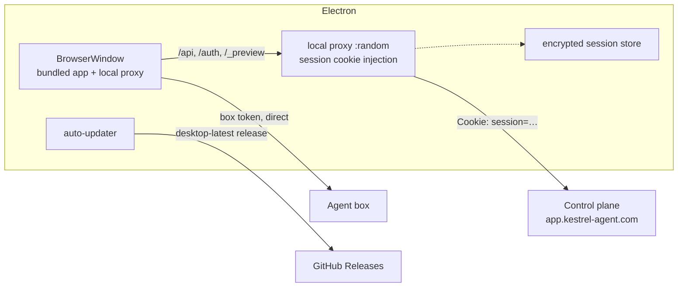
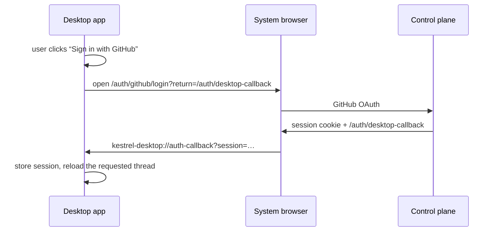

# Kestrel Desktop

The same React app as `packages/app`, packaged as an Electron application. Users can keep using the web app at
`app.kestrel-agent.com` or install the desktop build; both talk to the same control plane and agent boxes.

## How it works



- `packages/app/dist` is bundled into the application, so the window loads the app locally and keeps the web UI and
  desktop UI in lockstep at release time.
- A small loopback server (`src/server.ts`) serves those assets and proxies `/api`, `/auth`, `/_preview` and `/box` to
  the control plane. It attaches the stored session cookie, so the app's existing cookie-based client works unchanged.
  Node can set `Cookie`, a browser cannot; this is why the proxy exists.
- The app is served at a random loopback port behind a random per-launch cookie. Other local processes cannot use the
  proxy, and the renderer never sees the control-plane session.
- The session id lives in `SessionStore`, encrypted with Electron `safeStorage` (OS keychain/secret service where
  available) and never in the renderer's storage.
- Box calls already allow any origin (`packages/server/src/http/router.ts`), so the app talks to boxes directly with
  box tokens exactly as it does on the web.
- The desktop is a normal box client: agent runs, the desktop stream, previews and attachments are unchanged.

## Sign-in



`packages/control/src/auth.ts` adds `/auth/desktop-callback`, sharing the mobile callback helper. The custom scheme is
registered by Electron and in the packaged app (`protocols` in `electron-builder.yml`).

**Older control planes:** the app probes `/auth/desktop-callback` before opening sign-in. A `404` means the deployed
Worker predates this change, so the app returns through `/auth/mobile-callback` and registers the mobile `kestrel://`
scheme instead. The browser briefly says "Kestrel mobile"; the session still arrives in the desktop app. Remove this
fallback once the control-plane route is deployed. A `.deb` registers both schemes.

## Development

```sh
bun install
bun run dev:desktop     # local Worker + fake box + desktop app, signed in as the dev user
```

`dev:desktop` starts the local stack, signs the dev user in, and opens Electron against the dev Worker with a separate
user-data directory (`.data-dev/desktop`), so a production desktop install is untouched. The bundled UI includes every
provider and the download page, and the Connections page reads the dev control plane, which has the provider catalog.
Set `KESTREL_DEV_SLOT` to a free slot; it defaults to `7`. `KESTREL_DEV_LOGIN` signs in as another local user (default
`dev`), which is useful for checking that connections and keys are per account.

```sh
bun run --filter @cloudagents/desktop dev     # build + open against the default control plane
```

- `KESTREL_CONTROL_URL` points the desktop at another control plane. `KESTREL_DESKTOP_DEV_SESSION` seeds a session only
  for a loopback HTTP control; it is how `dev:desktop` signs in without a browser.
- `dev` serves the built app, not Vite HMR. Use `bun run dev` and the browser for UI work; use the desktop build to
  exercise the shell, auth and the packaged app.
- The machine needs a graphical session. CI builds the installers headlessly.

## Packaging and releases

```sh
bun run --filter @cloudagents/desktop dist    # release/Kestrel-<version>-amd64.deb, latest-linux.yml
```

This first step ships **Linux x64 as a `.deb`**. macOS, Windows and other Linux formats are follow-up PRs; the Electron
code already handles `open-url` and `second-instance` for those launchers.

- `.github/workflows/desktop-release.yml` builds the `.deb` on every `desktop-v*` tag (or manually) and uploads it
  with `latest-linux.yml` to the **`desktop-latest`** GitHub release, replacing the previous assets.
- The `.deb` installs the desktop entry and the `kestrel-desktop` URL scheme, which is what returns the browser
  sign-in to the app. That is why the first Linux package is a deb and not a portable AppImage.
- `electron-updater`'s `DebUpdater` downloads the next `.deb` and installs it through `dpkg`/`apt` (with the usual
  privilege prompt) before restarting the app.
- The tag (`desktop-v0.1.0`) must match `packages/desktop/package.json`.
- The updater uses a `generic` feed pointing at
  `https://github.com/jarenm1/kestrel/releases/download/desktop-latest/`. That avoids GitHub's “latest release”
  lookup, which would otherwise pick up the repository's `box-v*` releases.
- The app checks for updates on launch and every six hours, downloads in the background, and asks before restarting.
  **Kestrel → Check for Updates…** checks immediately; **Open Web App** opens the always-current web build.
- The AppImage needs `libfuse2` on the machine. The updater supports the AppImage install; other package formats would
  need their own update path.
- CI builds x86_64 on `ubuntu-latest`. Add an arm64 job before publishing Linux arm64 builds.

## Security notes

- `contextIsolation`, `sandbox`, no Node integration and no preload API; the renderer is the web app.
- Navigation stays on the loopback origin; all other HTTP(S) links open in the system browser.
- The local proxy requires a random per-launch cookie and only forwards the control-plane path prefixes.
- The session file is mode 600 and encrypted where `safeStorage` can reach an OS credential store.
- The control-plane session is a bearer secret. Signing out deletes it locally and invalidates it at the control plane.

## Known gaps

- **Linux only for now.** macOS and Windows installers, signing and their release jobs are separate PRs.
- **No download section yet.** The marketing site needs a page that links the latest `desktop-latest` assets; that is
  the last step after the platform builds.
- **UI updates ship with desktop releases.** That is the tradeoff of a bundled app; choose the web app for always-latest
  UI. The shell itself updates automatically.
- **Reconnecting GitHub** (`/auth/connect/github`) needs the external browser to hold the control-plane session. The
  login flow already stores the GitHub token, so this is only a reconnect edge; use the web app until a desktop
  connect flow exists.
- No native notifications, tray, file association or deep links into threads yet.
- The app trusts the control plane's TLS and the box URLs it returns; pinning or extra validation is future work.
